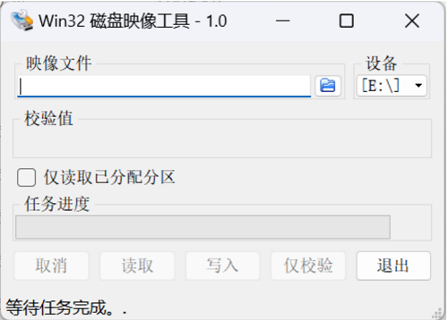
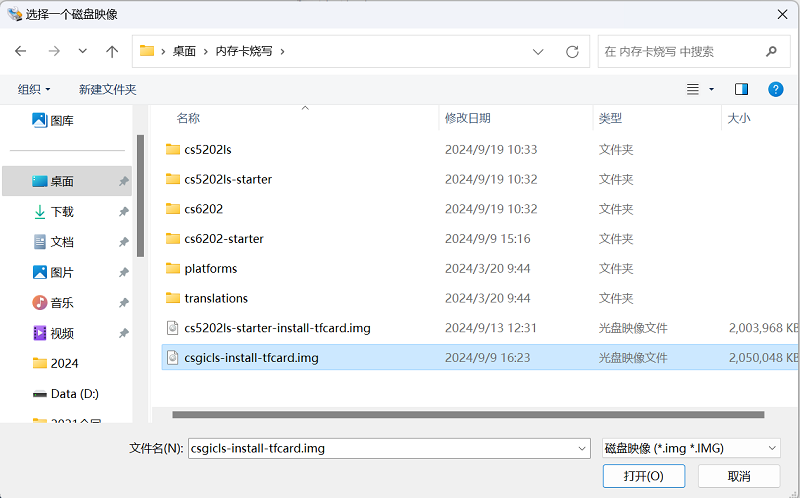
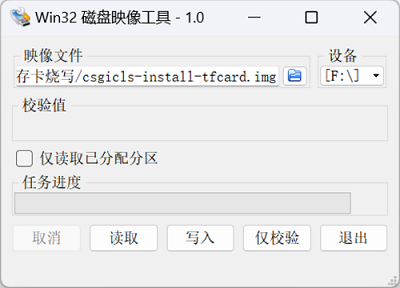
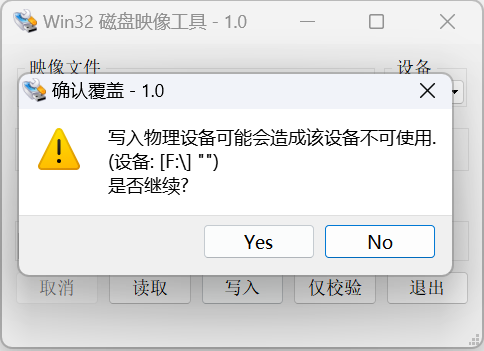
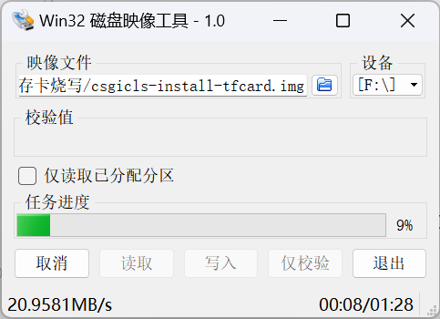
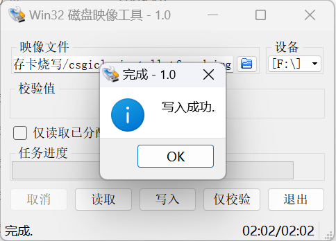
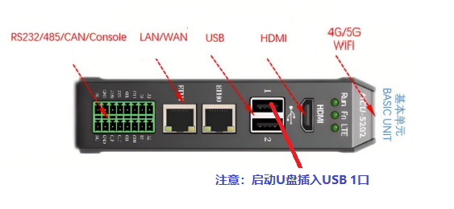

= Flash the Image

== Overview

An image file (with the .img extension) contains the system environment, including the operating system, interface drivers, and application service software.

Two image versions are available for the BPI-5202S embedded industrial controller:

(1) cs5202ls-starter-install-tfcard.img is the base system image, referred to as the base image.

(2) csgicls-install-tfcard.img includes applications and is referred to as the application image.

NOTE: Contact your supplier to obtain the image files. The base image is approximately 2GB, and the application image is approximately 4GB.

== Write the Image
The BPI-5202 embedded industrial controller currently supports installation using an SD/TF card. Use Win32DiskImager to create a bootable image drive.

=== Create a USB Boot Drive from the Image
1) Insert an SD/TF card with at least 8GB of space into a USB card reader. Check its drive letter in Windows (for example, F).
Note: Writing the image will erase all data on the SD/TF card!
2) Run the Win32DiskImager application, as shown below:

3) Click the button next to Image File. In the dialog, select the image file csgicls-install-tfcard.img, as shown below:

4) Open the drop-down list under Device and select the USB drive letter, as shown below:

5) Click the Write button, then click Yes in the dialog, as shown below:

6) Image writing begins, and a progress bar is displayed, as shown below:

7) When writing is complete, a dialog displays "Write Successful", as shown below:

=== Where to Insert the USB Drive
Insert the prepared USB boot drive into the USB port marked "1" on the CS5202LS embedded industrial controller, as shown below:

Note: The USB boot drive can only be detected for booting and automatic installation when it is inserted into the USB port marked "1".

=== Installation Process

Power on the BPI-5202 embedded industrial controller. If a USB boot drive is detected in the USB port marked "1", the controller automatically boots from it and starts installation. No manual intervention is required during the installation process.

[options="header",cols="1,1,4"]
|====
|Run LED	|Fn LED	|Status
|Off	|Off	|Reading and loading from the USB drive; this takes some time
|Heartbeat blinking	|Off	|The installation environment is starting
|Heartbeat blinking	|On	|The installation software is starting or installing; this takes some time
|Heartbeat blinking	|Heartbeat blinking	|Installation succeeded. The power can be disconnected
|Heartbeat blinking	|Off	|Installation failed
|====

TIP: During installation, the Fn LED turns on when writing begins. If the Fn LED turns off, writing has failed. If the Fn LED blinks in a heartbeat pattern, writing has succeeded.

NOTE: Important:
1) Do not disconnect the power during installation.
2) Booting from the USB drive forces installation, regardless of whether a system is already installed on the BPI-5202 hard drive. The image on the USB drive will be installed again, automatically erasing the existing contents of the SATA hard drive.
2) After successful installation, remove the USB drive promptly; otherwise, installation will run again on the next boot.
