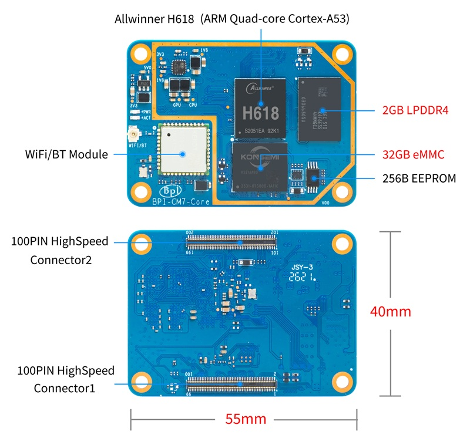

= BPI-CM7 Introduction

Banana Pi BPI-CM7 is an Allwinner H618 compute module with LPDDR4 memory, eMMC storage, a K019 Wi-Fi 5/Bluetooth 5.0 module, and two 100-pin board-to-board connectors.

TIP: Allwinner H618 design: link:/en/BPI-M4_Berry/BananaPi_BPI-M4_Berry[Banana Pi BPI-M4 Berry] single-board computer +
Allwinner H618 design: link:/en/BPI-M4_Zero/BananaPi_BPI-M4_Zero[Banana Pi BPI-M4 Zero] single-board computer +
Allwinner H618 design: link:/en/BPI-CM7/BananaPi_BPI-CM7[Banana Pi BPI-CM7] compute module

== Key Features

* Allwinner H618 quad-core 64-bit Arm Cortex-A53 processor, up to 1.5 GHz
* Arm Mali-G31 GPU
* Onboard LPDDR4 memory
* Onboard eMMC storage
* K019 Wi-Fi 5 and Bluetooth 5.0 module
* HDMI output
* 10/100M Ethernet
* 1x USB 2.0 OTG and 3x USB 2.0 Host interfaces
* microSD interface
* 2x 100-pin board-to-board connectors
* GPIO, UART, TWI/I2C, SPI, PWM, I2S/PCM, DMIC, SPDIF, and IR
* 5 V power input

== Getting Started

TIP: link:/en/BPI-CM7/GettingStarted_BPI-CM7[Getting Started BPI-CM7]

= Hardware

== Hardware Interface

== Hardware Specifications

[options="header",cols="1,3"]
|===
| Item | Specification

| SoC
| Allwinner H618

| CPU
| Quad-core 64-bit Arm Cortex-A53, up to 1.5 GHz

| GPU
| Arm Mali-G31

| Memory
| Onboard LPDDR4; capacity depends on the product model

| Storage
| Onboard eMMC; capacity depends on the product model

| Wireless
| K019 Wi-Fi 5 and Bluetooth 5.0 module with a U.FL/IPEX antenna connector

| Display
| HDMI output

| Network
| 10/100M Ethernet

| USB
| 1x USB 2.0 OTG and 3x USB 2.0 Host interfaces

| Expansion
| 2x 100-pin board-to-board connectors

| Power
| 5 V input
|===

== BPI-CM7 Module Pin Definitions

TIP: link:/en/BPI-CM7/GettingStarted_BPI-CM7#_bpi_cm7_module_pin_definitions[See the module pin definitions at the end of Getting Started BPI-CM7]

== BPI-CM7 IO Board

link:/en/BPI-CM7IO/BananaPi_BPI-CM7IO[Banana Pi BPI-CM7IO Expansion Board]

= Development

== Source Code

=== Android 12

NOTE: https://github.com/BPI-SINOVOIP/BPI-H618-Android12

=== Linux

NOTE: https://github.com/BPI-SINOVOIP/armbian-build/tree/bpi-v24.11.01

== Resources

NOTE: link:/en/BPI-CM7IO/BananaPi_BPI-CM7IO[Banana Pi BPI-CM7IO Expansion Board]

NOTE: link:/en/BPI-M4_Zero/BananaPi_BPI-M4_Zero[Banana Pi BPI-M4 Zero]

= System Images

== Android
NOTE: 2026-10-19-bananapi-cm7-android12.img

Baidu cloud: https://pan.baidu.com/s/10CyF5D5vNBJfR-KoXMyMHw?pwd=8888 (Access code: 8888)

Google drive: https://drive.google.com/file/d/1EcKliKVlpU_EKsi5vfFXBXw9AOvlJyAX/view?usp=sharing

== Linux
NOTE: Bananapi-Armbian_24.11.1_Bpi-cm7_jammy_legacy_5.4.125_xfce_desktop.img.xz

Baidu cloud: https://pan.baidu.com/s/1d7Ic8uTNZIDl26J2F4F-0Q?pwd=8888 (Access code: 8888)

Google drive: https://drive.google.com/file/d/18CrBgRDMTZfu47roedXy5rOc5B9YUUFs/view?usp=sharing

= Easy to Buy Samples
WARNING: OEM&ODM, please contact: judyhuang@banana-pi.com