= Introduction

Banana Pi BPI-CM7 is an Allwinner H618 compute module designed for use with the BPI-CM7IO carrier board.

TIP: More information: link:/en/BPI-CM7/BananaPi_BPI-CM7[Banana Pi BPI-CM7 Main Page]

== Specifications

* SoC: Allwinner H618, quad-core Cortex-A53, up to 1.5GHz
* GPU: ARM Mali G31
* Memory: Onboard LPDDR4
* Storage: Onboard eMMC
* Wireless: K019-CW43-Dw Wi-Fi 5 and Bluetooth 5.0
* USB: 1x USB 2.0 OTG and 3x USB 2.0 Host
* Display: HDMI output and CVBS composite video output
* Ethernet: 1x 10/100M Ethernet
* Expansion: microSD card slot and 2x 100-pin board-to-board connectors

= Android

== Preparation
. Download the latest link:/en/BPI-CM7/BananaPi_BPI-CM7#_android[Android image].
. Download the Allwinner flashing tool PhoenixSuit: link:https://download.banana-pi.dev/d/ca025d76afd448aabc63/files/?p=%2FTools%2Fimage_download_tools%2Fphoenixsuit_V1.1.0_20150325.rar[phoenixsuit] (Windows).
. Prepare a Type-C cable that supports data transfer and a 5V power supply.

== Install the Image with the USB Tool
. Open **PhoenixSuit** and click the **Firmware** icon to switch to the firmware download panel.
+
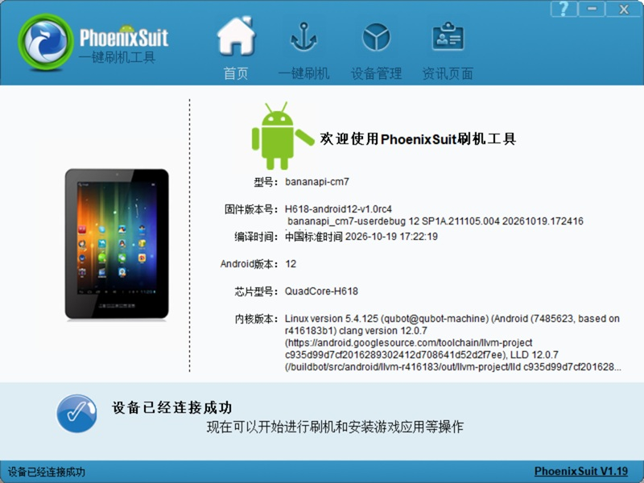

. Click **Image** to select the **Android image file**.
+
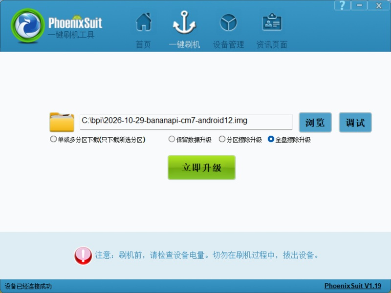

. Press and hold the **FEL button** while connecting CM7 to the PC through the **Type-C port using a data cable**. When the warning dialog appears, click **Yes**.

. The firmware download starts automatically. Wait for flashing to complete.

. Download complete (**the Android version can only be installed to eMMC**).

= Linux Development

== Preparation
. Linux images support booting from either an SD card or eMMC. When an SD card is inserted, the board boots from the SD card first.
. Recommended SD card: an A1-rated card with a capacity of at least 8GB.
. To boot from an SD card, it is recommended to format the eMMC beforehand to remove the existing system.
. To boot from eMMC and use the SD card only for storage, format the SD card beforehand and do not write a system image to it.
. Download the latest link:/en/BPI-CM7/BananaPi_BPI-CM7#_linux_2[Linux image]. After downloading, verify the MD5 checksum to ensure the image is intact.
. Image flashing tool: link:https://etcher.balena.io/[balenaEtcher].
. Default login credentials: pi/bananapi or root/1234.
. This Wiki guide applies only to Ubuntu/Debian images.

== Install the Image to an SD Card
Choose either of the following methods:

> Method 1: **Balena Etcher** graphical tool (Windows/Linux/macOS)

Balena Etcher is an open-source graphical flashing tool from Balena for writing operating system images to SD cards or USB drives.

. On Linux desktop systems such as Ubuntu, you may need to grant the AppImage file execute permission first.
+
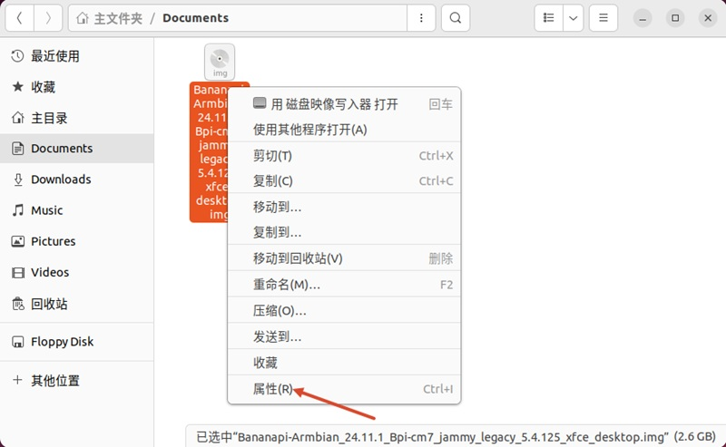
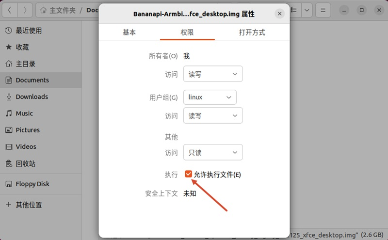

. Run Balena Etcher, select **Flash from file**, and load the image file.
+
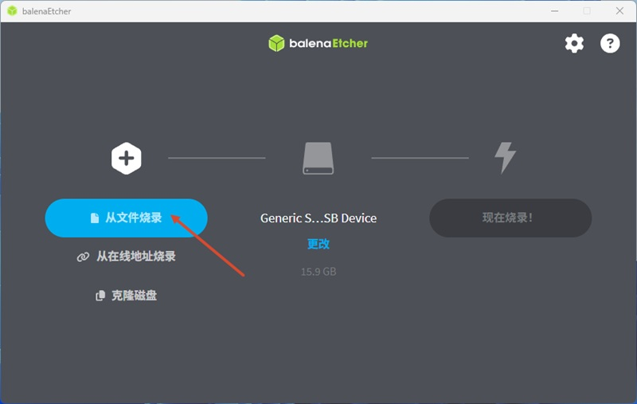
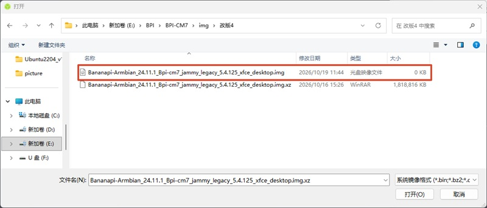
WARNING: Select the target SD card. **Check the device carefully to avoid selecting the wrong disk**.

+
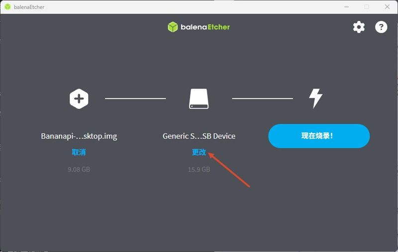
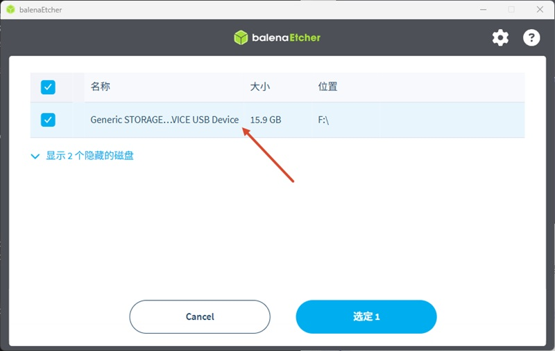
Start flashing and wait for writing and validation to complete.

+
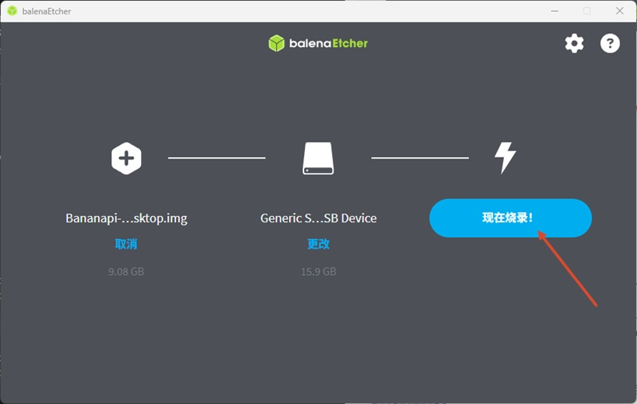
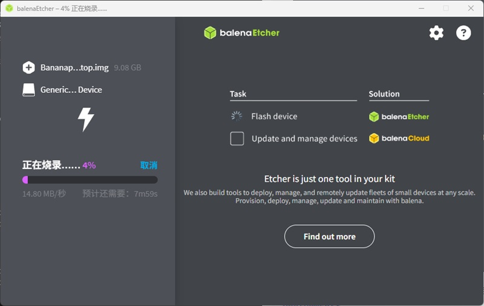
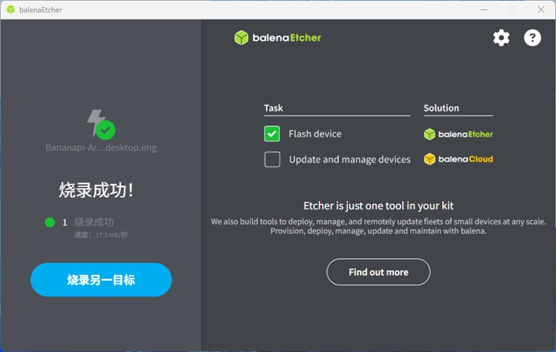

> Method 2: **Balena CLI** command-line tool (Windows/Linux/macOS)

Balena CLI is a command-line tool for balenaCloud/openBalena that can also write Linux images.

. Download the appropriate installer or standalone package (Windows example): link:https://github.com/balena-io/balena-cli/releases[balena-cli-v25.2.6-windows-x64-installer.exe].
+
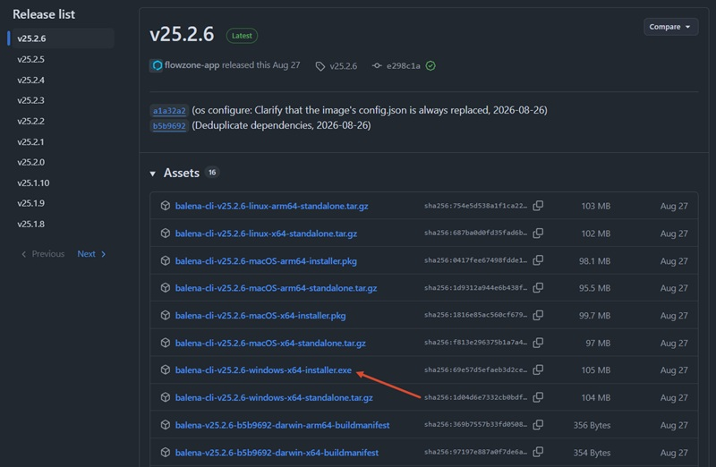

. On Windows, open PowerShell as an administrator.

. List the storage devices available for writing operating system images.
+
```bash
balena util available-drives
```

. Write the image (if there is no response, press Ctrl+C once to display the progress bar).
+
```bash
balena local flash C:\BPI\Bananapi-Armbian_24.11.1_Bpi-cm7_jammy_legacy_5.4.125_xfce_desktop.img.zip --drive \\.\PhysicalDrive2 --yes
```

. On Linux, you may need to use sudo to obtain root privileges before writing the image.
+
```bash
sudo balena local flash path/to/xxx-bpi-m4-berry-xxx.img.zip --drive /dev/disk2
```

== Install the Image to eMMC
. Make sure the Linux image has been flashed to the SD card and the board can boot from it normally.
. Power on BPI-CM7 and log in to the system. Enter this command in the terminal to open the graphical configuration menu.
+
```bash
sudo armbian-config
```
. Follow the steps below to install the Linux system image to eMMC.

+
Select **System**.

+
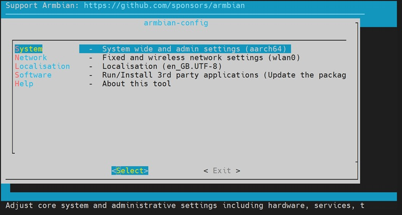
Select **Storage**.

+
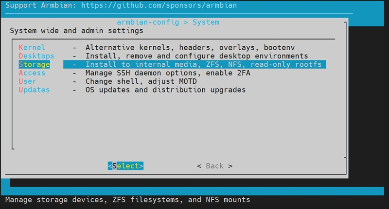
Select **ST0001**.

+
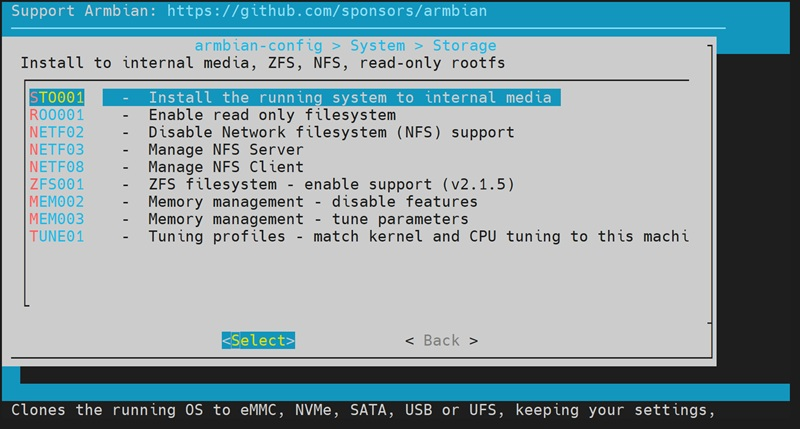
Select **install**.

+
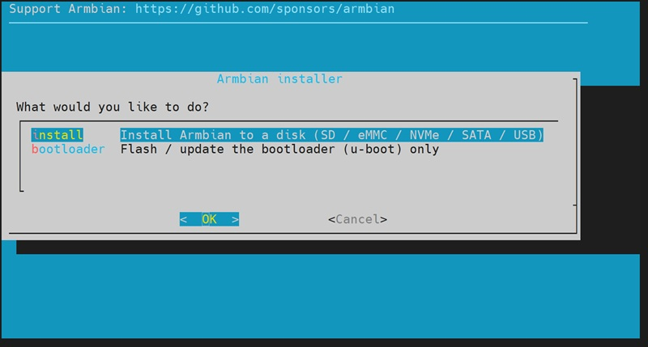
Select **mmcbLk0**.

+
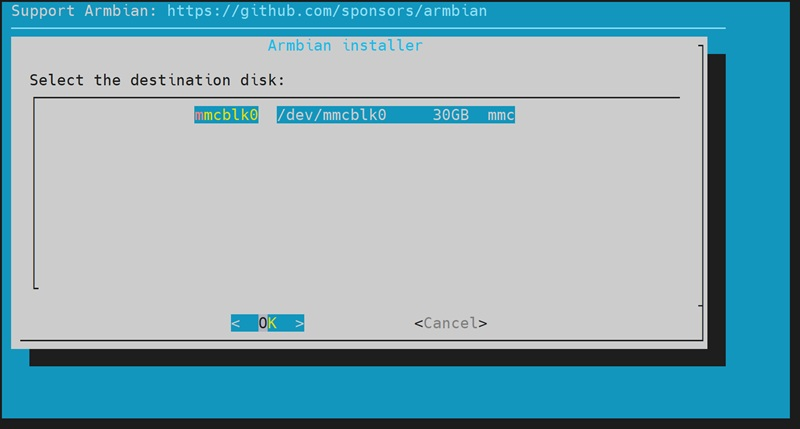
Select **emmc**.

+
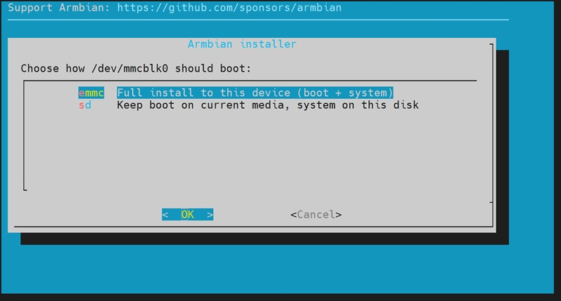
Select **ext4**.

+
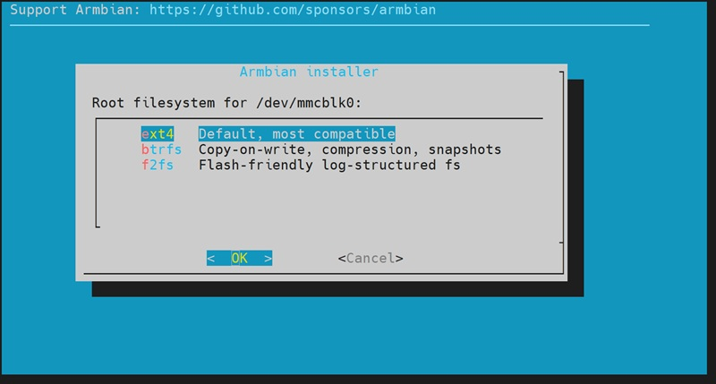
Select **Erase and install**.

+
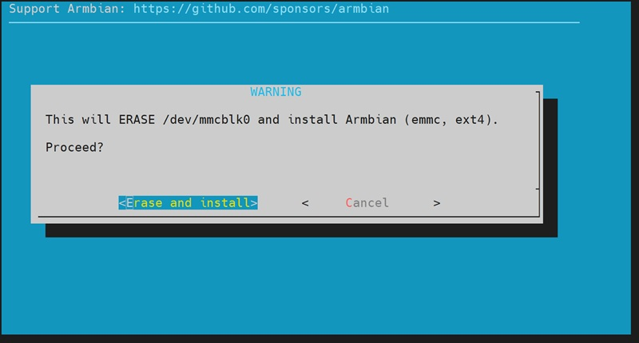
Wait for ten to twenty minutes. Do not shut down or restart the board during this time.

+
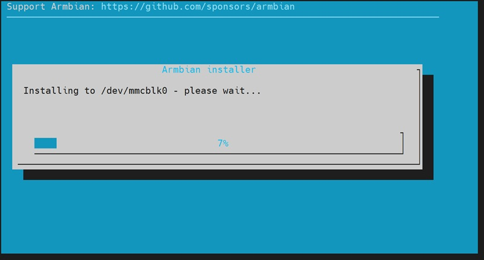
Once installation succeeds, select OK, shut down the board, and disconnect the power. Remove the SD card and reconnect the power. The board will boot from eMMC.

+
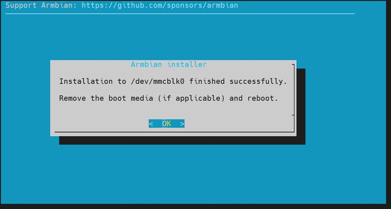

== Erase eMMC
. Make sure a Linux image has been flashed to the SD card, then insert the card. By default, an inserted SD card has boot priority.
. Run the following command in the terminal to list block devices such as disks and partitions.
+
```bash
lsblk
```

. mmcblk0 is the eMMC, and mmcblk1 is the SD card. Enter the following command in the terminal to erase the eMMC. This takes more than twenty minutes and cannot be undone. Back up important data beforehand.
+
```bash
sudo dd if=/dev/zero of=/dev/mmcblk0  # Continuously write zeros across the entire eMMC, overwriting all partitions and data
```

== Display the Desktop over HDMI
. Flash an Ubuntu/Debian desktop image to enable the graphical desktop environment.
. Prepare a display with an HDMI port and an HDMI cable.
. Connect BPI-CM7 to the display and select the display input source. Power on the board and wait for the desktop to load.
--
* Linux desktop environment
+
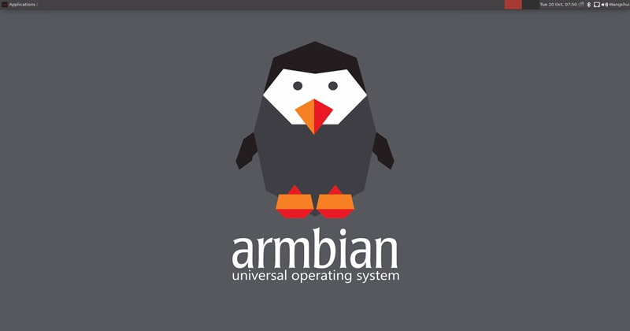
--

== Debug UART
. Prepare a 3.3V USB-to-TTL adapter.
. Connect the USB-to-TTL adapter to the PC's USB port and the board's debug UART port.
. Open a serial terminal tool on the PC, such as MobaXterm or PuTTY.
. Download link:https://mobaxterm.mobatek.net/[MobaXterm].
. Using MobaXterm as an example, open MobaXterm and click **Sessions → User sessions** in the top menu bar to create a new session.
+
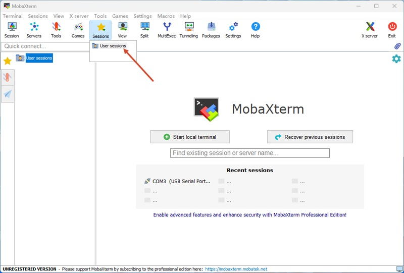

+
Select the **Serial** session type, choose the device's **COM port**, and set the baud rate to **115200**.

+
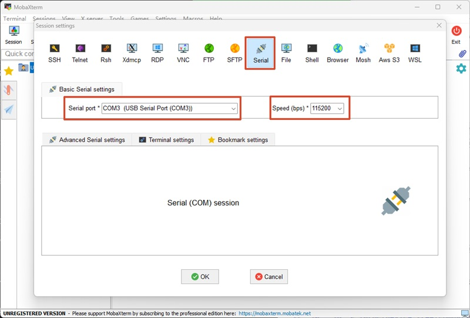
Click **OK** to open the serial terminal session window. If there is no response, close and reopen it, then press the board's **RST reset button**.

+
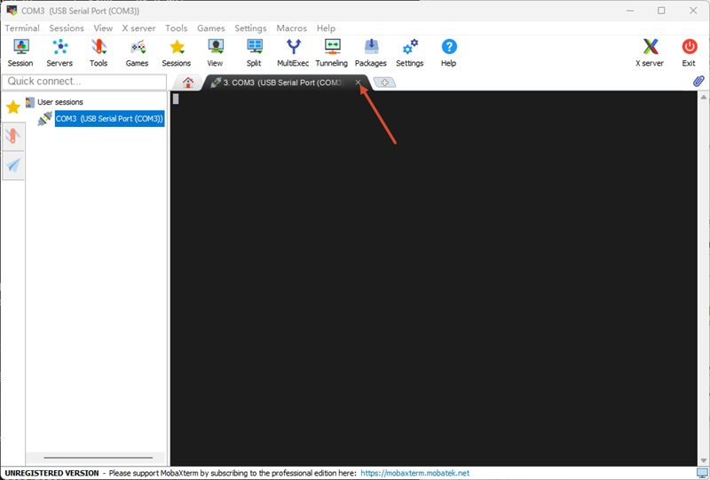
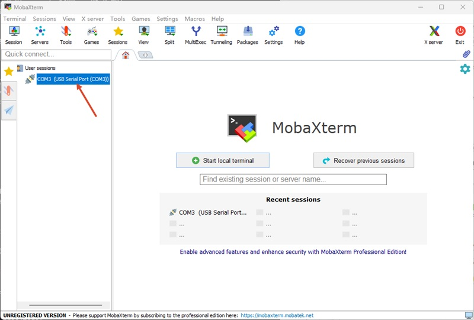
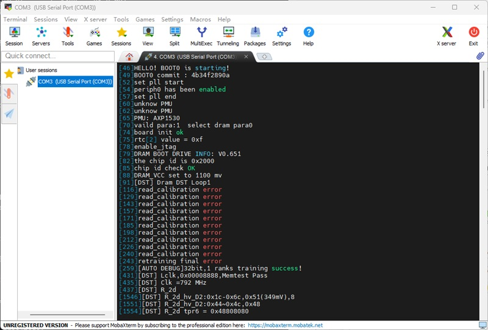

== SSH
. Prepare Ethernet cables and a router.
. Connect one LAN port of the router to BPI-CM7 using an Ethernet cable, and connect the PC to another LAN port so that both are on the same local network.
. Open a terminal on BPI-CM7.
+
```bash
ip a                     # Check the IP address
systemctl is-active ssh  # Check the current status of the SSH service
```

. Open a terminal on the PC.
+
```bash
ssh pi@10.0.35.168    # Connect to the board at 10.0.35.168 over SSH using the BPI-CM7 user account
whoami                # Confirm the remote username
hostnamectl --static  # Check the static system hostname
uname -r              # Check the kernel version
```

. You can also connect using **MobaXterm**.
+
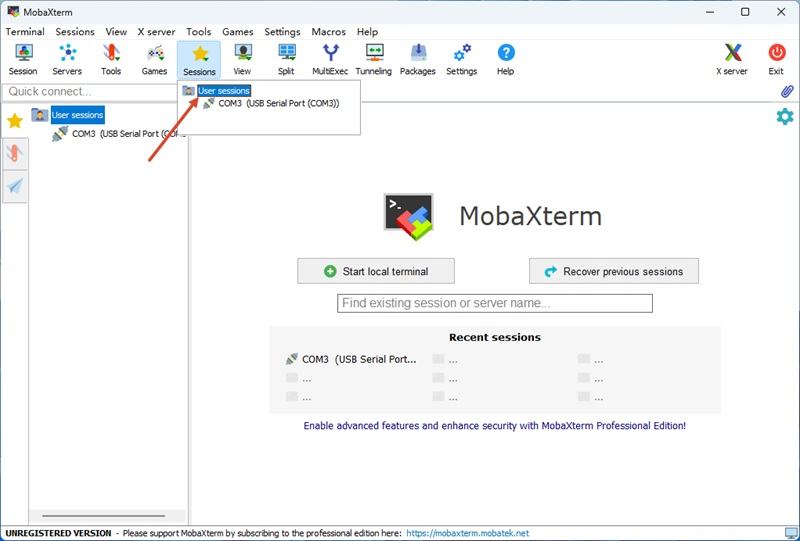
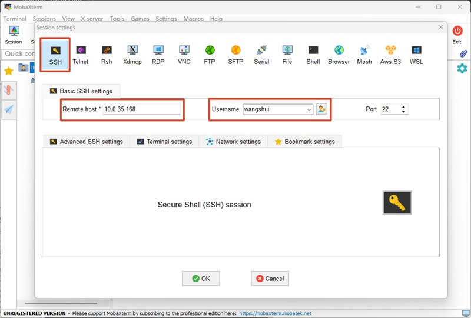
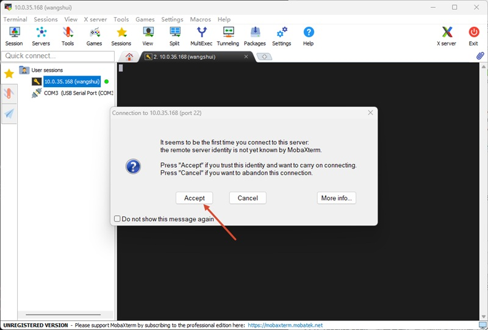
Enter the password for the board's user account to connect successfully.

+
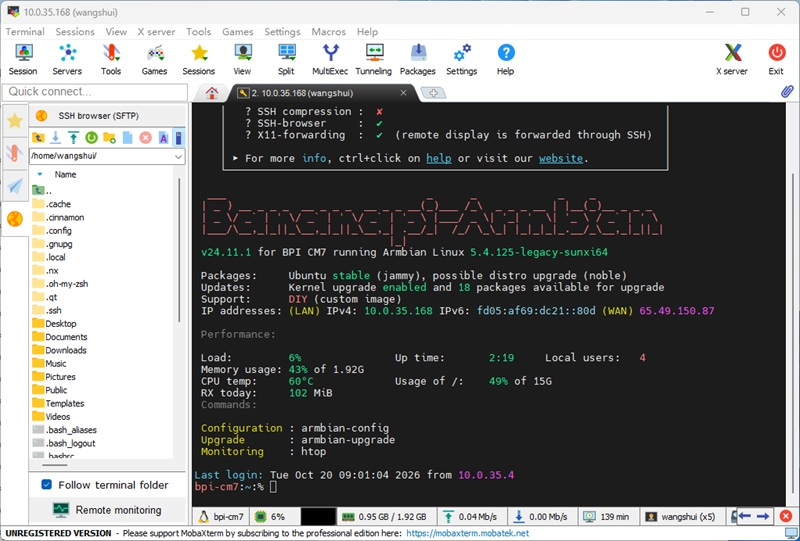

. You can also connect from a terminal on Ubuntu.
+
```bash
sudo apt update
sudo apt install nmap                     # Install the network discovery tool
sudo nmap -p22 --open -sV 10.0.35.168/24  # Scan for SSH devices with port 22 open
ssh pi@10.0.35.168                        # Connect
```

== Transfer Files
**SCP (secure copy)** is a Linux command for securely copying files between servers.

. Install **OpenSSH** on Windows.
. After installation, run **PowerShell** as an administrator.
. Enter the **username** and **IP address** of the remote device.

+
```bash
scp C:\BPI\1.wav pi@10.0.35.168:~/Music  # Send 1.wav from Windows to BPI-CM7
pi@10.0.35.168:~/Documents/1.txt .\      # Send 1.txt from BPI-CM7 to Windows
```

. If you reflash the board, reinstall SSH, or replace it with another board at the same IP address, the remote host key changes. If Windows OpenSSH's `known_hosts` still contains the old fingerprint for `10.0.35.168`, verification fails and scp disconnects immediately.
+
```bash
ssh-keygen -R 10.0.35.168  # Remove the old record for this IP address
```

== NoMachine Remote Desktop
Starting with v10, NoMachine no longer officially provides a free personal edition. Download links for v8 are provided here. If suitable for your needs, you can download the latest version from the official website: link:https://download.nomachine.com/[NoMachine Download].

. Download **NoMachine (x64)** on the PC: link:https://download.banana-pi.dev/d/ca025d76afd448aabc63/files/?p=%2FTools%2Fcommon_tools%2Fnomachine_8.2.3_4_x64.exe&dl=1[nomachine_8.2.3_4_x64.exe]
. Download **NoMachine (arm64)** on BPI-CM7.
+
```bash
wget -O nomachine_8.2.3_3_arm64.deb \
'https://download.banana-pi.dev/d/ca025d76afd448aabc63/files/?p=%2FTools%2Fcommon_tools%2Fnomachine_8.2.3_3_arm64.deb&dl=1'
sudo dpkg -i nomachine_8.2.3_3_arm64.deb  # Install NoMachine
```

. You can also download it directly on the PC and copy it to BPI-CM7 over SSH or with a USB drive: link:https://download.banana-pi.dev/d/ca025d76afd448aabc63/files/?p=%2FTools%2Fcommon_tools%2Fnomachine_8.2.3_3_arm64.deb&dl=1[nomachine_8.2.3_3_arm64]
. Make sure the PC and BPI-CM7 are on the same local network.
. Open NoMachine on the PC. Once the NoMachine client discovers the BPI-CM7 board successfully, double-click it.
+
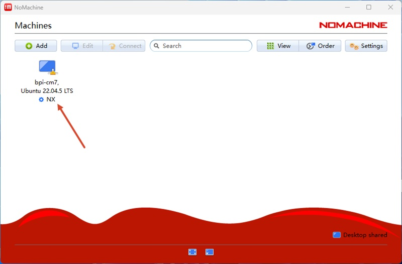

. Enter the **board username** and **password**.
+
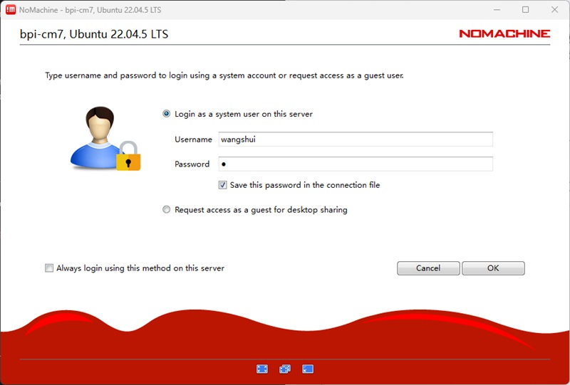

. The NoMachine welcome dialog appears, indicating a **successful connection**.
+
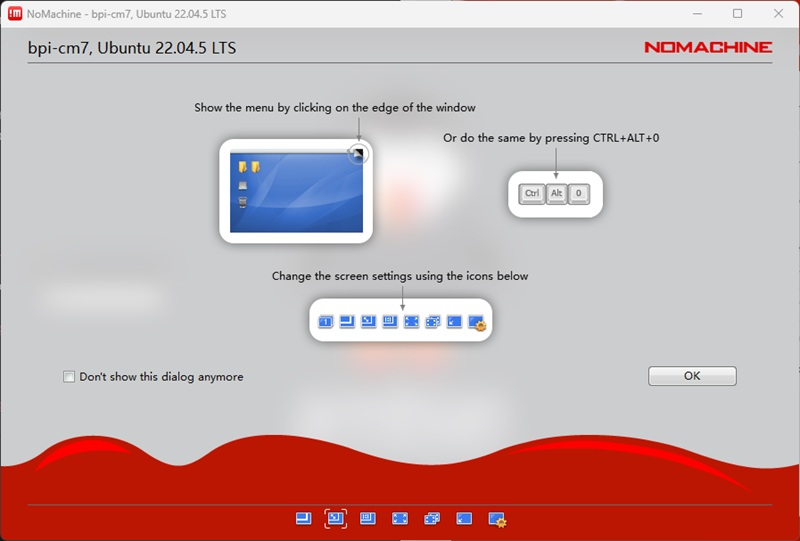

. Keep clicking **OK** until the **Armbian desktop** appears.
+
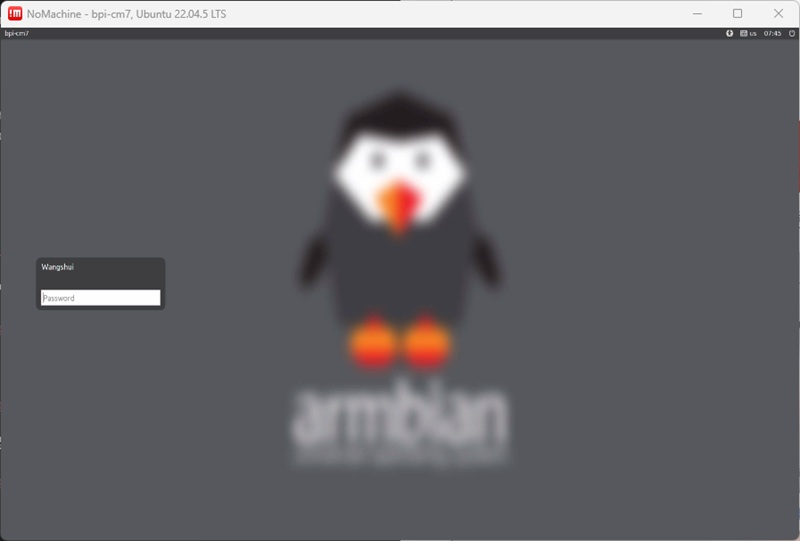

== armbian-config
The system configuration tool included with Armbian.

```bash
command -v armbian-config  # Check whether armbian-config exists and display its full path
sudo armbian-config        # Start the Armbian configuration tool
```


== Check BPI-CM7 Hardware and System Information
These commands read the board's **system version, hardware model, CPU, memory, storage partitions, and root filesystem mount information in one pass**, making it easier to confirm the board hardware, kernel, and boot medium (SD card / eMMC).
```bash
hostnamectl                                  # Check the operating system version, hostname, kernel version, and architecture
tr '\0' '\n' < /proc/device-tree/model       # Read the hardware model from the device tree and display the board model
tr '\0' '\n' < /proc/device-tree/compatible  # Check compatible device tree models to confirm the chip platform
uname -a                                     # Check the full kernel information, architecture, and build time
lscpu                                        # Check CPU details such as core count, architecture, and frequency
free -h                                      # Check memory and swap sizes; `-h` displays readable units such as GB/MB
lsblk                                        # List block storage devices, including eMMC, SD cards, and USB drives
findmnt -no SOURCE,FSTYPE,SIZE,USED,AVAIL,USE%,TARGET /  # Check the root partition /: source disk, filesystem, total capacity, used/available space, and usage percentage
```

== Check Graphical Session Status

```bash
systemctl get-default                # Check the default systemd boot target; graphical.target means the graphical interface starts by default
systemctl is-active display-manager  # Check whether the display-manager (graphical login manager) service is running; active indicates normal operation
loginctl list-sessions               # List all system login sessions to check whether local and remote (NoMachine) sessions were created successfully
```

== Wireless Network

=== Connect to Wi-Fi
```bash
nmcli device                                           # Check network interface hardware status
nmcli device wifi list                                 # List available wireless access points
nmcli device wifi connection R4Pro-5G password ******  # Connect to Wi-Fi
nmcli device disconnect wlan0                          # Disconnect Wi-Fi
```

=== Create an AP Hotspot
. Create an AP.
+
```bash
nmcli device wifi hotspot con-name AP1 ifname wlan0 ssid Annick password 88888888
```

. Check the host's hotspot forwarding and NAT rules.
+
```bash
ip a show wlan0                          # Check the wlan0 address (10.42.0.1)
cat /proc/sys/net/ipv4/ip_forward        # Confirm IP forwarding is enabled; if the value is 0, enable it temporarily with sudo sysctl -w net.ipv4.ip_forward=1
sudo iptables -t nat -L POSTROUTING -nv  # Check the POSTROUTING chain rules in the NAT table
```

. Connect to the Annick hotspot and configure the phone with the static IPv4 address 10.42.0.100 (subnet: 10.42.0.x). Also set DNS to 223.5.5.5.
+
```bash
ip neigh show dev wlan0  # Check whether the device is connected to the hotspot
```

. Verify connectivity.
+
(1) Ping the gateway from the phone: ping 10.42.0.1. A successful response indicates that the Wi-Fi link between the phone and the board is working.

+
(2) Ping an external address from the phone: ping 223.5.5.5. A successful response indicates that Internet access is working.

. Disconnect the AP hotspot you created.
+
```bash
nmcli connection down AP1  # Stop the hotspot
nmcli connection show      # Show all current connections; -- indicates a stopped connection
```

. To restart AP1:
+
```bash
nmcli connection up AP1
```

. Completely remove the AP1 configuration (make sure you stop AP1 before deleting its configuration; otherwise, deleting the AP1 configuration directly will also remove wlan0!).
+
```bash
nmcli connection delete AP1
```

=== Turn the Wi-Fi Radio On or Off
. Turn off the Wi-Fi radio. Power to wlan0 is cut, the AP hotspot disappears immediately, and all Wi-Fi functions are disabled. If you have not deleted the AP1 configuration file, it remains in the system.
+
```bash
nmcli radio wifi off
nmcli radio # Check the wireless radio state
```

. Turn on the Wi-Fi radio to restore power to the Wi-Fi hardware.
+
```bash
nmcli radio wifi on
nmcli radio  # Check the wireless radio state
```

== Set a Static IP Address and DNS
Before setting a static IP address, establish and maintain the corresponding network connection. The following example sets a static IP address for Ethernet.
```bash
nmcli connection show                                                     # Show all connections
nmcli connection show "Wired connection 1"                                # Show all properties of the specified connection
nmcli connection modify "Wired connection 1" ipv4.addresses 10.0.35.4/24  # Set the static IP address and subnet mask
nmcli connection modify "Wired connection 1" ipv4.dns8.8.8.8              # Set DNS
reboot                                                                    # Reboot
```
Test connectivity.

. Ping the gateway: a successful response indicates that the physical/local network link between the board and router is working and the IP configuration is correct.
+
```bash
ping 10.35.0.1
```

. Ping a public IP address: a successful response indicates that the local network is working, the router can access the Internet, and routing is correct.
+
```bash
ping 223.5.5.5
```

. Ping a domain name: a successful response indicates that DNS resolution is working.
+
```bash
ping baidu.com
```

== Network Time Synchronization

The image used for testing synchronizes network time through Chrony.

Use the following commands to check the system clock, synchronization status, Chrony service, and time sources.

```bash
timedatectl status       # Check the system time, time zone, RTC hardware clock, and automatic NTP synchronization state
systemctl status chrony  # Check the Chrony service itself
chronyc tracking         # Check time synchronization tracking details
chronyc sources -v       # List all NTP time sources
date                     # Print the current system date and time
```

Use the following commands to manage the Chrony service.

```bash
sudo systemctl start chrony    # Start the Chrony service
sudo systemctl enable chrony   # Enable Chrony at boot
sudo systemctl restart chrony  # Restart the Chrony service
```

Use the following commands to list or change the time zone.

```bash
timedatectl list-timezones
sudo ln -sf /usr/share/zoneinfo/Asia/Shanghai /etc/localtime
```

* link:https://chrony-project.org/documentation.html[Chrony Reference Documentation]

== Check Hardware Temperatures

Use the following commands to identify the four thermal zones.

```bash
cat /sys/class/thermal/thermal_zone0/type
cat /sys/class/thermal/thermal_zone1/type
cat /sys/class/thermal/thermal_zone2/type
cat /sys/class/thermal/thermal_zone3/type
```

Use the following commands to read the temperatures.

```bash
cat /sys/class/thermal/thermal_zone0/temp
cat /sys/class/thermal/thermal_zone1/temp
cat /sys/class/thermal/thermal_zone2/temp
cat /sys/class/thermal/thermal_zone3/temp
```

Divide each returned value by 1000 to obtain the temperature in degrees Celsius.

Test results:

```text
cpu_thermal_zone: 50.2 °C
ddr_thermal_zone: 51.4 °C
gpu_thermal_zone: 53.4 °C
ve_thermal_zone: 50.8 °C
```

== Use a USB Drive
Prepare a properly partitioned USB drive and insert it into a USB port on BPI-CM7. Once the system detects the USB drive, you can double-click it on the desktop to open it.

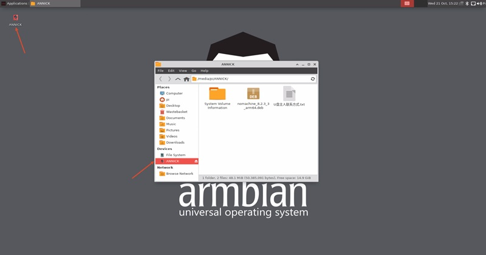
Create a separate mount directory in the user's home directory for easier management.
```bash
mkdir test_u
```
The block device partition table exported by the kernel.
```bash
cat /proc/partitions | grep "sd*"
```
Mount /dev/sda1 at ~/test_u/. If you do not see the files in the mount directory, leave the directory and enter it again.
```bash
sudo mount /dev/sda1 ~/test_u/
ls
```
Remove the USB drive.
```bash
sudo umount -v /dev/sda1
```
**Note**: If you unplug a mounted USB drive without unmounting it with umount, the kernel will assign it a new name, sdb, when it is inserted again. Only physically unplug the USB drive after unmounting it to prevent file corruption.

== Use Bluetooth
=== Pair the Board with Bluetooth Headphones (Graphical Interface)
. Click the **Bluetooth icon** in the upper-right corner of the Armbian desktop, then click **devices**.
. Put the Bluetooth headphones in pairing mode, then click **Search** to find the target device.
+
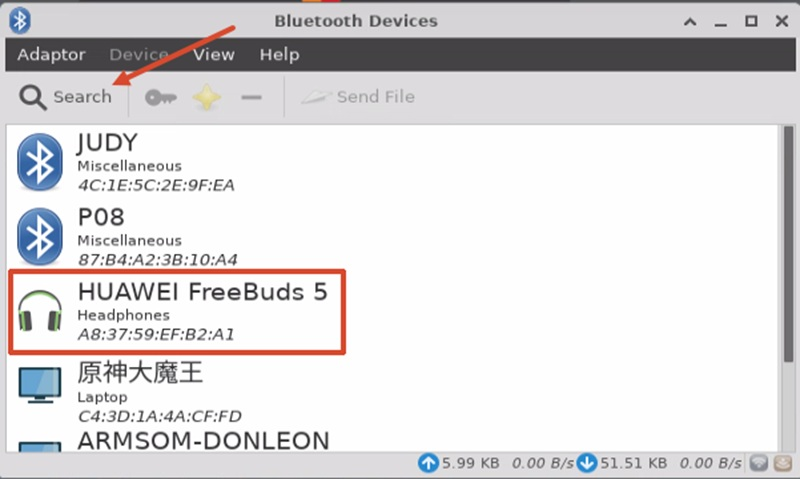

. Click the target device, then click the **key icon** to connect. A dialog appears in the upper-right corner; click **Confirm** to establish the connection.
+
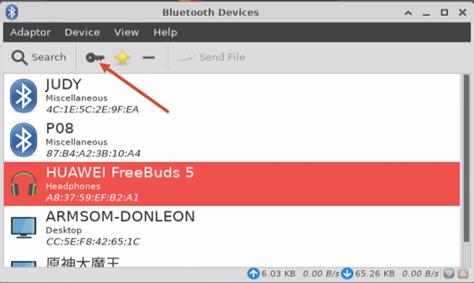

. On the **Armbian desktop**, right-click and select **Open in New Window**, then click **Music** and **double-click 1.wav** to play music.
+
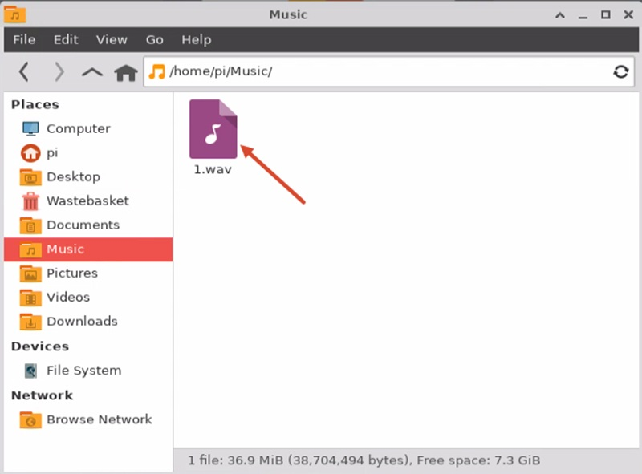

. To disconnect, click the **Bluetooth device**, then click **-**.
+
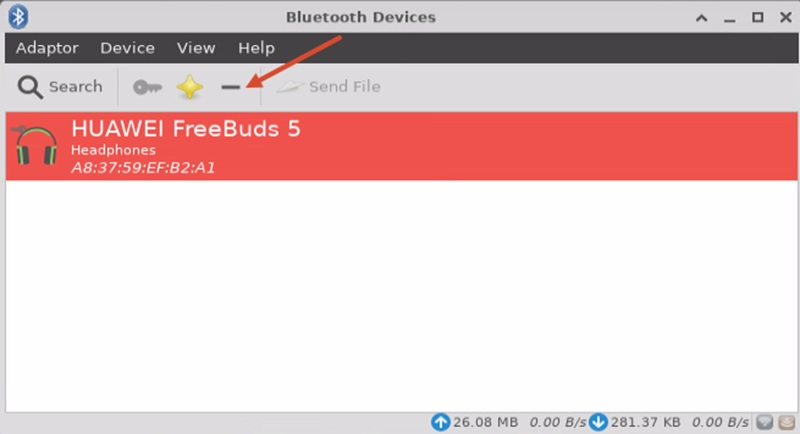

=== Pair the Board with Bluetooth Headphones (Shell Commands)
```bash
bluetoothctl               # Start the Bluetooth control tool
power on                   # Power on the Bluetooth controller
agent on                   # Enable the pairing agent
default-agent              # Set the current agent as the default pairing agent
pairable on                # Make the device pairable
discoverable on            # Make the device discoverable
paired-devices             # Check the MAC addresses of connected devices
remove A8:37:59:EF:B2:A1   # Remove the Bluetooth device
scan on                    # Scan for devices
pair A8:37:59:EF:B2:A1     # Request pairing with the headphones at this MAC address; enter yes when prompted to confirm
trust A8:37:59:EF:B2:A1    # Mark the headphones as trusted so they reconnect automatically after boot or a Bluetooth restart
connect A8:37:59:EF:B2:A1  # Establish the Bluetooth audio connection; the device name appears in the terminal when connected
quit                       # Exit the BlueZ interactive Bluetooth terminal
aplay 1.wav                # Open a terminal and play music
```

== nano Text Editor
link:https://www.nano-editor.org/[GNU nano] is a command-line text editor. It is preinstalled in the image used for testing.

. Open a file with `nano [file path]`.
. Edit the file.
. Press `Ctrl+O` to write the file.
. Edit or confirm the file path, then press `Enter`.
. Press `Ctrl+X` to exit nano.

* https://www.nano-editor.org/dist/latest/cheatsheet.html[nano Keyboard Shortcuts]
* https://www.nano-editor.org/dist/latest/nano.html[nano Documentation]

== Onboard Audio
=== Preparation
. One **2mm-pitch 4-pin straight header**.
. One **3.5mm 4-pole female audio jack to PH2.0 connector cable**.
. One **3.5mm-to-three-plug audio/video AV cable**.
. One cable with **HDMI connectors at both ends**.
. One **AV-to-HDMI HD converter**.
. One **display with an audio jack and an HDMI port**.
. Starting from the **+** mark, the board's 4-pin header is defined as **TV_OUT, GND, R, L**. The **3.5mm-to-three-plug audio/video AV cable** pin order is **R, L, TV_OUT, GND**.
+
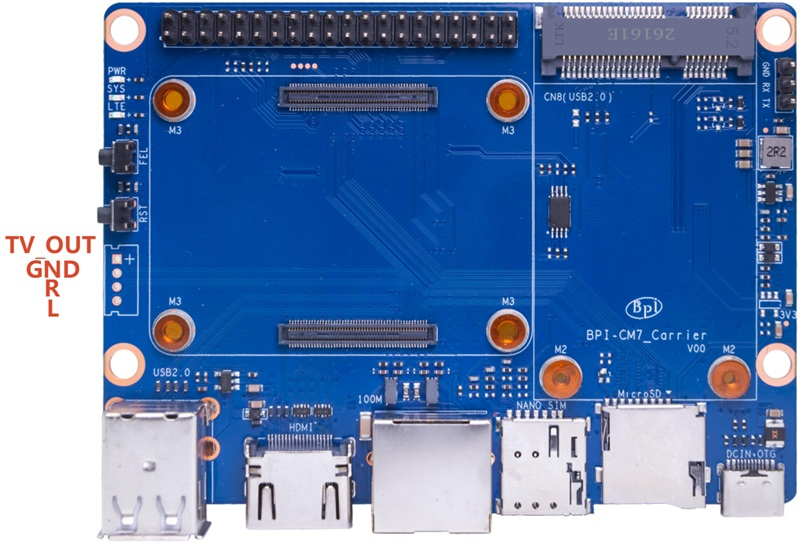
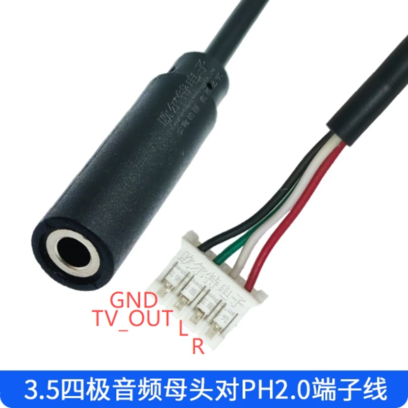

=== 3.5mm Audio Jack
. Solder the **2mm-pitch 4-pin straight header** onto the board.
. Connect the **PH2.0 connector** of the **3.5mm 4-pole female audio jack to PH2.0 connector cable** to the board according to the pin definitions. Plug the headphone cable directly into the **3.5mm 4-pole female audio jack** at the other end.
. Open a terminal to play audio.
+
```bash
aplay 1.wav
```

=== HDMI Audio
. Solder the **2mm-pitch 4-pin straight header** onto the main board.
. Connect the **PH2.0 connector** of the **3.5mm 4-pole female audio jack to PH2.0 connector cable** to the main board according to the pin definitions. Plug the **3.5mm 4-pole male plug** of the **3.5mm-to-three-plug audio/video AV cable** directly into the **3.5mm 4-pole female audio jack** at the other end.
. Connect the red, white, and yellow signal plugs of the **3.5mm-to-three-plug audio/video AV cable** to the **AV-to-HDMI HD converter**. The **AV-to-HDMI HD converter** requires a separate power supply.
. Connect one end of the HDMI cable to the **AV-to-HDMI HD converter** and the other end to the display.
. Open a terminal to play audio. Only `.wav` files are supported.
+
```bash
pactl list short sinks                                # List all PulseAudio audio output devices
pactl set-default-sink 0                              # Set device 0 (HDMI Audio) as the default audio output
pactl info I grep "Default Sink"                      # Check the current PulseAudio information
ffmpəg -i 1.ogg -c:a pcm_s16le -ar 48000 -ac 2 1.wav  # Convert an .ogg music file to .wav before playback
aplay 1.wav                                           # Play music; if there is still no sound after configuration, try rebooting the board
speaker-test -D plughw:1,0 -c 2 -r 48000 -t sine      # Play a sine wave directly if no music file is available
pactl set-sink-volume 0 100%                          # Control the volume
```
**Note**: Image clarity is limited with this hardware connection. The output resolution is 720P.

== Configure the Boot Logo

=== Enable or Disable the Boot Logo
. Disable the boot logo.
Open the boot environment configuration file and change bootlogo=true to bootlogo=false.
+
```bash
sudo nano "/boot/armbianEnv.txt"  # Open the boot environment configuration file
```

. Run sudo reboot. The boot logo will no longer appear after restarting.

. To enable the boot logo, change bootlogo=false to bootlogo=true.

=== Replace the Boot Logo
. Keep bootlogo=true.
. Preferably use an image with a resolution of 1920x1080 and a transparent background.
. The boot logo is stored at /usr/share/plymouth/themes/armbian/watermark.png. Copy and save the file to this path.
. Finally, run:
+
```bash
sudo update-initramfs -u  # Updating initramfs is required
sudo reboot               # Reboot
```

+
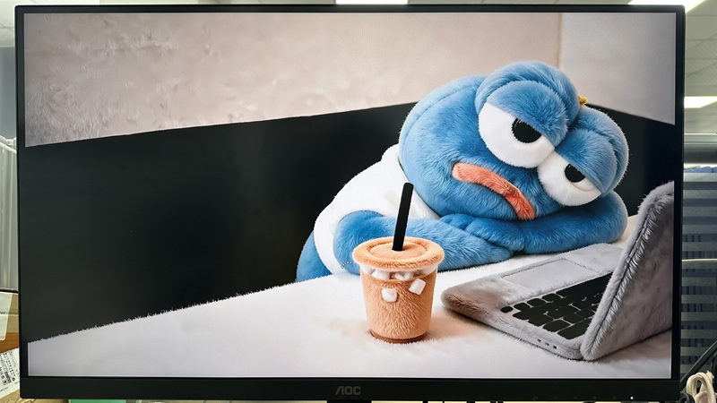

== Test GPIO, I2C, UART, SPI, and PWM on the 40-pin Header

=== 40-pin Header Schematic
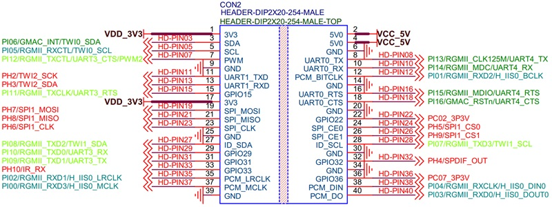

=== GPIO
. Basic GPIO I/O test (using GPIO33 as an example): control an LED through the GPIO port.
. Connect the LED anode to GPIO33 and the cathode to GND.
. Allwinner H618 GPIO numbering formula: **Pyx: y*32 + x**.
. y: the letters **A, B, C, D, E, F, G, H, I** correspond to the numbers **1, 2, 3, 4, 5, 6, 7, 8**, respectively. GPIO33 corresponds to PH10, giving 7*32+10=234.
+
```bash
sudo apt update               # Update the package index
sudo apt install gpiod        # Install the GPIO userspace tools
sudo gpiodetect               # Scan all GPIO controllers in the system
sudo gpioinfo gpiochip1       # Print the status of all pins on `gpiochip1` (H618 main PIO, PA to PI, 288 lines in total)
sudo gpioset gpiochip1 234=1  # Set GPIO33 high
sudo gpioset gpiochip1 234=0  # Set GPIO33 low
sudo gpioget gpiochip1 234    # Read the GPIO33 level
```

=== I2C
According to the schematic, the available **I2C** interfaces are **PIN3, PIN5**, **PIN13, PIN15**, and **PIN27, PIN28**.

=== UART
According to the schematic, the available **UART** interfaces are **PIN11, PIN13** and **PIN8, PIN10**.

=== SPI
According to the schematic, the available **SPI** interface uses **PIN19, PIN21, PIN23, PIN24, PIN26**.

=== PWM
According to the schematic, the available **PWM** interface is **PIN7**.


= BPI-CM7 Module Pin Definitions

🟥 Power · ⬛ Ground · 🟧 Ethernet · 🟦 USB · 🟪 HDMI / Analog A/V · 🟨 microSD · 🟩 GPIO / Control · ⬜ NC

.Connector 1
[%collapsible]
====
[options="header",cols="1,3,1,3"]
|===
| Pin | Signal | Pin | Signal
| 1 | ⬛ GND | 2 | ⬛ GND
| 3 | ⬜ NC | 4 | 🟧 EPHY_RXP
| 5 | ⬜ NC | 6 | 🟧 EPHY_RXN
| 7 | ⬛ GND | 8 | ⬛ GND
| 9 | ⬜ NC | 10 | 🟧 EPHY_TXN
| 11 | ⬜ NC | 12 | 🟧 EPHY_TXP
| 13 | ⬛ GND | 14 | ⬛ GND
| 15 | 🟧 ETH_ACT_3V3 | 16 | 🟩 DEBUG_UART_RX
| 17 | ⬜ NC | 18 | 🟩 DEBUG_UART_TX
| 19 | ⬜ NC | 20 | ⬜ NC
| 21 | ⬜ NC | 22 | ⬛ GND
| 23 | ⬛ GND | 24 | 🟩 PI0 / DMIC_CLK / I2S0_MCLK
| 25 | 🟩 PI3 / DMIC_D2 / I2S0_DOUT | 26 | 🟩 PI2 / DMIC_D1 / I2S0_LRCLK
| 27 | 🟩 PI4 / DMIC_D3 / I2S0_DIN | 28 | 🟩 PH10 / IR_RX
| 29 | 🟩 PC7 / GPIO (3.3 V) | 30 | 🟩 PI9 / UART3_TX / RGMII_TXD1
| 31 | 🟩 PH4 / SPDIF_OUT | 32 | ⬛ GND
| 33 | ⬛ GND | 34 | 🟩 PI10 / UART3_RX / RGMII_TXD0
| 35 | 🟩 PI7 / TWI1_SCL / RGMII_TXD3 | 36 | 🟩 PI8 / TWI1_SDA / RGMII_TXD2
| 37 | 🟩 PH9 / SPI1_CS1 | 38 | 🟩 PH6 / SPI1_CLK
| 39 | 🟩 PH5 / SPI1_CS0 | 40 | 🟩 PH8 / SPI1_MISO
| 41 | 🟩 PC2 / GPIO (3.3 V) | 42 | ⬛ GND
| 43 | ⬛ GND | 44 | 🟩 PH7 / SPI1_MOSI
| 45 | 🟩 PI16 / UART4_CTS / GMAC_RSTn | 46 | 🟩 PI11 / UART3_RTS / PWM1 / RGMII_TXCLK
| 47 | 🟩 PI15 / UART4_RTS / RGMII_MDIO | 48 | 🟩 PH3 / UART5_RX / TWI2_SDA / SPDIF_IN / PWM1
| 49 | 🟩 PI1 / DMIC_D0 / I2S0_BCLK | 50 | 🟩 PH2 / UART5_TX / TWI2_SCL / SPDIF_CLK / PWM2
| 51 | 🟩 PI14 / UART4_RX / RGMII_MDC | 52 | ⬛ GND
| 53 | ⬛ GND | 54 | 🟩 PI12 / UART3_CTS / PWM2
| 55 | 🟩 PI13 / UART4_TX / RGMII_CLK125M | 56 | 🟩 PI5 / TWI0_SCL / RGMII_RXCTL
| 57 | 🟨 SD_CLK | 58 | 🟩 PI6 / TWI0_SDA / GMAC_INT
| 59 | ⬛ GND | 60 | ⬛ GND
| 61 | 🟨 SD_DAT3 | 62 | 🟨 SD_CMD
| 63 | 🟨 SD_DAT0 | 64 | ⬜ NC
| 65 | ⬛ GND | 66 | ⬛ GND
| 67 | 🟨 SD_DAT1 | 68 | ⬜ NC
| 69 | 🟨 SD_DAT2 | 70 | ⬜ NC
| 71 | ⬛ GND | 72 | ⬜ NC
| 73 | 🟨 SD_VDD_OVERRIDE (R86 NC) | 74 | ⬛ GND
| 75 | 🟨 SD_PWR_ON | 76 | 🟨 SD_DET
| 77 | 🟥 5V_INPUT | 78 | 🟥 GPIO_VREF (3.3 V)
| 79 | 🟥 5V_INPUT | 80 | 🟩 IO_EEPROM_SCL
| 81 | 🟥 5V_INPUT | 82 | 🟩 IO_EEPROM_SDA
| 83 | 🟥 5V_INPUT | 84 | 🟥 3.3V_OUTPUT
| 85 | 🟥 5V_INPUT | 86 | 🟥 3.3V_OUTPUT
| 87 | 🟥 5V_INPUT | 88 | 🟥 1.8V_OUTPUT
| 89 | 🟩 WL_DISn (R147 NC) | 90 | 🟥 1.8V_OUTPUT
| 91 | 🟩 BT_DISn (R148 NC) | 92 | 🟩 SYS_RESET
| 93 | 🟩 FEL / MASKROM | 94 | 🟩 ADC_IOID (R146 NC)
| 95 | 🟩 LED_nPWR | 96 | ⬜ NC
| 97 | ⬜ NC | 98 | ⬛ GND
| 99 | 🟩 GLOBAL_EN (R145 NC) | 100 | ⬜ NC
|===
====

.Connector 2
[%collapsible]
====
[options="header",cols="1,3,1,3"]
|===
| Pin | Signal | Pin | Signal
| 101 | 🟦 USB_OTG_ID | 102 | ⬜ NC
| 103 | 🟦 USB_OTG_DM | 104 | 🟦 USB_HOST3_DP (USB 2.0)
| 105 | 🟦 USB_OTG_DP | 106 | 🟦 USB_HOST3_DM (USB 2.0)
| 107 | ⬛ GND | 108 | ⬛ GND
| 109 | ⬜ NC | 110 | ⬜ NC
| 111 | 🟪 TV_OUT | 112 | ⬜ NC
| 113 | ⬛ GND | 114 | ⬛ GND
| 115 | 🟪 LINE_OUTL | 116 | 🟦 USB_HOST2_DP (USB 2.0)
| 117 | 🟪 LINE_OUTR | 118 | 🟦 USB_HOST2_DM (USB 2.0)
| 119 | ⬛ GND | 120 | ⬛ GND
| 121 | ⬜ NC | 122 | 🟦 USB_HOST1_DP (USB 2.0)
| 123 | ⬜ NC | 124 | 🟦 USB_HOST1_DM (USB 2.0)
| 125 | ⬛ GND | 126 | ⬛ GND
| 127 | ⬜ NC | 128 | ⬜ NC
| 129 | ⬜ NC | 130 | ⬜ NC
| 131 | ⬛ GND | 132 | ⬛ GND
| 133 | ⬜ NC | 134 | ⬜ NC
| 135 | ⬜ NC | 136 | ⬜ NC
| 137 | ⬛ GND | 138 | ⬛ GND
| 139 | ⬜ NC | 140 | ⬜ NC
| 141 | ⬜ NC | 142 | ⬜ NC
| 143 | ⬜ NC | 144 | ⬛ GND
| 145 | ⬜ NC | 146 | ⬜ NC
| 147 | ⬜ NC | 148 | ⬜ NC
| 149 | ⬜ NC | 150 | ⬛ GND
| 151 | 🟪 HDMI0_CEC | 152 | ⬜ NC
| 153 | 🟪 HDMI0_HPD | 154 | ⬜ NC
| 155 | ⬛ GND | 156 | ⬛ GND
| 157 | ⬜ NC | 158 | ⬜ NC
| 159 | ⬜ NC | 160 | ⬜ NC
| 161 | ⬛ GND | 162 | ⬛ GND
| 163 | ⬜ NC | 164 | ⬜ NC
| 165 | ⬜ NC | 166 | ⬜ NC
| 167 | ⬛ GND | 168 | ⬛ GND
| 169 | ⬜ NC | 170 | 🟪 HDMI0_TX2_P
| 171 | ⬜ NC | 172 | 🟪 HDMI0_TX2_N
| 173 | ⬛ GND | 174 | ⬛ GND
| 175 | ⬜ NC | 176 | 🟪 HDMI0_TX1_P
| 177 | ⬜ NC | 178 | 🟪 HDMI0_TX1_N
| 179 | ⬛ GND | 180 | ⬛ GND
| 181 | ⬜ NC | 182 | 🟪 HDMI0_TX0_P
| 183 | ⬜ NC | 184 | 🟪 HDMI0_TX0_N
| 185 | ⬛ GND | 186 | ⬛ GND
| 187 | ⬜ NC | 188 | 🟪 HDMI0_CLK_P
| 189 | ⬜ NC | 190 | 🟪 HDMI0_CLK_N
| 191 | ⬛ GND | 192 | ⬛ GND
| 193 | ⬜ NC | 194 | ⬜ NC
| 195 | ⬜ NC | 196 | ⬜ NC
| 197 | ⬛ GND | 198 | ⬛ GND
| 199 | 🟪 HDMI0_SDA | 200 | 🟪 HDMI0_SCL
|===
====
