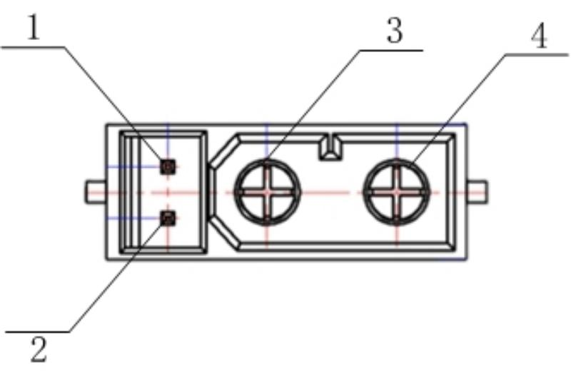

= Introduction

BPI-JC10 is a fully open-source driver board platform for robotic joint motor applications. At its core are Fortior Technology's FU7512L dual-core motor control MCU and FD6288Q three-phase gate driver IC, delivering native CAN/CAN FD support, dual onboard encoders, full closed-loop control, and MIT mode. The platform is specifically engineered for collaborative robot joints, integrated servo motors, exoskeletons, and wheel-legged robots.

== About the FU7512L
The FU75xx series from Fortior Technology is the industry’s first motor control-specific MCU based on a 32-bit RISC-V dual-core architecture. This chip integrates high-performance computing with real-time control capabilities. Leveraging the proprietary 2nd generation ME (Motor Engine) core, it effectively addresses the challenges of complex application scenarios. Whether for industrial servo drives, robotic joints, smart home appliances, or new energy vehicles, it provides an unprecedented motor control experience.

The FU75xx series MCU combines the **Motor Engine 2 (ME2)** with the 32-bit RISC-V core. Through this innovative heterogeneous architecture, it provides an ideal solution for high-performance motor applications:

**•	ME2 (Motor Engine 2)**: Integrates dedicated and flexible hardware algorithm modules that can be called directly or replaced by custom software, achieving efficiency far superior to pure software implementations. Compared to the first-generation ME, it offers significantly enhanced performance and a 100% increase in functional modules.

**•	RISC-V Core**: Provides flexible processing for system communication, application logic, and user interface functions.

The seamless collaboration between the two ensures sufficient capacity to handle diverse application scenarios. In servo applications, the FOC (Field Oriented Control) calculation time is as low as **5μs**.

== KeyFeatures
. MCU

* RISC-V 32-bit core

* ME2 (2nd-generation Motor Control Engine)
** Supports hardware FOC module, dual current-loop sampling, hardware speed loop, hardware PI, hardware CORDIC module, hardware 4-stage configurable filter, etc.
* 50 MHz operating frequency
* 64 KB Flash, 12 KB SRAM
* Junction temperature (Tj): -40 to 150°C
* Operating temperature (Ta): -40 to 125°C
. Board
* Supports CAN/CAN FD communication
+
(CAN FD arbitration phase bit rate: 1 Mbit/s, data phase bit rate: 5 Mbit/s)

* Onboard dual encoders, supporting full closed-loop control
* Native support for MIT control
* Board dimensions: ø60 mm
. Module
* Rated voltage: 48 V | Rated current: 6 Arms | Peak current: 40 Amp
 
* Rated torque: 6 Nm | Peak torque: 18 Nm
  
* Gear ratio: 7.75:1

== Application direction

* Dual-encoder, fully closed-loop position control: high precision with no loss of position upon power loss.
* Native CAN FD support + MIT control mode: designed for high-frequency dynamic control.
* 40A peak current: ensures stable closed-loop performance under high-dynamic loads, with overload protection to prevent loss of control.
* Integrated servo, motor, and gearbox: compact, smaller, and lighter design.
* Professional servo configuration software with a graphical interface for debugging.

= Getting Start 

TIP: link:/en/BPI-JC10/GettingStarted_BPI-JC10[Quick Start Debugging Guide]

= Hardware

== Hardware Interface Diagrams

== BPI-JC10 Photo

== Hardware Specifications

[cols="1,3", options="header" ]
|====
| Item                          | Description                                                                                                                              
| MCU-FU7512L                   | FU7512L, Fortior Technology self-developed dual-core MCU (32-bit RISC-V core + motor control engine ME2 core)                            
| Pre-driver FD6288             | FD6288, Fortior Technology self-developed pre-driver, integrates three independent half-bridge gate drivers 

|Magnetic Encoders              | KTH7112,Encoder position feedback

| MOS                           | ZMS026N10HNC                                                                                                                                        
| Code download interface       | For downloading code to the MCU for debugging                                                                                            
| CANFD interface               | For connecting to the servo PC for tuning and external CAN/CAN FD control                                                                
| U/V/W                         | Joint motor power lines (U/V/W)                                                               
| Power interface               |  Joint module power input

| Indicator LEDs                | LED1: steady on indicates power-on; LED2: blinking indicates fault                                                                                                                 
|====

== CANFD/Power Interface Definition

[cols="2*", options="header"]
|================
| Pin | Function 
| 1   | CAN_H    
| 2   | CAN_L  
| 3   | GND    
| 4   | 48V           
|================

= Development

== **Source Code**

== **Reference**

= Easy to buy sample

