= Wiring Instructions

Following the figure below, connect the power cable first and then the CAN debug cable. Use a 48 V DC power supply: connect the red power-cable wire to 48 V and the black wire to 0 V. For the CAN debug cable, connect the red wire to CAN_H and the black wire to CAN_L.

Before switching on the main power supply, double-check that the power-cable polarity is connected correctly.

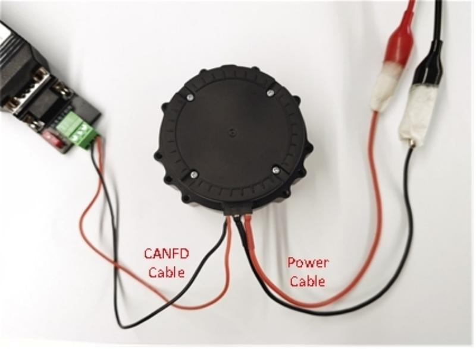

= Test Run and Commissioning

The test run is performed with the host software FortiorTechServoStudio.

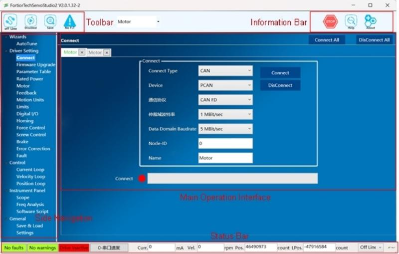

== Communication Connection

. Install the CAN driver;
. Use the CAN debug cable to connect the PC and the drive;
. Double-click FortiorTechServoStudio.exe to open it, then in the navigation sidebar click the “Connect” submenu;
. Set the connection type to CAN and select the corresponding CAN device, set the communication protocol to CAN FD, the arbitration-phase bit rate to 1 Mbit/s and the data-phase bit rate to 5 Mbit/s; (Note: the host software supports CAN devices from PCAN, VCICAN, ZLGCAN and so on, of which PCAN and ZLGCAN support CAN FD)
+
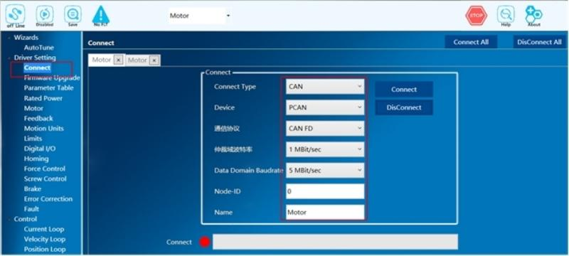

. Click the “Connect” button to establish the communication link.
+
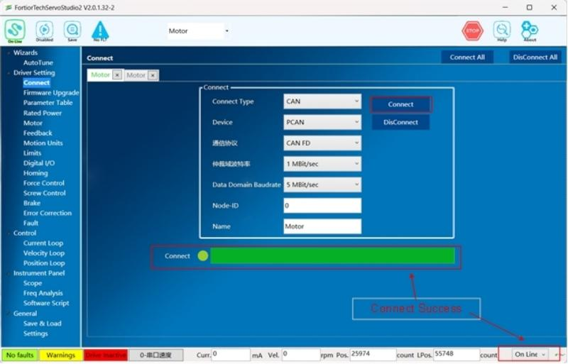

== Importing Parameters

When using the servo drive module for the first time, import the parameter file first:

. In the navigation sidebar, click the “Backup & Restore” submenu;
. Click “Import Parameters” and select the .rpc file provided with this document. After a short wait, the “Parameters imported successfully” dialog box appears;
+
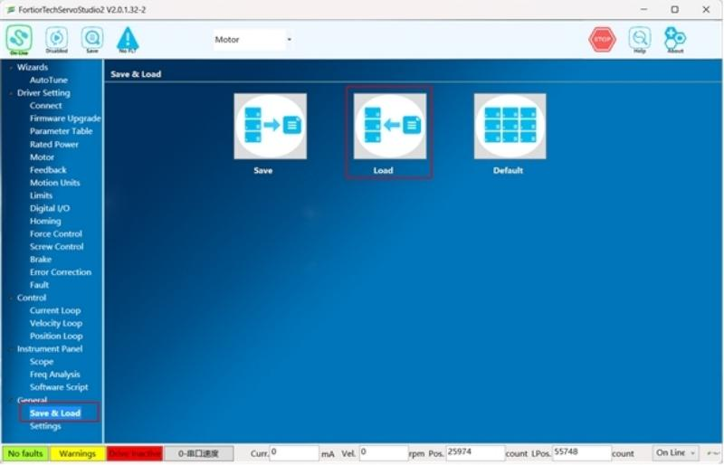

. In the toolbar at the top, click the “Save” button to save the parameters to the drive Flash.
+

== Finding the Phase Angle

Procedure for finding the phase angle:

. In the navigation sidebar, click the “Feedback” submenu;

. Set “Phase Search Mode” to “8-AutoPhase” and set the phase search current to 3 A;

. Click the “Find Phase Angle” button.

. When the phase search finishes, a dialog box reports that it succeeded. If it fails, increase the phase search current and try again, then check whether the motor and feedback parameters are set correctly and whether the encoder reading is normal.

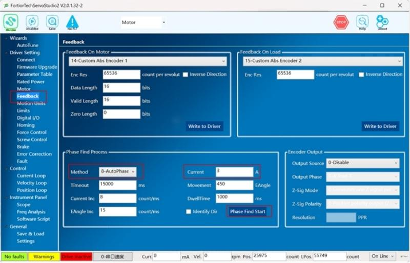

== Running the Motor

Because the parameter file just imported has already tuned the gains of the three control loops, gain tuning can be skipped and the position loop run directly.
Procedure for running the position loop:

. Set the oscilloscope “Sample Points” to 10000 and “Time Interval” to 21;
 
. In the oscilloscope recording variables, select command position CMDPOS, actual position ACTPOS, command current CMDCUR and actual current ACTCUR;

. Click the oscilloscope “Continuous Sampling” button to start capturing waveforms;

. Set “Operation Mode” to “5-Serial Position”;

. Under “Curve Mode” and “Motion Command”, select “T-curve”/“S-curve”, then select “Absolute”, “Reciprocate” and “Repeat”;

. Set “Target Position” and “Target Position 2” to a suitable travel distance, set “Speed” to 40% of the rated speed, set “Acceleration” to a relatively small value and set “Time” to 1000 ms;

. Click “Enable” in the toolbar at the top to enable the position loop;

. Click “Start”, and the motor begins to run.

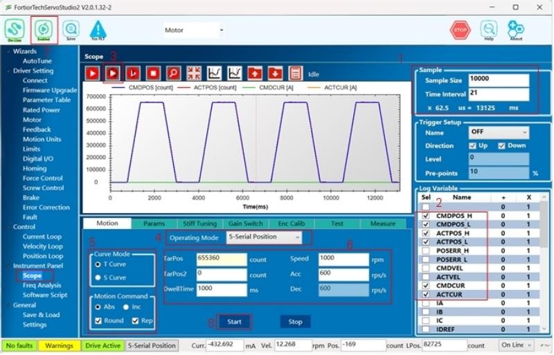

== MIT Control

Mode selection: on the oscilloscope screen, set the operation mode of the motion module to “12-MIT Control” to confirm that the current control mode is correct.

=== MIT Position Control

. Set “Operation Mode” to “12-MIT Control”;

. Set the oscilloscope “Sample Points” to 10000 and “Time Interval” to 21;

. In the oscilloscope recording variables, select command position CMDPOS and actual position ACTPOS;

. Click the oscilloscope “Continuous Sampling” button to start capturing waveforms;

. Set the MIT parameters as follows: KP = 50, KD = 200, target current = 0, target speed = 0, then set the target position and the target position 2. (Note: in this mode KD must not be 0 or too small, otherwise the motor may oscillate violently.)

. Under “Curve Mode” and “Motion Command”, select “T-curve”/“S-curve”, then select “Absolute”, “Reciprocate” and “Repeat”, and set the “Dwell Time” after the trajectory is reached.

. Click “Enable” in the toolbar at the top to enable the drive;

. Click “Start”, and the motor begins to run.

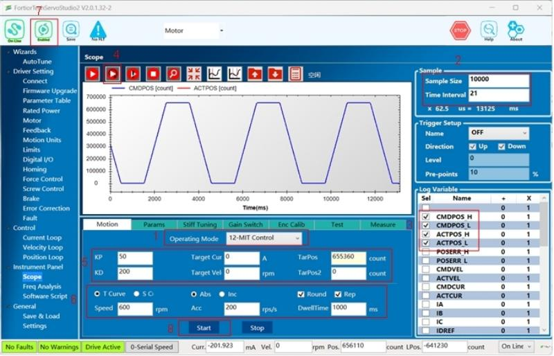

=== MIT Velocity Control

. Set “Operation Mode” to “12-MIT Control”;
. Set the oscilloscope “Sample Points” to 10000 and “Time Interval” to 21;
. In the oscilloscope recording variables, select command speed CMDVEL and actual speed ACTVEL;
. Click the oscilloscope “Continuous Sampling” button to start capturing waveforms;
. Set the MIT parameters as follows: KP = 0, KD = 250, target current = 0, target speed = 600, target position = 0 and target position 2 = 0. (Note: in this mode KD must not be too large, otherwise the motor may oscillate violently.)
. Click “Enable” in the toolbar at the top to enable the drive;
. Click “Start”, and the motor begins to run.

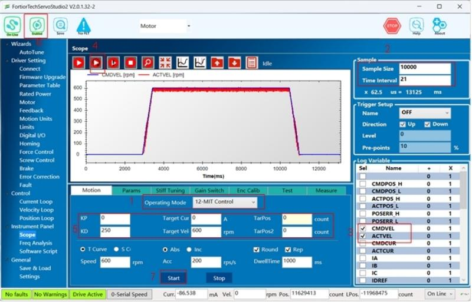

=== MIT Current Control

. Set “Operation Mode” to “12-MIT Control”;
. Set the oscilloscope “Sample Points” to 10000 and “Time Interval” to 21;
. In the oscilloscope recording variables, select command current CMDCUR and actual current ACTCUR;
. Click the oscilloscope “Continuous Sampling” button to start capturing waveforms;
. Set the MIT parameters as follows: KP = 0, KD = 0, target current = 0.35, target speed = 0, target position = 0 and target position 2 = 0. (Note: with no load attached, the target current should not be set too high in this mode, otherwise the motor speed will become excessive.)
. Click “Enable” in the toolbar at the top to enable the drive;
. Click “Start”, and the motor begins to run.

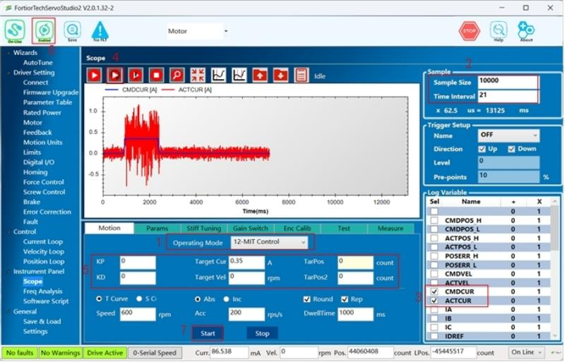

= Updating the Firmware

. If the firmware needs to be updated, download the new program with the Fortior development environment FTM32ForgeIDE through a Fortior emulator.
+
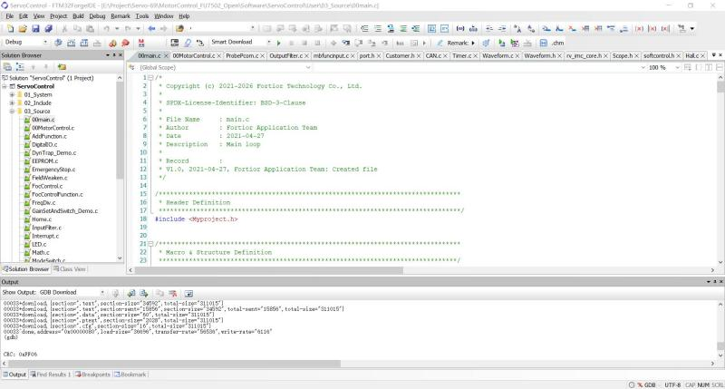

. First go to https://www.fortiortech.com/en/download/FTM32ForgeIDE to download Fortior FTM32ForgeIDE, and keep all installation options at their defaults.
+
Connect the Fortior emulator to the download port of the board. The pin assignment is as follows:
+
[cols="2*", options="header"]
|================
| Emulator | Board Download Port 
| VDD   | V    
| FICEK   | K  
| FICED   | D    
| GND   | G           
|================
+
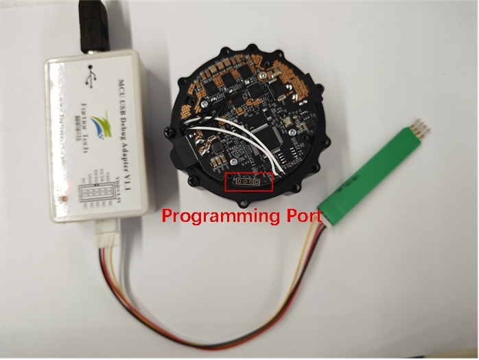

. Double-click the .ftproj file to open the project
+
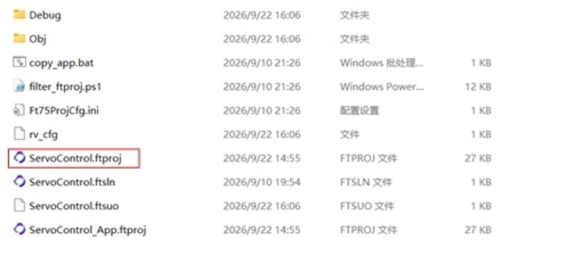

. Click  button to compile the code
+
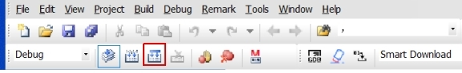

. After a successful build, the Output window displays “Build Project successfully”
+
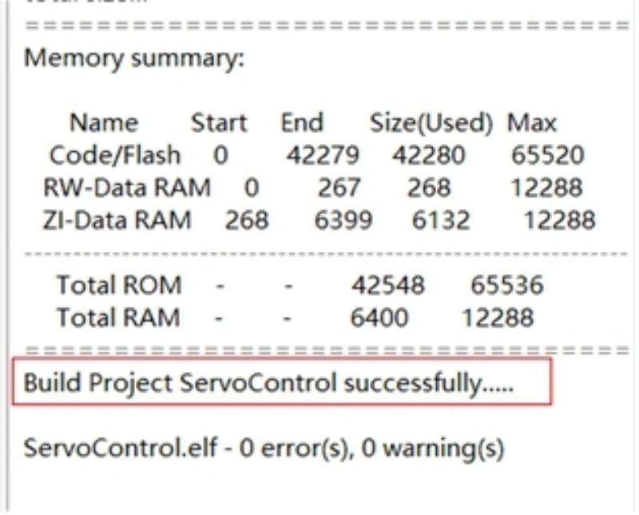

. Click  button to download the program to the board
+
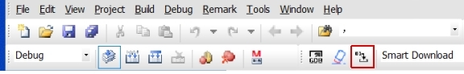

. When the download progress bar reaches 100%, the program has been downloaded to the chip.
+
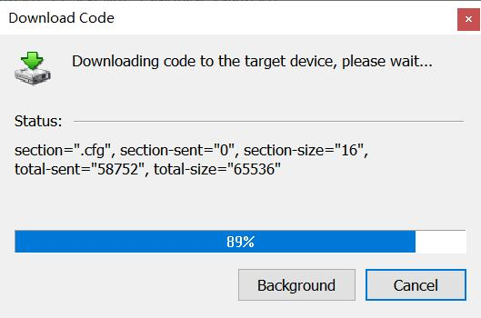

. After a successful download, the Output window shows a non-zero CRC value, which indicates that verification passed.
+
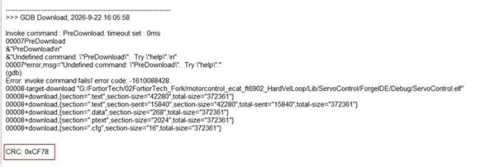

