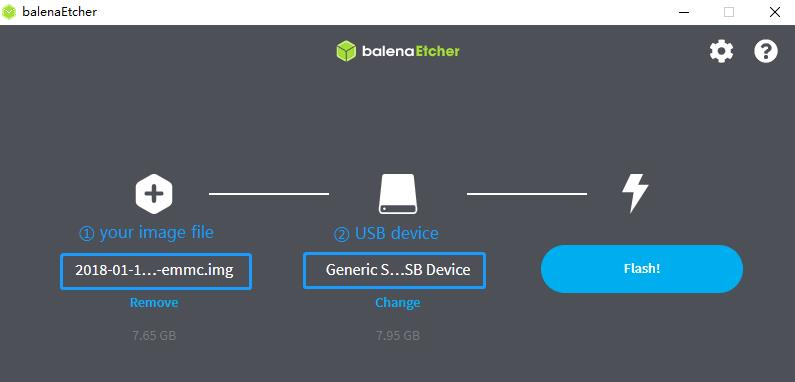

= Introduction

Banana Pi BPI-M2C is Banana Pi’s new generation single board computer, equipped with Unisoc uis7885 processor. It has 4GB LPDDR4 memory and 128GB EMMC storage onboard, and supports 4 USB 2.0 interfaces, 1 Gigabit network port, headphone interface, speaker interface, onboard 5G and WCN functions.

TIP: More Infomation: link:/en/BPI-M2C/BananaPi_BPI-M2C[Banana Pi BPI-M2C]

= Development
== Prepare

- Prepare 8G/above TF card, USB-Serial cable, Ubuntu System.
-  5V3A type-c adapter power supply
- Download tool:
* Windows: ResearchDownload
* Linux: Yunji
* Or an open-source flashing tool: link:https://etcher.balena.io/[balenaEtcher]
- link:/en/BPI-M2C/BananaPi_BPI-M2C#_system_image[Download the image] to be burned
- Using your USB-Serial cable(3.3V TTL,Baud=921600) Connect to debug console on BPI-M2C G=GND; RX=BPI-M2C input; TX=BPI-M2C output0

== Install Image with SD-1

Use the balenaEtcher tool to flash the SD image.

. Download the SD image. (Formats such as .zip, .xz, .gz, and .bz2 can be selected directly; however, compound archives like .tar.gz or .tar.xz must be extracted first.)
. Format the TF card using the SDFormatter tool.
. Open balenaEtcher, select the image file you wish to flash, choose your TF card, and click to begin the flashing process. (Be careful to ensure you have selected the correct TF card.)



== Install Image with SD-2

Use the ResearchDownload tool to flash the PAC package.

. Download the SD image. (If it is a compressed archive, please extract it beforehand.)
. Set the SD DIP switch on the back of the development board to the ON position.
. Open the tool and click "Load packet," then select the PAC package you wish to flash.
+

. Click "Settings," then click "Options," and check the boxes for "Repartition," "Keep Charge," and "Power Off."

== Install Image with eMMC

. xxx
. xxx
. xxx
. xxx

== Back up files such as NV data

== Query system information
```
uname -a
cat /etc/os-release
cat /proc/cpuinfo | head
cat /proc/meminfo | head
df -h
```

== Debug

The current kernel console parameters are as follows:

[cols="1,1",options="header"]
|===
|Parameter |Setting

|Device
|`ttyS1`

|Baud Rate
|`921600`

|Data Format
|`8N1` (8 data bits, no parity, 1 stop bit)

|Flow Control
|Disabled
|===

On a Linux host, you can use `picocom`:


```
sudo picocom -b 921600 /dev/ttyUSB0
```

Alternatively, you can use `minicom`, PuTTY, or MobaXterm; in each case, configure the settings to `921600 8N1` and ensure that hardware flow control is disabled.

== Network port

Connect an Ethernet cable to the BPI-M2C. The current system will initialize `eth0` and attempt to obtain an IP address via DHCP.

To check the interface status and IP address:

[source,shell]
```
ip link show eth0
ip addr show eth0
ip route
```

To manually request a new DHCP address, run the following commands:

```
ip link set eth0 up
udhcpc -i eth0
```

== Wi-Fi

First, check the wireless interface:

```
ip link show wlan0
ps | grep -E '[h]ostapd|[w]pa_supplicant'
```

Check the current operating mode:

```
iw dev wlan0 info
wpa_cli -i wlan0 status 2>/dev/null
```

To configure `wlan0` as a wireless hotspot—or before switching to standard Wi-Fi client mode—you should first stop any `hostapd` instance currently using the interface:

```
/etc/init.d/hostapd stop 2>/dev/null || true
killall wpa_supplicant 2>/dev/null || true
```

Generate a WPA Supplicant configuration. After running the command, enter your Wi-Fi password when prompted; the password will not be displayed in the terminal:

```
wpa_passphrase "Your Wi-Fi Name" > /tmp/wpa_supplicant.conf
chmod 600 /tmp/wpa_supplicant.conf
```
Connect to the wireless network and obtain an IP address via DHCP:
```
ip link set wlan0 up
wpa_supplicant -B -i wlan0 -c /tmp/wpa_supplicant.conf
udhcpc -i wlan0
```

After connecting, check the IP address and routing:

```
ip addr show wlan0
ip route
ping -c 4 8.8.8.8
```

Check the connection status and the current access point (AP):

```
wpa_cli -i wlan0 status
iw dev wlan0 link
```

Disconnect or reconnect:

```
wpa_cli -i wlan0 disconnect
wpa_cli -i wlan0 reconnect
```

Rescan for networks:

```
wpa_cli -i wlan0 scan
sleep 3
wpa_cli -i wlan0 scan_results
```

== Bluetooth

The `bluetoothd` daemon starts during system boot; the controller is typically identified as `hci0`.

Check the Bluetooth service and controller:

```
ps | grep '[b]luetoothd'
bluetoothctl list
bluetoothctl show
```

If the controller is not powered on:

```
bluetoothctl power on
```

=== Searching, Pairing, and Connecting Devices

Enter interactive mode:

```
bluetoothctl
```

Enter the following commands in sequence:

```
power on
agent on
default-agent
scan on
```

Wait for the target device to appear, note its MAC address (e.g., `11:22:33:44:55:66`), and then execute:

```
pair 11:22:33:44:55:66
trust 11:22:33:44:55:66
connect 11:22:33:44:55:66
info 11:22:33:44:55:66
scan off
quit
```

During pairing, follow the prompts in the terminal to confirm the PIN or verify that the numbers displayed on both devices match. HID devices, such as keyboards and mice, are generally ready for use once successfully connected. Disconnecting or removing a device:

```
bluetoothctl disconnect 11:22:33:44:55:66
bluetoothctl remove 11:22:33:44:55:66
```

=== Using a Bluetooth speaker or headset

Once an A2DP audio device is connected, PulseAudio creates an output with a name beginning with `bluez_sink`:

```
pactl list short sinks
```

Set the full `bluez_sink...` name (as shown in the output) as the default output:

```
pactl set-default-sink bluez_sink.11_22_33_44_55_66.a2dp_sink
paplay /mnt/data/test.wav
```

The sink name used above is just an example; you must copy the actual name from the output of `pactl list short sinks`. If no Bluetooth sink appears, verify that the device supports A2DP, that it is properly connected, and that the Bluetooth module for PulseAudio is loaded:

```
pactl list short modules | grep bluetooth
```

== SSH

Once you have confirmed that your development computer and the BPI-M2C can communicate with each other, execute the following command on your development computer:

```
ssh root@xxx.xxx.xxx.xxx
```

Upon your first connection, the host fingerprint will be displayed. After verifying that the address is correct, type `yes`.

[WARNING]
====
The fact that the serial console allows login with an empty password does not mean that SSH will also allow it.
If SSH returns a `Permission denied` error, please set a password for the user account via the serial console and try again:
```
passwd
```
Do not use empty or weak passwords on networks accessible by untrusted devices.
====

If you are unable to connect, check the following in order:

```
ip addr show eth0
ps | grep '[s]shd'
netstat -lnt 2>/dev/null | grep ':22'
```

If the SSH service is not running, you can attempt to start it from the serial console terminal:

```
/etc/init.d/sshd start
```