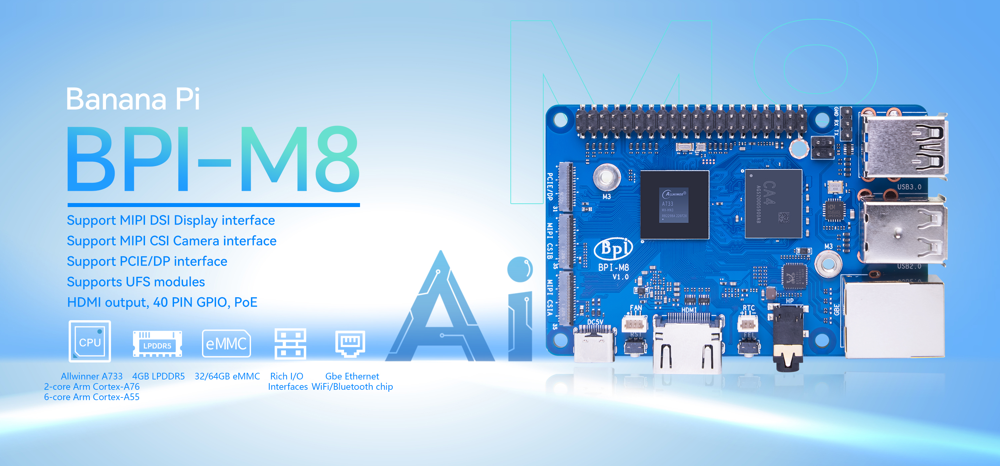
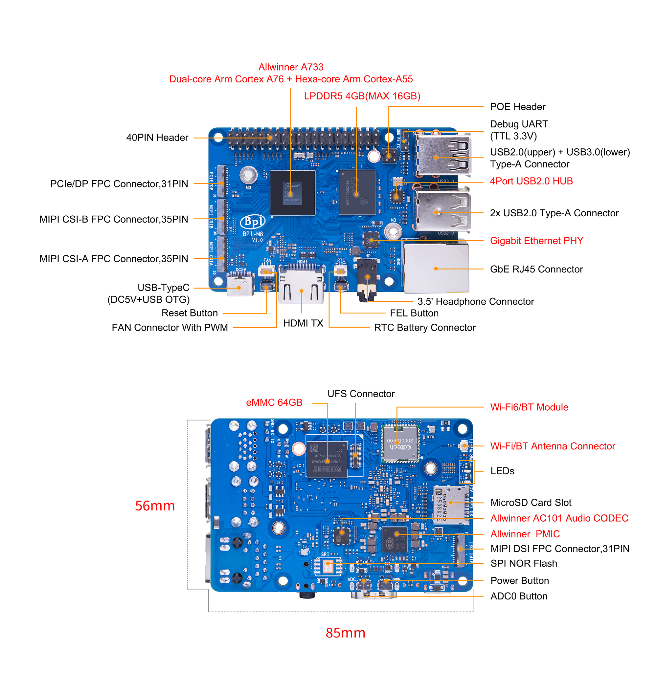

= BPI-M8 Introduction

The BPI-M8 is built on the high-performance octa-core AI platform chip A733, which combines a dual-core Arm® Cortex®-A76 and a hexa-core Arm Cortex-A55. It supports an Imagination PowerVR BXM-4-64 MC1 GPU, a 3 TOPS NPU, LPDDR4, LPDDR4x, and LPDDR5 DRAM, and UFS/eMMC storage.

The BPI-M8 provides a wide range of peripheral interfaces, including USB, DP, UFS, HDMI, MIPI CSI, MIPI DSI, FAN, RTC, and one Gigabit Ethernet port with PoE support. It supports booting from an SD card and features an onboard KEIIOT K038 Wi-Fi/Bluetooth chip. It is equipped with 4GB of LPDDR5 RAM, 32GB of eMMC storage, and two 12x12mm single-antenna modules.

TIP: Allwinner A733 design: link:/en/BPI-M8/BananaPi_BPI-M8[Banana Pi BPI-M8] similar in size to Raspberry Pi 5 + 
Allwinner H618 design: link:/en/BPI-M4_Berry/BananaPi_BPI-M4_Berry[Banana Pi BPI-M4 Berry] similar in size to Raspberry Pi 4B +
Allwinner H618 design: link:/en/BPI-M4_Zero/BananaPi_BPI-M4_Zero[Banana Pi BPI-M4 Zero] similar in size to Raspberry Pi Zero W +
Allwinner A40i design: link:/en/BPI-M2_Berry/BananaPi_BPI-M2_Berry[Banana Pi BPI-M2 Berry] SBC design +
Allwinner A40i design: link:/en/BPI-M2_Ultra/BananaPi_BPI-M2_Ultra[Banana Pi BPI-M2 Ultra] SBC design +
Allwinner A40i design: link:/en/BPI-6202/BananaPi_BPI-6202[Banana Pi BPI-6202] industrial control gateway +
Allwinner H3 design: link:/en/BPI-M2_Plus/BananaPi_BPI-M2_Plus[Banana Pi BPI-M2+] SBC with onboard eMMC +
Allwinner H3 design: link:/en/BPI-M2_Zero/BananaPi_BPI-M2_Zero[Banana Pi BPI-M2 Zero] similar in size to Raspberry Pi Zero W +
Allwinner H3 design: link:/en/BPI-P2_Zero/BananaPi_BPI-P2_Zero[Banana Pi BPI-P2 Zero] IoT design

== Key Features

* Dual-core Arm Cortex-A76 + hexa-core Arm Cortex-A55, up to 2.0GHz
* 4GB LPDDR5 memory
* 64GB eMMC flash (BPI-M8A)
* 16MB SPI NOR storage (BPI-M8B)
* 1x MIPI DSI display interface
* 2x MIPI CSI camera interfaces
* 1x PCIe/DP interface
* 1x HDMI 2.0b output interface
* 4x USB-A ports
* 1x Gigabit Ethernet (GbE) RJ45 port (PoE power supported through a PoE HAT)
* 1x Wi-Fi 6/Bluetooth 5 module
* 1x 40-pin GPIO header
* 1x UFS interface

== Getting Started

TIP: link:/en/BPI-M8/GettingStarted_BPI-M8[Getting Started BPI-M8]

= Hardware

== Hardware Interface

== BPI-M8 Photo 

link:/en/BPI-M8/Photo_BPI-M8[Banana Pi BPI-M8 Product photo gallery]

== Hardware Specifications

TIP: The BPI-M8A uses 64GB eMMC flash.
The BPI-M8B uses 16MB SPI NOR flash.

[options="header",cols="1,3"]
|=====
2+| **Hardware Specifications of Banana Pi M8**
| CPU             | Allwinner A733 dual-core Arm Cortex-A76 + hexa-core Arm Cortex-A55, up to 2.0 GHz
| GPU             | Imagination PowerVR BXM-4-64 MC1
|PMIC             | AXP318
| Memory          | 4GB LPDDR5 RAM
.4+| Storage         | MicroSD card slot | Supports 8GB/16GB/32GB/64GB/128GB eMMC storage (64GB eMMC by default) | Supports SPI NOR storage | Supports UFS modules
.2+| Network         | 10/100/1000M Ethernet | Wi-Fi 6/Bluetooth 5.0 chip
.2+| Video Output    | 1x HDMI 2.0b TX interface | 1x 4-lane MIPI DSI display interface
| Camera          | 2x 4-lane MIPI CSI camera interfaces
| Audio Output    | 3.5mm headphone jack output and HDMI audio output
| PCIe            | FPC PCIe socket (shared with the DP socket)
| USB Ports       | 3x USB 2.0 ports + 1x USB 3.0 port
| GPIO            | 40-pin expansion header supporting GPIO, UART, I²C, SPI, PWM, and other functions
| Switches        | PWR button and ADC button
| RTC             | Battery connector with 2 pins at 1mm pitch
| LED             | Power status and activity status
| Power           | 5 V/4 A input through USB Type-C, or PoE power
| Size and Weight | 85x56 mm, 60g
| Operating System | Android and Linux
|=====

= Accessories

= Development

== Source Code
=== Android
TIP: BPI-A733-Android13-Code

Baidu Cloud: 

Google Drive: 

Android source code https://github.com/BPI-SINOVOIP/BPI-A733-Android13

=== Linux

TIP: Linux BSP source code

u-boot for A733 : https://github.com/BPI-SINOVOIP/pi-u-boot/tree/sun60iw2p1-2018.07

kernel for A733 : https://github.com/BPI-SINOVOIP/pi-linux/tree/sun60iw2p1-5.15

* Bananapi Armbian build source code https://github.com/BPI-SINOVOIP/armbian-build/tree/bpi-v26.05

* WringPi source code 

* RPi.GPIO source code 

* WiringPi-Python source code 

== Resources

TIP: BPI-M8 DXF Files

Baidu: https://pan.baidu.com/s/1YewFVjmMhxQERNkgPD12Hw?pwd=8888 Access code: 8888

Google:  https://drive.google.com/drive/folders/1c4fSeGo-YRx21K1SWDts7p0UfFnFKTTw?usp=sharing

TIP: BPI-M8 3D Files

Baidu: https://pan.baidu.com/s/1v-EjBKZZVwJZVMMFUrv08g?pwd=8888 Access code: 8888

Google:  https://drive.google.com/file/d/1DTuamP2BAN0WE_9b7_ANvknU3UW1ALnI/view?usp=sharing

TIP: Camera 415 Files

Baidu: https://pan.baidu.com/s/1mmDr8WOm2AvfnA45F9-WpQ?pwd=8888 Access code: 8888

Google: https://drive.google.com/drive/folders/1B-MQ6mjfistsg_X7kd4xNwxLvoqSOU4H?usp=sharing

TIP: BPI-MIPI-HC070

Baidu: https://pan.baidu.com/s/1Bol_EVWRO2oMl6zTixQMXw?pwd=8888 Access code: 8888

Google: https://drive.google.com/drive/folders/156op2OhRCZuxN-EUzZrPlbT1s1G5k4eV?usp=sharing

= Image Release

== Android

Baidu: https://pan.baidu.com/s/1pT6bLWE1owqpdk3RVBgVmg?pwd=8888 Access code: 8888

Google: https://drive.google.com/drive/folders/1qwfW3NOa3JwDhMouAGT9JVd3XC-EU9RG?usp=sharing

== Linux

Baidu: https://pan.baidu.com/s/1CKX_UC2HIEfUHvYr2L74HQ?pwd=8888 Access code: 8888

Google:  https://drive.google.com/drive/folders/1o-IFXtbhbTsbD0VP30wKHBWM2kHfc1qz?usp=sharing

= Easy to Buy Samples
WARNING: BANANAPI Official Shop:
https://www.bpi-shop.com/products/banana-pi-bpi-m8-with-allwinner-a733-chip-design.html

WARNING: Sinovoip AliExpress Shop:
https://ko.aliexpress.com/item/1005013422098187.html?gatewayAdapt=glo2kor

WARNING: BIPAI AliExpress Shop:
https://ko.aliexpress.com/item/1005013422264089.html?gatewayAdapt=glo2kor

WARNING: BPI OpenSource AliExpress Shop:
https://fr.aliexpress.com/item/1005013422236363.html?gatewayAdapt=glo2fra

WARNING: JOOM Platform:
https://www.joom.com/en/products/6ad09988303ef201d39eefb2
