= Introduction

The BPI-M8 is powered by the Allwinner A733 octa-core processor, integrating a dual-core Arm Cortex-A76, a hexa-core Arm Cortex-A55, a PowerVR GPU, and a 3 TOPS NPU, with 4 GB of LPDDR5 memory.

The board provides HDMI, MIPI DSI, dual MIPI CSI, USB, Gigabit Ethernet, and 40-pin GPIO interfaces. It supports booting from an SD card and can connect to an M.2 SSD and an eDP display through an expansion board.

TIP: More information: link:/en/BPI-M8/BananaPi_BPI-M8[Banana Pi BPI-M8].

= Key Features

* Dual-core Arm Cortex-A76 + hexa-core Arm Cortex-A55, up to 2.0 GHz.
* 4 GB LPDDR5 memory.
* 64 GB eMMC (BPI-M8A) or 16 MB SPI NOR (BPI-M8B).
* 3 TOPS NPU.
* 1x HDMI 2.0b output interface.
* 1x MIPI DSI display interface.
* 2x MIPI CSI camera interfaces.
* 1x PCIe/DP expansion interface.
* 4x USB Type-A ports.
* 1x Gigabit Ethernet port, with power supported through a PoE HAT.
* Wi-Fi 6 and Bluetooth 5.
* 1x 40-pin GPIO header.
* 1x UFS interface.

= Android

== Preparation

* Download the link:/en/BPI-M8/BananaPi_BPI-M8#_android_2[Android image].
* Install link:https://download.banana-pi.dev/d/ca025d76afd448aabc63/files/?p=%2FTools%2Fimage_download_tools%2Fphoenixsuit_V1.1.0_20150325.rar[PhoenixSuit] on a Windows PC.
* Prepare a Type-C cable that supports data transfer and a 5 V power supply that meets the board's requirements.

== Flash the Image

WARNING: Flashing will erase the data on the eMMC. Back up your data first.

. Open PhoenixSuit, go to the "Firmware" page, and click "Image" to select the Android image.
. Press and hold the FEL button on the board, connect it to the PC through the USB OTG Type-C port, and release the button once the device is detected.
. Confirm flashing when prompted and wait for the download to complete. Do not disconnect the power or data cable during flashing.
. Once flashing is complete, power the board on again and wait for Android to start.

NOTE: The Android image in this guide is flashed to the eMMC.

= Linux Development

== Preparation

* Download the link:/en/BPI-M8/BananaPi_BPI-M8#_linux_2[Linux image]. The desktop version provides a graphical interface, while the Minimal version uses a terminal.
* Prepare an SD card and a card reader. The SD card capacity must be larger than the extracted image size. An A1-rated card is recommended.
* Download link:https://etcher.balena.io/[balenaEtcher], a flashing tool for Windows, Linux, and macOS.
* Refer to the image documentation for the default login details. Common credentials are `pi/bananapi` or `root/1234`. On first boot, follow the setup wizard to configure the password and user account.

This section applies to Ubuntu / Debian images for BPI-M8. You do not need to erase the eMMC before booting from an SD card.

== Install the Image to an SD Card

WARNING: Flashing will erase the data on the target device. Make sure you have selected the SD card.

. Insert the SD card into a card reader and connect it to the PC. Open balenaEtcher and click "Flash from file" to select the image.
+
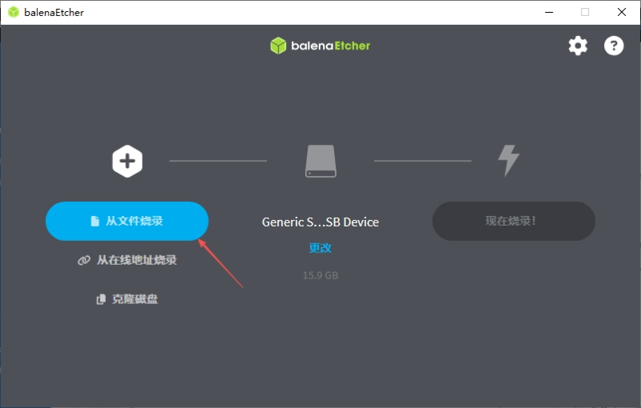
+
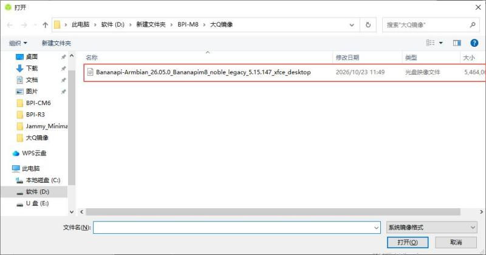

. Click "Select target", select the SD card, and check its capacity.
+
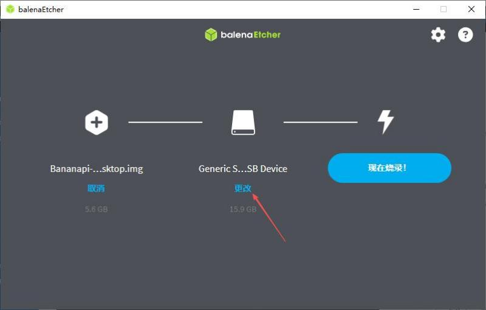
+
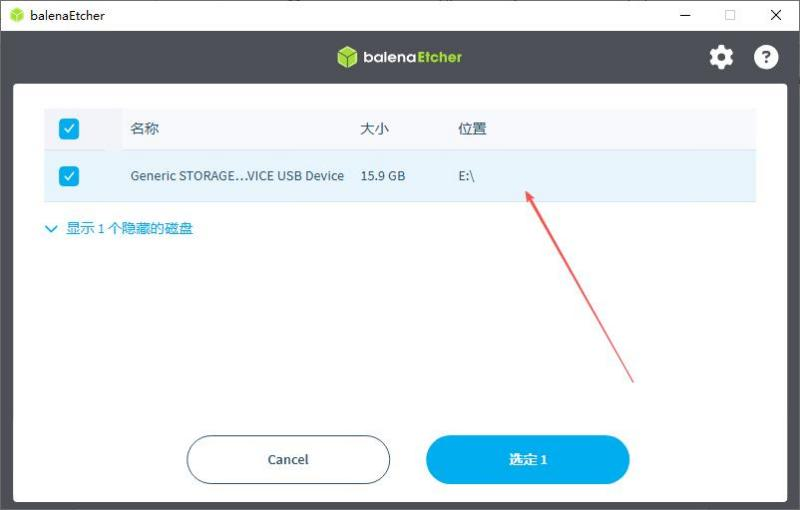

. Click "Flash!" and wait for writing and validation to complete.
+

+
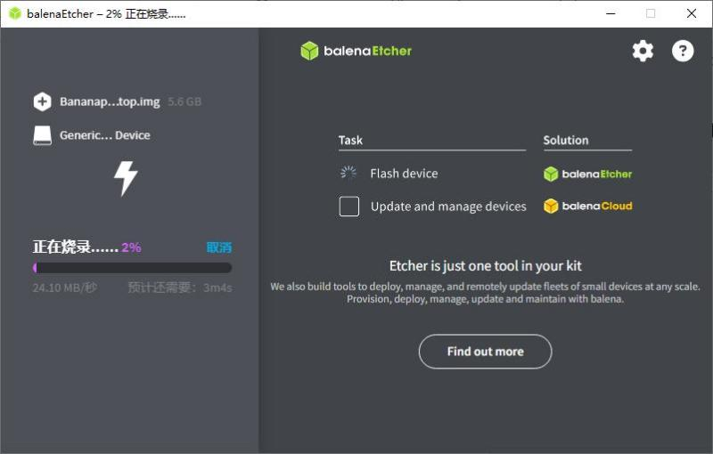
+
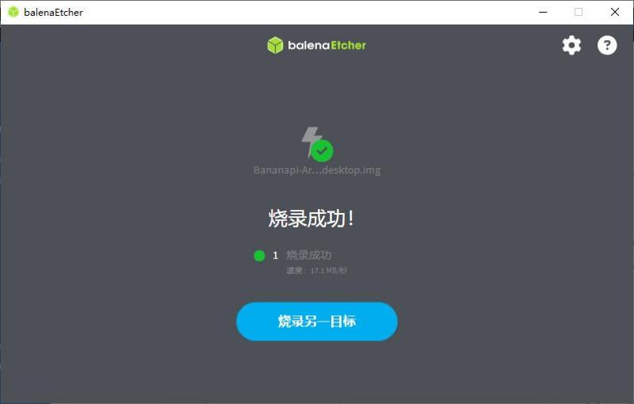

. Safely remove the SD card, insert it into BPI-M8, connect the display, keyboard, and power supply, and wait for the system to boot.

== Install the Image to eMMC

WARNING: Writing will erase the data on the eMMC. The following example uses `/dev/mmcblk1`; use the device name shown in your actual output. Do not write to the disk containing the currently running system.

. Boot M8 from the SD card, copy the extracted `.img` image to a USB drive, and connect the USB drive to M8.

. Check the disks and the current system partition to identify the SD card, eMMC, and USB drive.
+
[source,bash]
----
lsblk -o NAME,SIZE,TYPE,FSTYPE,MOUNTPOINT
findmnt /
----
+
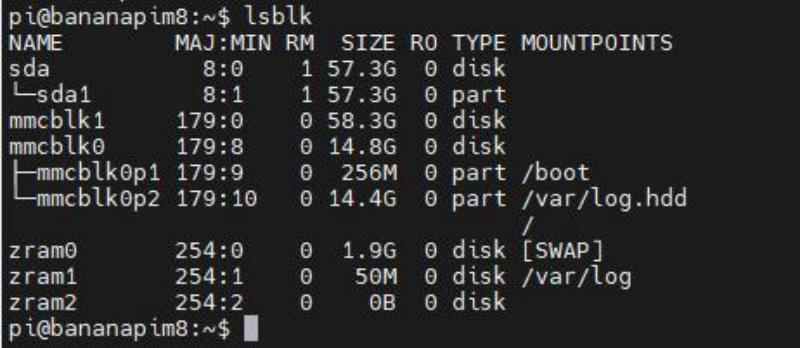

. Mount the USB drive. The following example uses `/dev/sda1`. If the USB drive is already mounted, use its existing mount path.
+
[source,bash]
----
sudo mkdir -p /mnt/usb
sudo mount /dev/sda1 /mnt/usb
ls /mnt/usb
----
+
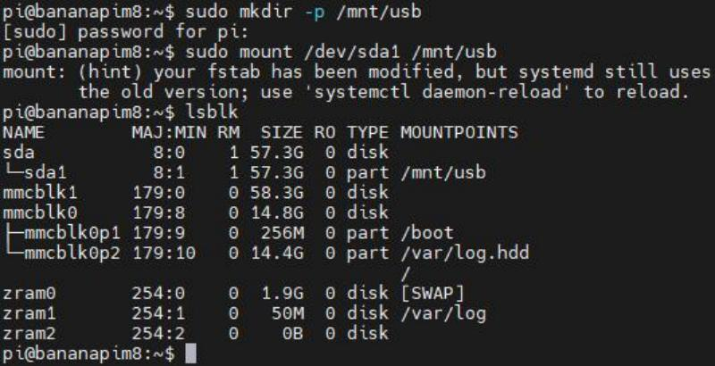

. Make sure all eMMC partitions are unmounted. Replace `bpi-m8.img` below with the actual image filename, then write the image.
+
[source,bash]
----
sudo dd if=/mnt/usb/bpi-m8.img of=/dev/mmcblk1 bs=4M status=progress conv=fsync
sync
----
+
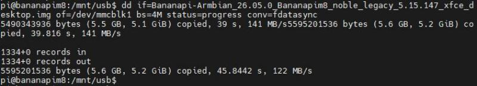

. Once writing is complete, shut down the system, disconnect the power, remove the SD card, and power the board on again.
+
[source,bash]
----
sudo poweroff
----

. After booting, confirm that the system partition is on the eMMC.
+
[source,bash]
----
findmnt /
lsblk
----
+
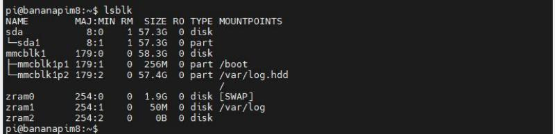

== Erase eMMC (Optional)

WARNING: This operation erases all data in the eMMC user area and cannot be undone. Only perform it while booted from an SD card, after confirming that the target is not the current system disk and that all target partitions are unmounted.

. Check the devices and system partition to confirm the eMMC device name.
+
[source,bash]
----
lsblk -o NAME,SIZE,TYPE,FSTYPE,MOUNTPOINT
findmnt /
----

. The following example uses `/dev/mmcblk1` and writes zeros to the eMMC user area.
+
[source,bash]
----
sudo dd if=/dev/zero of=/dev/mmcblk1 bs=4M status=progress conv=fsync
sync
----

Once the device is full, a "No space left on device" message appears. This operation does not erase the separate eMMC boot0 / boot1 boot areas.

== USB

. Connect a USB drive or another USB device to a USB Type-A port on the board and check whether it is detected.
+
[source,bash]
----
lsusb
lsblk
----
+
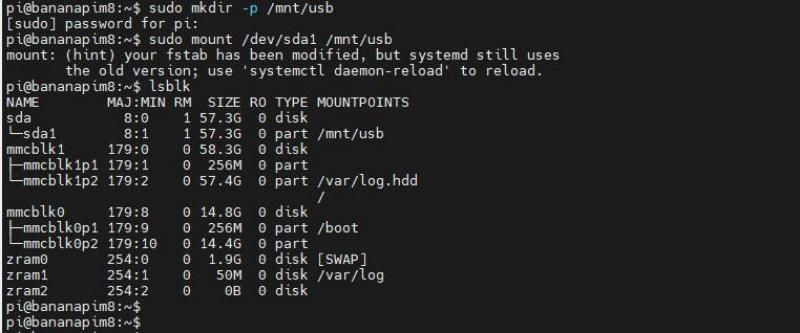

. Mount the USB drive. The following example uses `/dev/sda1`.
+
[source,bash]
----
sudo mkdir -p /mnt/usb
sudo mount /dev/sda1 /mnt/usb
ls /mnt/usb
----

. Unmount the USB drive after use, then unplug it.
+
[source,bash]
----
sudo umount /mnt/usb
----
+
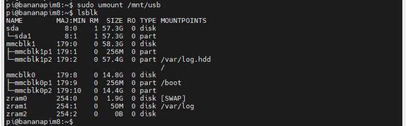

== Ethernet

. Connect M8 to a LAN port on the router using an Ethernet cable, then check the IP address of M8.
+
[source,bash]
----
ip -4 addr
----
+
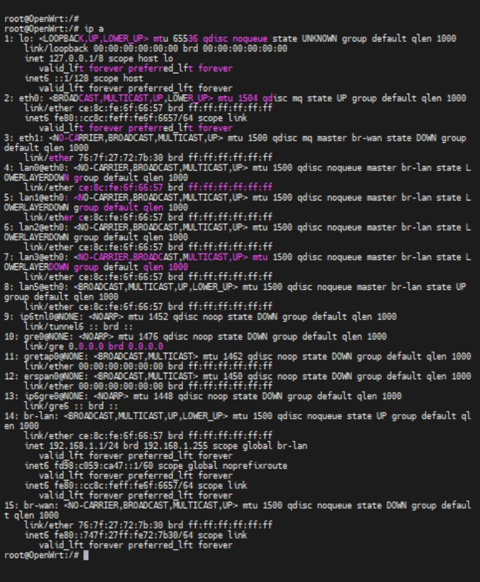

. Start the iperf3 server on another PC on the same local network.
+
[source,bash]
----
iperf3 -s
----
+
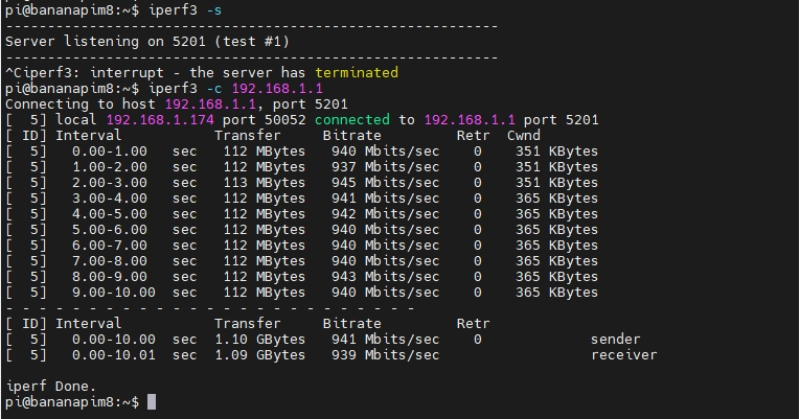

. Start the client on M8, replacing the example address with the IP address of the server PC.
+
[source,bash]
----
iperf3 -c 192.168.1.200
----
+
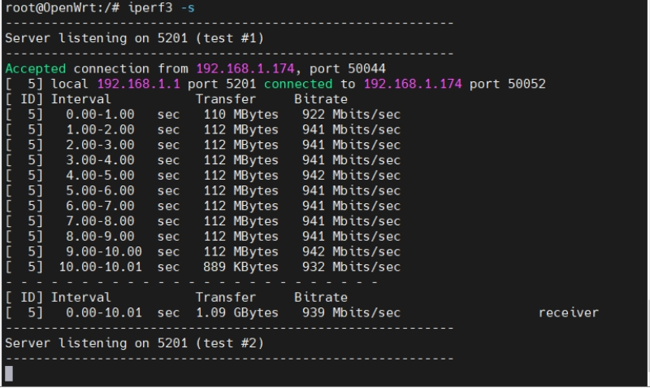

== Wi-Fi

. Check the network devices and available access points.
+
[source,bash]
----
nmcli device
nmcli device wifi list
----

. Connect to Wi-Fi. Replace "WiFi_Name" with the actual access point name and enter the password when prompted.
+
[source,bash]
----
sudo nmcli --ask device wifi connect "WiFi_Name"
nmcli connection show --active
----
+
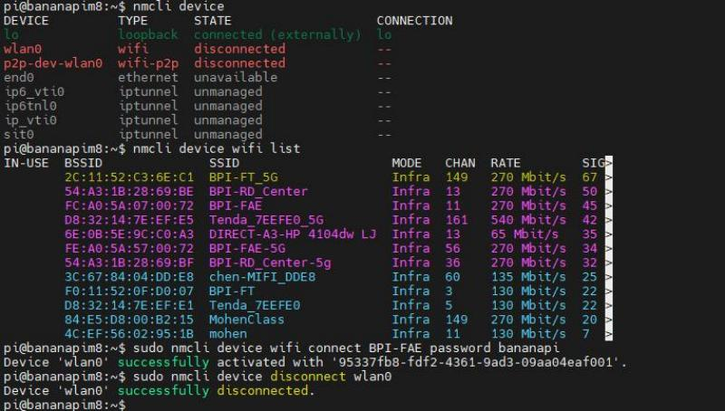

. To disconnect, run the following command. Use the wireless interface name shown by `nmcli device`.
+
[source,bash]
----
sudo nmcli device disconnect wlan0
----

== Bluetooth

. Turn on the target Bluetooth device and put it in pairing mode, then start the Bluetooth management tool on M8.
+
[source,bash]
----
bluetoothctl
----

. In `bluetoothctl`, turn on Bluetooth and start scanning.
+
[source,text]
----
power on
agent on
default-agent
scan on
----

. Once you find the target device, stop scanning, pair, and connect. Replace the example MAC address with the actual address and confirm pairing when prompted.
+
[source,text]
----
scan off
devices
pair AA:BB:CC:DD:EE:FF
trust AA:BB:CC:DD:EE:FF
connect AA:BB:CC:DD:EE:FF
----

. To disconnect or exit, run the following commands in `bluetoothctl`:
+
[source,text]
----
disconnect AA:BB:CC:DD:EE:FF
exit
----

== HDMI Display

Connect the display using an HDMI cable, select the corresponding input source, and power on M8. The desktop version opens a graphical interface, while the Minimal version opens a terminal.

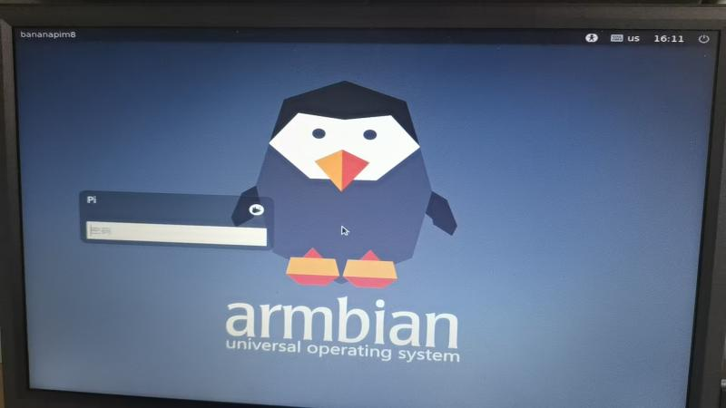

== Buttons

=== PWR

When the board is off, press and hold PWR to turn it on. When the board is on, a short press triggers the system power action; the exact response depends on the current image settings.

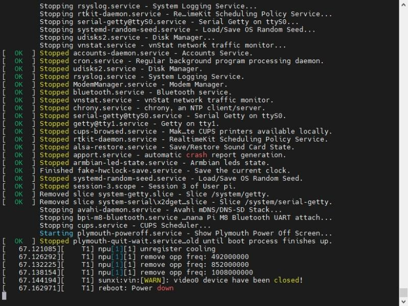

=== RST

A short press of RST immediately restarts the board. Save your data first.

== SSH

. Connect M8 and the PC to the same local network, then check the IP address on M8.
+
[source,bash]
----
ip -4 addr
----
+
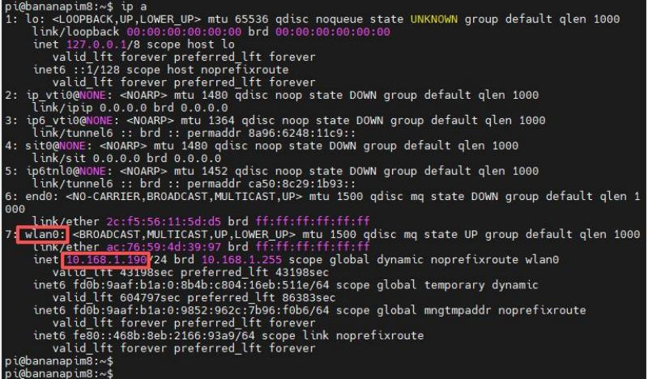

. Open MobaXterm on the PC, create an SSH session, and enter the IP address of M8, the username, and port `22`.
+
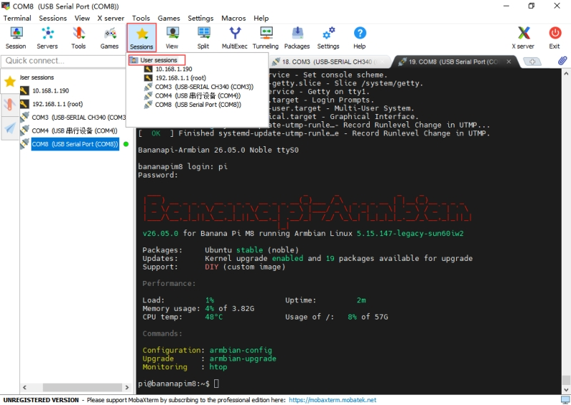
+
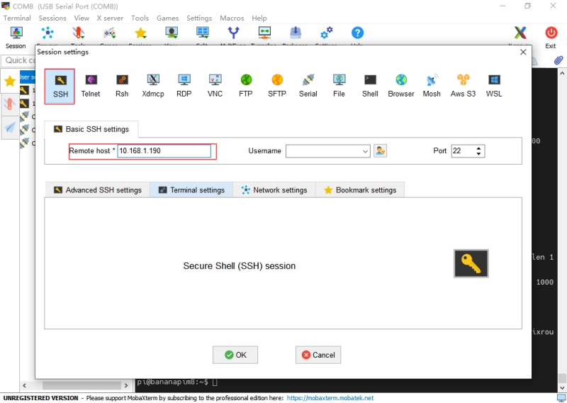

. Enter the account password after connecting. You can also connect using a terminal command; replace the example IP with the actual address.
+
[source,bash]
----
ssh pi@192.168.1.100
----
+
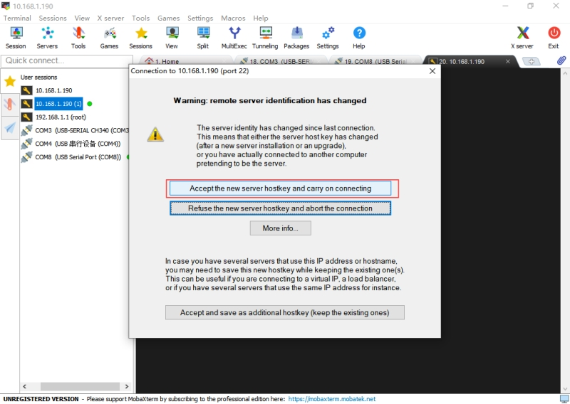
+
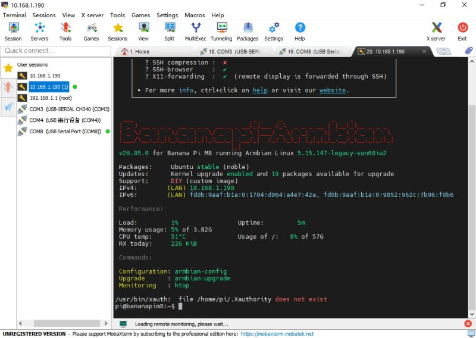

== Audio

. Plug in headphones or connect a display that supports HDMI audio, then check the system sound cards.
+
[source,bash]
----
aplay -l
----
+
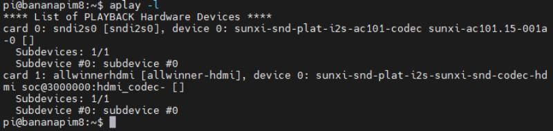

. Copy the audio file to a USB drive, mount it as described in the "USB" section, and check the files.
+
[source,bash]
----
ls /mnt/usb
----
+
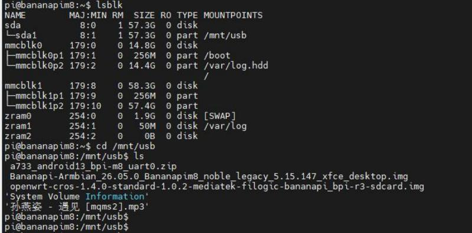

. Play the audio using VLC. The following example uses sound card `0`, device `0`. Adjust the numbers according to the output of `aplay -l` and replace the filename.
+
[source,bash]
----
cvlc --aout alsa --alsa-audio-device plughw:0,0 "/mnt/usb/audio_filename"
----
+
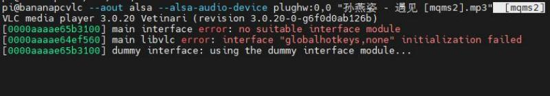

NOTE: To play HDMI audio, select the corresponding HDMI sound card and make sure the display is not muted. If VLC is not installed, use `aplay -D plughw:0,0 /mnt/usb/test.wav` to play a WAV file.

== RTC

. Disconnect the power, connect the RTC backup power supply, and check the connector polarity.
+
WARNING: The RTC backup supply voltage must not exceed 2 V.
+
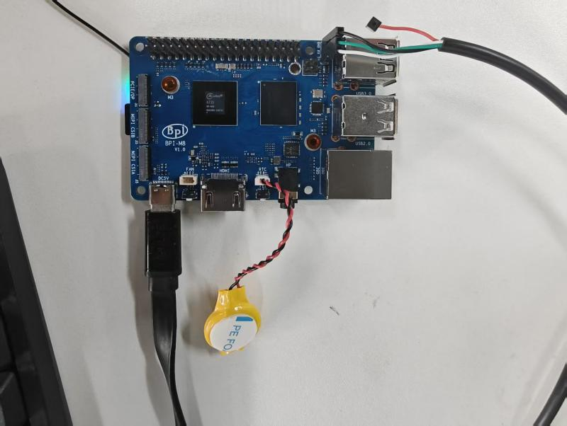

. Power on the board, check the RTC driver, and read the hardware clock.
+
[source,bash]
----
sudo dmesg | grep -Ei 'rtc|sunxi-rtc'
sudo hwclock -r -f /dev/rtc0
----

. After confirming that the system time is correct, write it to the RTC.
+
[source,bash]
----
date
sudo hwclock -w -f /dev/rtc0
sudo hwclock -r -f /dev/rtc0
----

. Shut down the system and disconnect the main power supply, leaving the RTC backup supply connected. Power the board on again after a few minutes and check whether the RTC has continued keeping time.
+
[source,bash]
----
sudo hwclock -r -f /dev/rtc0
date
----

== Fan

The system thermal policy controls the fan speed. Check the fan device and the current PWM output:

[source,bash]
----
for m8_hwmon in /sys/class/hwmon/hwmon*; do
    echo "$m8_hwmon"
    cat "$m8_hwmon/name"
    if [ -f "$m8_hwmon/pwm1" ]; then
        cat "$m8_hwmon/pwm1"
    fi
done
----

NOTE: The `hwmon` number may change. Use `name` to identify the fan device. Do not disable automatic thermal control during stress testing.

== PoE Power

. Prepare a compatible PoE switch, a BPI-M8 PoE HAT, and an Ethernet cable.
. With the power disconnected, attach the PoE HAT, then connect it to the PoE switch using the Ethernet cable.
. Power on the switch and confirm that the board boots normally.

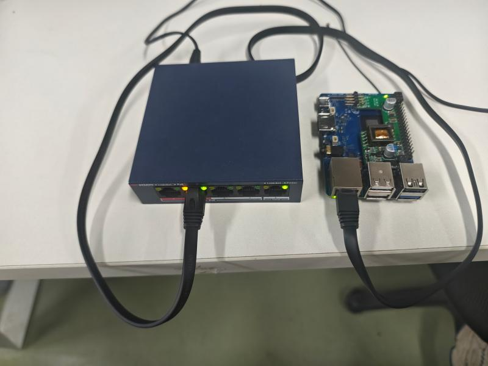

== BPI-M8 Expansion Board

. Prepare the expansion board, one 31-pin FPC cable, and two 35-pin FPC cables.
. With the power disconnected, connect the PCIe/DP and MIPI interfaces on the main board to the corresponding interfaces on the expansion board.
. Align the 40-pin GPIO header in the correct orientation and connect the main board to the expansion board.

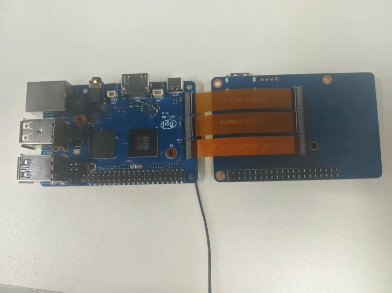

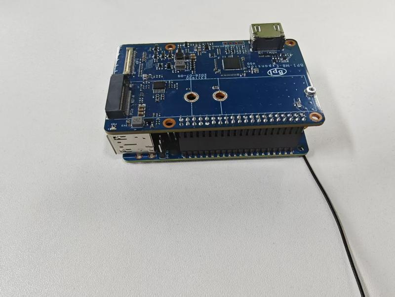

=== M.2 SSD

. With the power disconnected, insert the NVMe SSD into the M.2 slot on the expansion board and secure it.
+
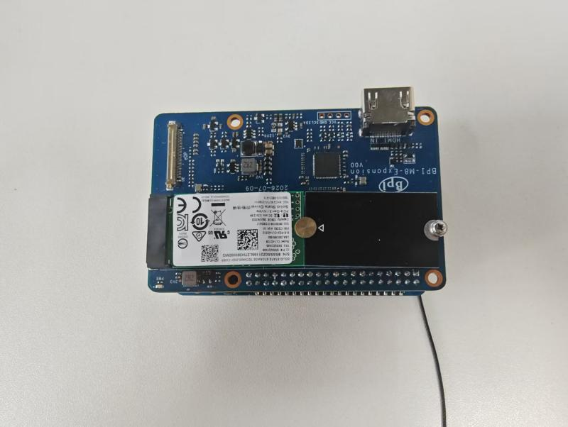

. Boot the system and confirm that the device tree overlay for M.2 is installed.
+
[source,bash]
----
ls /boot/dtb/sunxi/overlay/bpi-m8/ | grep -i pcie
----
+
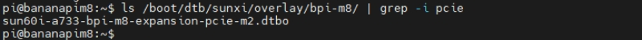

. Back up and edit the boot configuration.
+
[source,bash]
----
sudo cp -an /boot/armbianEnv.txt /boot/armbianEnv.txt.before-pcie
sudo nano /boot/armbianEnv.txt
----

. Append `bpi-m8-expansion-pcie-m2` to the existing `overlays=` line, separating multiple overlays with spaces. If the line does not exist, add:
+
[source,text]
----
overlays=bpi-m8-expansion-pcie-m2
----
+
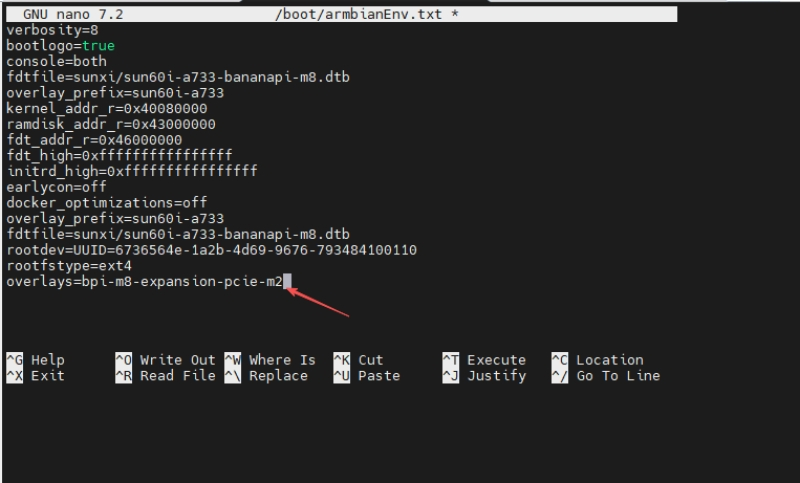

. Press `Ctrl+O` to save, `Enter` to confirm, and `Ctrl+X` to exit, then reboot the system.
+
[source,bash]
----
sudo reboot
----

. After rebooting, check the PCIe devices and disks.
+
[source,bash]
----
lspci
lsblk
----
+
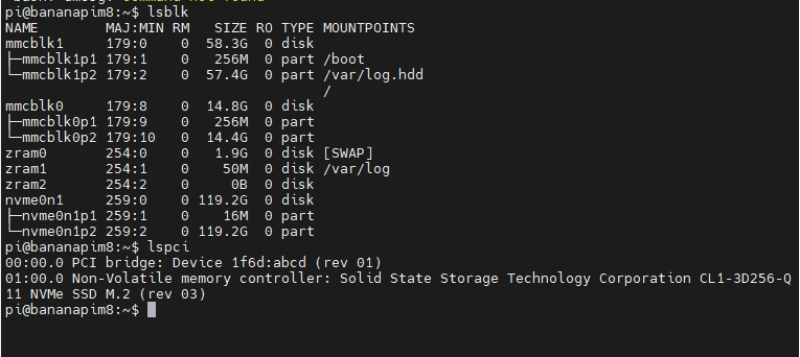

NOTE: Do not add duplicate `overlays=` lines or overwrite other existing overlay settings.

== NPU

BPI-M8 supports running AI examples with AWNPU Model Zoo. The following YOLOv5 image object detection example shows how to convert the model, build the program, and run it.

=== Preparation

* An x86_64 Ubuntu development PC.
* A BPI-M8 running 64-bit Armbian with a network connection.
* `AWNPU_Docker_cp38.zip`: A733 version `v2.0.10.2`.
* `AWNPU_ModelZoo.gz`: version `v1.0.0`.
* An AArch64 GCC cross-compilation toolchain. Download instructions are in the `0-toolchains` directory of ModelZoo.

NOTE: Model conversion and compilation take place on the development PC. The inference program runs on M8.

. Check the NPU device on M8.
+
[source,bash]
----
uname -m
ls -l /dev/vipcore
----

The system architecture should be `aarch64`, and `/dev/vipcore` should exist.

=== Set Up the Development Environment

. Install Docker and the basic tools on the development PC. Skip this step if they are already installed.
+
[source,bash]
----
sudo apt-get update
sudo apt-get install -y docker.io unzip tar cmake build-essential file openssh-client
sudo systemctl start docker
sudo docker version
----

. Set the package path and working directory. Replace `M8_PACKAGE_DIR` with the actual storage path.
+
[source,bash]
----
export M8_PACKAGE_DIR="$HOME/Downloads"
export M8_AI_ROOT="$HOME/m8-ai"
export M8_MODEL_ZOO="$M8_AI_ROOT/awnpu_model_zoo-v1.0.0-20260423-f562dd16"

mkdir -p "$M8_AI_ROOT/docker"
unzip -t "$M8_PACKAGE_DIR/AWNPU_Docker_cp38.zip"
gzip -t "$M8_PACKAGE_DIR/AWNPU_ModelZoo.gz"
----

. After verification passes, extract the packages.
+
[source,bash]
----
unzip -n "$M8_PACKAGE_DIR/AWNPU_Docker_cp38.zip" -d "$M8_AI_ROOT/docker"
tar -xzf "$M8_PACKAGE_DIR/AWNPU_ModelZoo.gz" -C "$M8_AI_ROOT"
cat "$M8_MODEL_ZOO/version"
----

. Extract and load the Docker image.
+
[source,bash]
----
unzip -n \
"$M8_AI_ROOT/docker/docker_images_v2.0.x/ubuntu-npu_v2.0.10.2.tar.zip" \
-d "$M8_AI_ROOT/docker"

sudo docker load -i "$M8_AI_ROOT/docker/ubuntu-npu_v2.0.10.2.tar"
sudo docker images
----

. Create and enter the container.
+
[source,bash]
----
sudo docker run -it --name m8-npu-a733 \
--shm-size=1g \
--mount "type=bind,source=$M8_AI_ROOT,target=/workspace" \
ubuntu-npu:v2.0.10.2 /bin/bash
----

The `$M8_AI_ROOT` directory on the development PC is mapped to `/workspace` inside the container. After exiting, use the following command to enter it again:

[source,bash]
----
sudo docker start -ai m8-npu-a733
----

. Set the ModelZoo path inside the container and check the conversion tools.
+
[source,bash]
----
export M8_MODEL_ZOO=/workspace/awnpu_model_zoo-v1.0.0-20260423-f562dd16

printf 'ACUITY_PATH=%s\nVIV_SDK=%s\n' "$ACUITY_PATH" "$VIV_SDK"
pegasus --help
----

`ACUITY_PATH` and `VIV_SDK` should already be configured, and `pegasus --help` should display help information.

=== Convert the YOLOv5 Model

Run the following commands inside the container to convert the included ONNX model to an A733 model.

NOTE: The bundled `yolov5s_rt_uint8_t527.nb` is for T527. For M8, you must export the model again for A733; simply renaming it will not work.

. Enter the model conversion directory and check the ONNX model, quantization dataset, and toolchain environment.
+
[source,bash]
----
cd "$M8_MODEL_ZOO/examples/yolov5/convert_model"
test -s yolov5s_rt.onnx
test -s ../../dataset/coco_12/dataset.txt
test -n "$ACUITY_PATH"
test -d "$VIV_SDK"
pwd
ls -lh yolov5s_rt.onnx ../../dataset/coco_12/dataset.txt
----

. Import the ONNX model.
+
[source,bash]
----
pegasus import onnx \
    --model yolov5s_rt.onnx \
    --output-model yolov5s_rt.json \
    --output-data yolov5s_rt.data
----

. Generate and configure the input, output, and preprocessing files.
+
[source,bash]
----
pegasus generate inputmeta \
    --model yolov5s_rt.json \
    --separated-database \
    --input-meta-output yolov5s_rt_inputmeta.yml

pegasus generate postprocess-file \
    --model yolov5s_rt.json \
    --postprocess-file-output yolov5s_rt_postprocess_file.yml

python3 ./config_yml.py yolov5s_rt
----

. Quantize the model using the COCO sample data.
+
[source,bash]
----
pegasus quantize \
    --model yolov5s_rt.json \
    --model-data yolov5s_rt.data \
    --device CPU \
    --with-input-meta yolov5s_rt_inputmeta.yml \
    --iterations 12 --rebuild \
    --model-quantize yolov5s_rt_uint8.quantize \
    --quantizer asymmetric_affine --qtype uint8
----

. Export the A733 model and copy it to the example program's model directory.
+
[source,bash]
----
pegasus export ovxlib \
    --pack-nbg-unify \
    --optimize VIP9000NANODI_PLUS_PID0X1000003B \
    --viv-sdk "$VIV_SDK" \
    --model yolov5s_rt.json \
    --model-data yolov5s_rt.data \
    --dtype quantized \
    --model-quantize yolov5s_rt_uint8.quantize \
    --target-ide-project linux64 \
    --with-input-meta yolov5s_rt_inputmeta.yml \
    --postprocess-file yolov5s_rt_postprocess_file.yml \
    --output-path ./wksp/yolov5s_rt_uint8/yolov5s_rt_uint8

test -s ./wksp/yolov5s_rt_uint8_nbg_unify/network_binary.nb
cp ./wksp/yolov5s_rt_uint8_nbg_unify/network_binary.nb \
    ../model/yolov5s_rt_uint8_a733.nb
ls -lh ../model/yolov5s_rt_uint8_a733.nb
----

The generated model is located at `examples/yolov5/model/yolov5s_rt_uint8_a733.nb`.

=== Build the Example

. Follow `0-toolchains/gcc-arm-10.3-aarch64-none-linux-gnu.tar.txt` to download GCC 10.3 and place it in the `0-toolchains` directory.

. Extract the toolchain and OpenCV inside the container.
+
[source,bash]
----
cd "$M8_MODEL_ZOO/0-toolchains"
tar -xf gcc-arm-10.3-2021.07-x86_64-aarch64-none-linux-gnu.tar.xz
./gcc-arm-10.3-2021.07-x86_64-aarch64-none-linux-gnu/bin/aarch64-none-linux-gnu-gcc --version

cd "$M8_MODEL_ZOO/3rdparty/opencv"
python3 -m zipfile -e opencv-4.9.0-aarch64-linux-sunxi-glibc.zip .
test -d opencv-4.9.0-aarch64-linux-sunxi-glibc
----

NOTE: The NPU container does not have `unzip` preinstalled. The commands above use the Python standard library for extraction, so no additional software needs to be installed from the Allwinner APT source inside the container.

. Build YOLOv5 and copy the A733 runtime libraries.
+
[source,bash]
----
cd "$M8_MODEL_ZOO/examples"
test -s yolov5/model/yolov5s_rt_uint8_a733.nb

bash ./build_linux.sh -t a733 -p yolov5 -s linux

M8_DEMO_DIR="$M8_MODEL_ZOO/examples/yolov5/install/yolov5_demo_linux_a733"
test -x "$M8_DEMO_DIR/yolov5_demo_a733"
test -s "$M8_DEMO_DIR/model/yolov5s_rt_uint8_a733.nb"

mkdir -p "$M8_DEMO_DIR/lib"
cp -a "$M8_MODEL_ZOO/common/npuruntime/lib_linux_aarch64/A733/"*.so \
    "$M8_DEMO_DIR/lib/"

ls -lh "$M8_DEMO_DIR/lib/"
----

NOTE: Bullseye uses GCC 10.2. Download instructions are in `0-toolchains/gcc-arm-10.2-aarch64-none-linux-gnu.tar.xz.txt`. After extraction, change the build option `-s linux` to `-s debian11`.

=== Run the Example

. On the development PC, transfer the program to M8. Replace the IP address with the actual address of M8.
+
[source,bash]
----
export M8_MODEL_ZOO="$HOME/m8-ai/awnpu_model_zoo-v1.0.0-20260423-f562dd16"
export M8_TARGET=pi@192.168.1.100

ssh "$M8_TARGET" 'mkdir -p ~/m8-ai'
scp -r "$M8_MODEL_ZOO/examples/yolov5/install/yolov5_demo_linux_a733" \
"$M8_TARGET:~/m8-ai/"
----

. Check the runtime libraries on M8. The output should not contain `not found`.
+
[source,bash]
----
cd "$HOME/m8-ai/yolov5_demo_linux_a733"
LD_LIBRARY_PATH="$PWD/lib" \
ldd ./yolov5_demo_a733
----

. Run object detection.
+
[source,bash]
----
sudo env LD_LIBRARY_PATH="$PWD/lib" \
timeout 120 ./yolov5_demo_a733 \
-nb model/yolov5s_rt_uint8_a733.nb \
-i model/dog.jpg -l 50 -m 128

m8_demo_rc=$?
printf 'exit code: %s\n' "$m8_demo_rc"
test "$m8_demo_rc" -eq 0 && test -s output_yolov5.png
----

`-l` sets the number of runs, and `-m` sets the NPU initialization memory size in MiB. After a successful run, the detection result image `output_yolov5.png` is generated in the current directory.

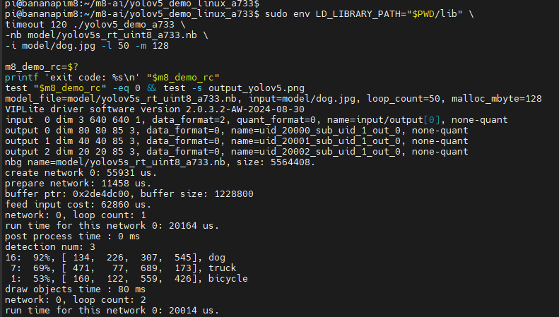

. Retrieve the result image on the development PC.
+
[source,bash]
----
scp "$M8_TARGET:~/m8-ai/yolov5_demo_linux_a733/output_yolov5.png" ./
----

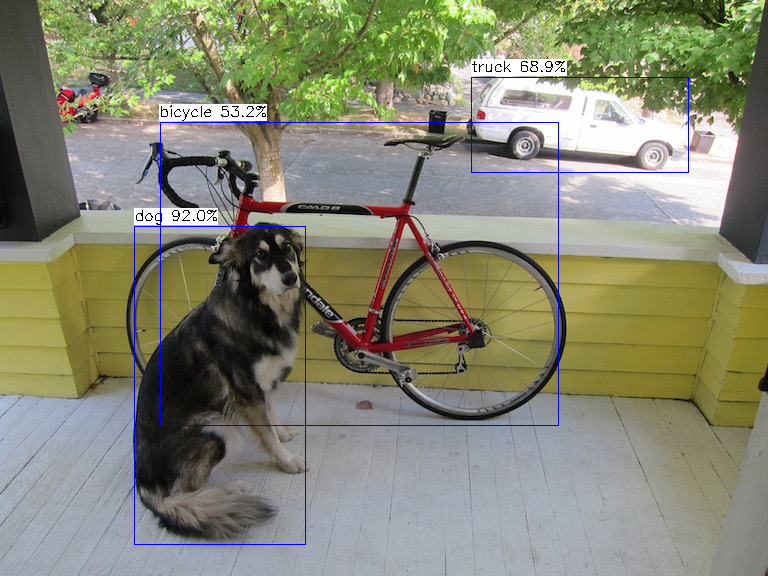

To use your own image, replace `-i model/dog.jpg` with the corresponding JPG path.

=== Other Examples

See the `README.md` in each directory for instructions on the other examples:

* Image classification: `examples/mobilenetv2` and `examples/resnet50v2`.
* Object detection: `examples/yolov8` and `examples/yolo11`.
* Image segmentation: `examples/yolov8_seg` and `examples/ppseg`.
* Human pose estimation: `examples/yolov8_pose`.
* Text detection and recognition: `examples/ppocr`; license plate recognition: `examples/LPRNet`.

Select `a733` as the build platform for M8. For more information, see `docs/NPU_快速入门_开发指南.pdf` in the package.

= Pin Definitions

NOTE: Disconnect the power before connecting cables or expansion boards, and check the pin 1 position of each connector.

.40-pin GPIO
[%collapsible]
====
[options="header",cols="1,2",width="70%"]
|===
| Pin Number | Pin Name
| 1  | DCDC1
| 2  | VBUS-AXP318
| 3  | PJ23/TWI7-SDA
| 4  | VBUS-AXP318
| 5  | PJ22/TWI7-SCK
| 6  | GND
| 7  | PL05/PWM0-3
| 8  | PB00/UART2-TX
| 9  | GND
| 10 | PB01/UART2-RX
| 11 | PL12/S-UART1-TX
| 12 | HD-PIN12
| 13 | PL13/S-UART1-RX
| 14 | GND
| 15 | PL06/S-UART0-TX
| 16 | PB02/UART2-RTS
| 17 | DCDC1
| 18 | PB03/UART2-CTS
| 19 | PJ25/SPI3-MOSI
| 20 | GND
| 21 | PJ26/SPI3-MISO
| 22 | HD-PIN22
| 23 | PJ24/SPI3-CLK
| 24 | HD-PIN24
| 25 | GND
| 26 | PJ27/SPI3-CS0
| 27 | HD-PIN27
| 28 | HD-PIN28
| 29 | PL07/S-UART0-RX
| 30 | GND
| 31 | HD-PIN31
| 32 | HD-PIN32
| 33 | HD-PIN33
| 34 | GND
| 35 | HD-PIN35
| 36 | HD-PIN36
| 37 | HD-PIN37
| 38 | HD-PIN38
| 39 | GND
| 40 | HD-PIN40
|===
====

.MIPI CSI-A
[%collapsible]
====
[options="header",cols="1,2",width="70%"]
|===
| Pin Number | Pin Name
| 1  | MCSIA-D3N
| 2  | MCSIA-D3P
| 3  | GND
| 4  | MCSIA-D2N
| 5  | MCSIA-D2P
| 6  | GND
| 7  | NC
| 8  | NC
| 9  | GND
| 10 | MCSIA-D1N
| 11 | MCSIA-D1P
| 12 | GND
| 13 | MCSIA-D0N
| 14 | MCSIA-D0P
| 15 | GND
| 16 | MCSIA-CKN
| 17 | MCSIA-CKP
| 18 | GND
| 19 | PE00/MCSI-A-MCLK
| 20 | PE06/MCSI-A-STBY
| 21 | PE07/MCSI-A-RST
| 22 | PE10/TWI4-SCK
| 23 | PE11/TWI4-SDA
| 24 | GND
| 25 | NC
| 26 | NC
| 27 | NC
| 28 | NC
| 29 | NC
| 30 | VCC1V8_CSI0
| 31 | GND
| 32 | GND
| 33 | VCC3V3_CSI0
| 34 | VCC3V3_CSI0
| 35 | VCC3V3_CSI0
| 36 | GND
| 37 | GND
|===
====

.MIPI CSI-B
[%collapsible]
====
[options="header",cols="1,2",width="70%"]
|===
| Pin Number | Pin Name
| 1  | MCSIB-D3N
| 2  | MCSIB-D3P
| 3  | GND
| 4  | MCSIB-D2N
| 5  | MCSIB-D2P
| 6  | GND
| 7  | NC
| 8  | NC
| 9  | GND
| 10 | MCSIB-D1N
| 11 | MCSIB-D1P
| 12 | GND
| 13 | MCSIB-D0N
| 14 | MCSIB-D0P
| 15 | GND
| 16 | MCSIB-CKN
| 17 | MCSIB-CKP
| 18 | GND
| 19 | PE05/MCSI-B-MCLK
| 20 | PE08/MCSI-B-STBY
| 21 | PE09/MCSI-B-RST
| 22 | PE03/TWI3-SCK
| 23 | PE04/TWI3-SDA
| 24 | GND
| 25 | AP-NMI
| 26 | PMU-PWRON
| 27 | AP-RESET
| 28 | PMU-SCK
| 29 | PMU-SDA
| 30 | VCC1V8_CSI1
| 31 | GND
| 32 | GND
| 33 | VCC3V3_CSI1
| 34 | VCC3V3_CSI1
| 35 | VCC3V3_CSI1
| 36 | GND
| 37 | GND
|===
====

.PCIe/DP
[%collapsible]
====
[options="header",cols="1,2",width="70%"]
|===
| Pin Number | Pin Name
| 1  | COMB1-TX0P
| 2  | COMB1-TX0N
| 3  | GND
| 4  | COMB1-RX0P
| 5  | COMB1-RX0N
| 6  | GND
| 7  | COMB1-REFP
| 8  | COMB1-REFN
| 9  | GND
| 10 | DP_TX0P
| 11 | DP_TX0N
| 12 | GND
| 13 | DP_TX1P
| 14 | DP_TX1N
| 15 | GND
| 16 | DP_AUXP
| 17 | DP_AUXN
| 18 | DP_HPD
| 19 | HOST-D4M
| 20 | HOST-D4P
| 21 | GND
| 22 | PCIE-PERSTn-3p3V
| 23 | PCIE-WAKEn-3p3v
| 24 | PCIE-CLKREQn-3p3v
| 25 | PCIE-PWREN-3p3v
| 26 | VDD1P8V-PCIe
| 27 | GND
| 28 | GND
| 29 | VDD5P0V-PCIe
| 30 | VDD5P0V-PCIe
| 31 | VDD5P0V-PCIe
| 32 | GND
| 33 | GND
|===
====

.MIPI DSI0
[%collapsible]
====
[options="header",cols="1,2",width="70%"]
|===
| Pin Number | Pin Name
| 1  | MIPI-DSI0-D0N
| 2  | MIPI-DSI0-D0P
| 3  | GND
| 4  | MIPI-DSI0-D1N
| 5  | MIPI-DSI0-D1P
| 6  | GND
| 7  | MIPI-DSI0-CKN
| 8  | MIPI-DSI0-CKP
| 9  | GND
| 10 | MIPI-DSI0-D2N
| 11 | MIPI-DSI0-D2P
| 12 | GND
| 13 | MIPI-DSI0-D3N
| 14 | MIPI-DSI0-D3P
| 15 | GND
| 16 | GPADC6
| 17 | PD18/LCD-PWREN
| 18 | PD21/LCD-RST
| 19 | PD19/LCD-BLEN
| 20 | PD22/LCD-PWM
| 21 | GND
| 22 | PD23/TP-INT
| 23 | PD20/TP-RST
| 24 | PD16/TWI2-SCK
| 25 | PD17/TWI2-SDA
| 26 | VDD1P8V-DSI0
| 27 | GND
| 28 | GND
| 29 | VDD5P0V-DSI0
| 30 | VDD5P0V-DSI0
| 31 | VDD5P0V-DSI0
| 32 | GND
| 33 | GND
|===
====
