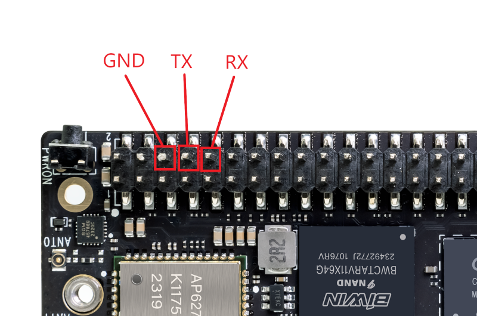

. **How do I connect the serial cable?**
+
Most boards have a 3-pin debug header. Connect the serial cable to this header.
+
|====
|Board|Serial Cable
|GND|GND
|RX|TX
|TX|RX
|====
+
If your serial cable has a molded enclosure with no labels, you can identify the wires by their colors. +
Red is VCC and does not need to be connected; black is GND; green is RX; white is TX. Connect the wires according to the table above.
+
If the board does not have a dedicated 3-pin debug header, you can use its 40/26/20-pin header instead. It contains at least one TX/RX pair. (A white dot marks pin 1 at its front or left side. The pin to its right is pin 2; count the remaining pins in order.)
+
Examples: BPI-M7 and BPI-M2M
+
|====
|Pin|Board|Serial Cable
|6|GND|GND
|8|TX|RX
|10|RX|TX
|====
+

+

. **What is the serial baud rate?**
+
Boards with RK chips use a baud rate of 1500000; all others use 115200.

. **Serial output suddenly stops during boot**
+
First, press Enter to see whether the serial terminal responds. If it does, the system has not frozen and is still booting. Some images hide the boot log.
Others may be waiting for you to create a user account.

. **Create a user account**
+
Most images do not require you to create a user account. Only Armbian images and desktop images for some systems require you to create one manually. Some use the serial terminal for account creation, while others use the HDMI display. It is therefore recommended to connect both serial and HDMI before booting. +

. **A jffs2 error appears when booting an SD card image**
+
This error generally occurs with OpenWrt. Perform a low-level format of the SD card, then flash the image again to avoid the jffs2 error. (If you have time to spare, leave it running and wait for the scan to finish.)

. **An error occurs when running a command**
+
If you follow the Wiki instructions and receive a "permission denied" error, you do not have the required permissions. Add sudo before the command or switch to the root user.
