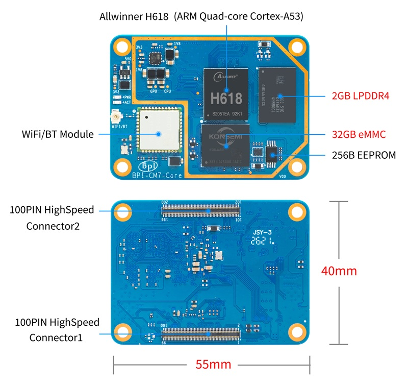

= BPI-CM7 简介

Banana Pi BPI-CM7 是一款基于 Allwinner H618 的计算模块，配备 LPDDR4 内存、eMMC 存储、K019 Wi-Fi 5/蓝牙 5.0 模块以及两个 100 针板对板连接器。

TIP: Allwinner H618 方案 : link:/zh/BPI-M4_Berry/BananaPi_BPI-M4_Berry[Banana Pi BPI-M4 Berry] 单板计算机 +
Allwinner H618 方案：link:/zh/BPI-M4_Zero/BananaPi_BPI-M4_Zero[Banana Pi BPI-M4 Zero] 单板计算机 +
Allwinner H618 方案：link:/zh/BPI-CM7/BananaPi_BPI-CM7[Banana Pi BPI-CM7] 计算机模组

== 主要特性

* Allwinner H618 四核 64 位 Arm Cortex-A53 处理器，高达 1.5 GHz
* Arm Mali-G31 GPU
* 板载 LPDDR4 内存
* 板载 eMMC 存储
* K019 Wi-Fi 5 和蓝牙 5.0 模块
* HDMI 输出
* 10/100M Ethernet
* 1 个 USB 2.0 OTG 和 3 个 USB 2.0 Host 接口
* microSD 接口
* 2 个 100 针板对板连接器
* GPIO、UART、TWI/I2C、SPI、PWM、I2S/PCM、DMIC、SPDIF 和 IR
* 5 V 电源输入

== 快速入门

TIP: link:/zh/BPI-CM7/GettingStarted_BPI-CM7[BPI-CM7 快速入门]

= 硬件

== 硬件接口

== 硬件规格

[options="header",cols="1,3"]
|===
| 项目 | 规格参数

| SoC
| Allwinner H618

| CPU
| 四核 64 位 Arm Cortex-A53，高达 1.5 GHz

| GPU
| Arm Mali-G31

| 内存
| 板载 LPDDR4；容量取决于产品型号

| 存储
| 板载 eMMC；容量取决于产品型号

| 无线
| K019 Wi-Fi 5 和蓝牙 5.0 模块，配备 U.FL/IPEX 天线接口

| 显示
| HDMI 输出

| 网络
| 10/100M Ethernet

| USB
| 1 个 USB 2.0 OTG 和 3 个 USB 2.0 Host 接口

| 扩展
| 2 个 100 针板对板连接器

| 电源
| 5 V 输入
|===

== BPI-CM7 模块引脚定义

TIP: link:/zh/BPI-CM7/GettingStarted_BPI-CM7#_bpi_cm7_模块引脚定义[查看 BPI-CM7 入门指南末尾的模块引脚定义]

== BPI-CM7 IO 板

link:/zh/BPI-CM7IO/BananaPi_BPI-CM7IO[Banana Pi BPI-CM7IO 扩展板]

= 开发

== 源代码

=== Android 12

NOTE: https://github.com/BPI-SINOVOIP/BPI-H618-Android12

=== Linux

NOTE: https://github.com/BPI-SINOVOIP/armbian-build/tree/bpi-v24.11.01

== 资源

NOTE: link:/zh/BPI-CM7IO/BananaPi_BPI-CM7IO[Banana Pi BPI-CM7IO 扩展板]

NOTE: link:/zh/BPI-M4_Zero/BananaPi_BPI-M4_Zero[Banana Pi BPI-M4 Zero]

= 系统镜像

== Android
NOTE: 2026-10-19-bananapi-cm7-android12.img

Baidu cloud： https://pan.baidu.com/s/10CyF5D5vNBJfR-KoXMyMHw?pwd=8888 (提取码: 8888)

Google drive： https://drive.google.com/file/d/1EcKliKVlpU_EKsi5vfFXBXw9AOvlJyAX/view?usp=sharing

== Linux
NOTE: Bananapi-Armbian_24.11.1_Bpi-cm7_jammy_legacy_5.4.125_xfce_desktop.img.xz

Baidu cloud： https://pan.baidu.com/s/1d7Ic8uTNZIDl26J2F4F-0Q?pwd=8888 (提取码: 8888)

Google drive： https://drive.google.com/file/d/18CrBgRDMTZfu47roedXy5rOc5B9YUUFs/view?usp=sharing

= 样品购买
WARNING: OEM&ODM, please contact: judyhuang@banana-pi.com