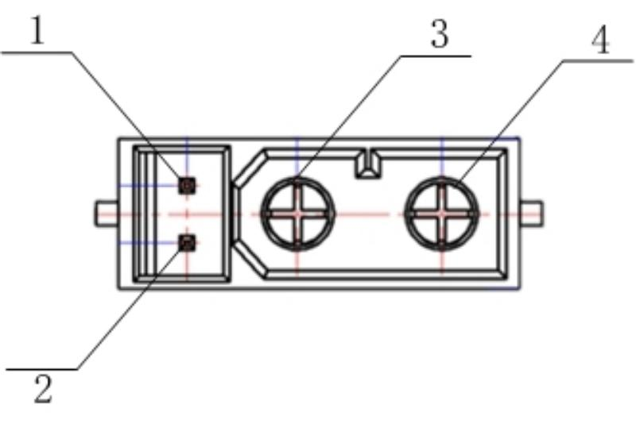

= 介绍

BPI-JC10是一个面向机器人关节电机应用的全开源驱动板项目。核心采用峰岹科技FU7512L双核电机控制MCU与FD6288Q三相栅极驱动芯片，原生支持CAN/CAN FD，板载双编码器，支持全闭环控制与MIT模式，专为协作机器人关节、一体化伺服电机、外骨骼及轮足机器人等场景打造。

== 关于FU7512L
峰岹科技的FU75xx系列业界首款基于32位RISC-V双核架构的电机驱动专用MCU，这款芯片不仅融合了高性能计算与实时控制能力，更通过自主研发的第2代ME内核，解决了复杂应用场景中的诸多挑战。无论是工业伺服驱动器、机器人关节，还是智能家电、新能源汽车，它都将为电机控制带来前所未有的新体验！ 

FU75xx系列MCU融合了第二代电机控制引擎（ME2）与32位RISC-V内核，通过创新的异构架构，为高性能电机应用提供理想解决方案。

* ME2：硬件集成专用、灵活的算法模块，用户可以直接调用，或自主软件替换，效率远超纯软件实现。相较于第一代ME性能显著提升，功能模块增加100%！
* RISC-V：灵活处理系统通信、应用逻辑及用户界面等功能。

两者无缝协同，应对多变应用场景提供充足底气。伺服场景下FOC运算时间仅需5us！

== 主要特征

. RSIC-V 32bit内核

* ME2 第二代电机控制引擎
（支持硬件FOC模块、电流环双采样、硬件度环、硬件PI、硬件CORDIC模块、硬件4级可配置滤波器等）

* 50M主频

* 64K Flash、12K SRAM

* 芯片节温(Tj)：-40 ~ 150℃，工作温度(Ta)：-40 ~ 125℃

. 板卡：
* 支持CAN/CANFD通信(CANFD仲裁域波特率1MBit/s，仲裁域波特率5Mbit/s)
* 板载双编码器，支持全闭环控制
* 原生支持MIT控制
* 板卡尺寸ø60mm

. 模组：
* 额定电压48V，额定电流6Arms，峰值电流28Arms
* 额定扭矩6Nm，峰值扭矩18Nm
* 减速比7.75 : 1

== 主要应用

. 双编码器全闭环位置控制 · 高精度 · 断电不丢位；
. 原生 CAN FD + MIT 模式 · 为高频动态控制而生；
. 40A 峰值电流 · 高动态负载下闭环稳定，过载保护不失控；
. 伺服 / 电机 / 减速器三合一 · 结构紧凑 · 更小更轻；
. 专业伺服上位机，图形化调试。

== 快速入门

TIP: link:/zh/BPI-JC10/GettingStarted_BPI-JC10[BPI-JC10 快速入门]

= 硬件

== 硬件接口示意图

== 产品图片

== 硬件规格描述
[options="header",cols="1,5"]
|====
2+| 香蕉派 BPI-VP10 硬件规格
| 项目     | 描述
| MCU-FU7512L     | FU7512L，峰岹科技自研双核MCU，基于 32位RISC-V核和电机控制引擎ME2核
| 预驱芯片FD6288Q       | FD6288，峰岹科技自研预驱，集成三个独立半桥栅极驱动
| 磁编码器          | KTH7112，编码器位置反馈
| MOS      | ZMS026N10HNC                                             
| 代码下载接口   | 代码下载到MCU完成调试                      
| CANFD接口  | 用于连接关节模组上位机调试及外部CAN/CANFD控制                   
| U/V/W      | 关节电机动力线U/V/W焊点                
| 电源接口     | 关节模组电源接口             
|指示灯    | 红灯常亮显示通电，红灯闪烁显示故障                                           
|====

== CANFD/电源接口定义

[cols="2*", options="header"]
|================
| 接口引脚 | 功能 
| 1   | CAN_H    
| 2   | CAN_L  
| 3   | GND    
| 4   | 48V           
|================

= 开发
== 软件源代码

== 参考资料

= 样品购买

