= 接线说明

参考下面依次接上电源线、CAN调试线。48V直流电源，电源线红色接48V，黑色接0V。CAN调试线，红色接CAN_H，黑色接CAN_L。

主电源接通前，请再次确认电源线正负向是否正确连接。

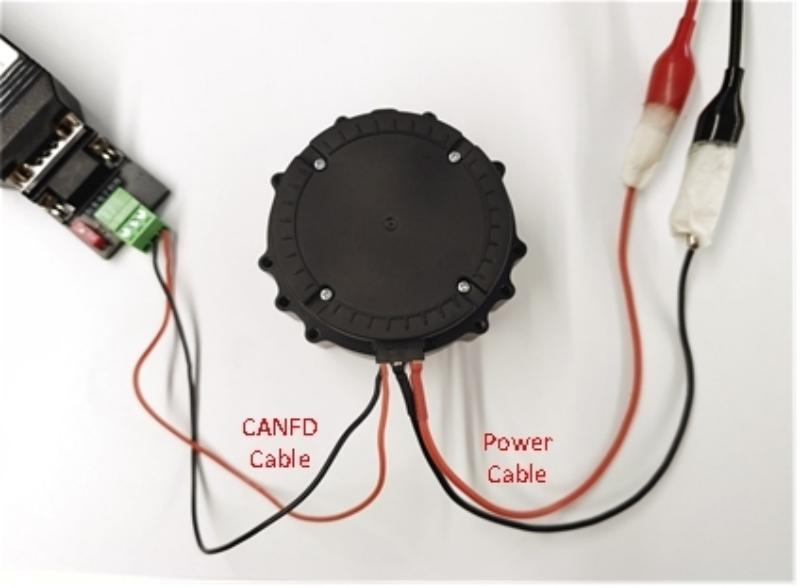

= 试运行调试

试运行调试使用上位机软件FortiorTechServoStudio。

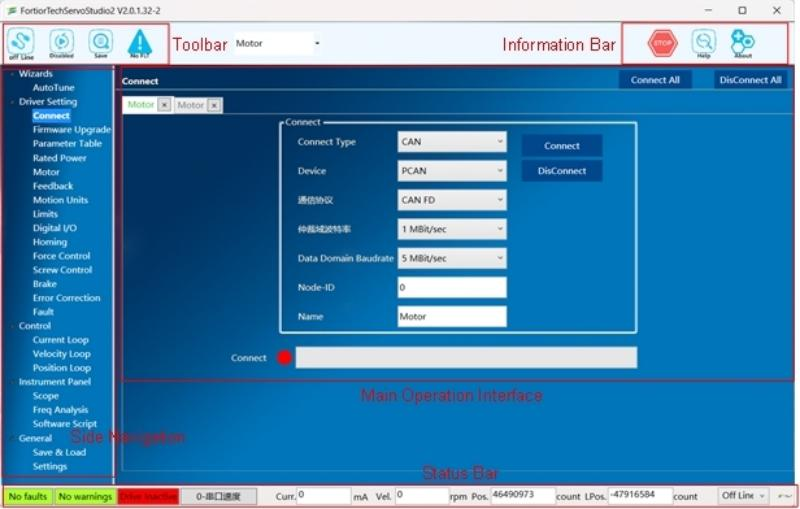

== 通信连接

. 安装CAN驱动程序；
. 使用CAN调试线连接PC和驱动器；
. 双击打开FortiorTechServoStudio.exe，在侧边导航栏，点击“连接”子菜单；
. 连接类型选择CAN，选择相应的CAN设备，通信协议选择CANFD,仲裁域波特率选择1MBit/s，数据域波特率选择5MBit/s；(注：上位机支持PCAN、VCICAN、ZLGCAN等CAN连接设备，其中PCAN 、ZLGCAN 支持CANFD
)
+
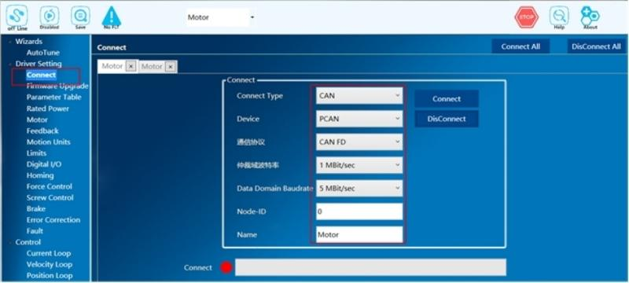

. 点击“连接”按钮，实现通信连接。
+
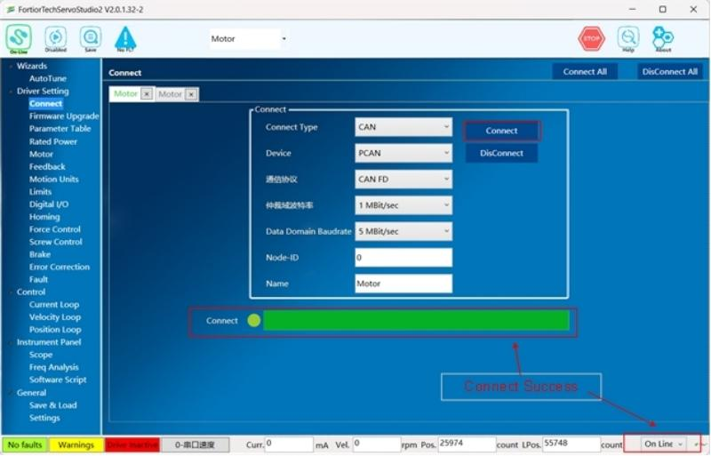

== 导入参数

第一次使用伺服驱动模块，可以先导入参数：

. 在侧边导航栏，点击 “备份与恢复”子菜单；
. 点击“导入参数”，选择附件中的.rpc文件，稍等片刻，弹出“导入参数成功”的提示框；
+
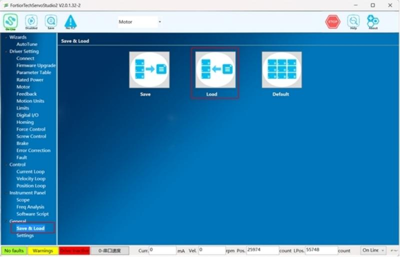

. 在上方工具栏，点击 “Save”按钮，保存参数到驱动器Flash。
+ 

== 寻找相位角

寻找相位角步骤：

. 在侧边导航栏，点击“反馈”子菜单；
. “寻相方式”选择“8-AutoPhase”，寻相电流设为3A；
. 点击“寻找相位角”按钮。
. 寻相结束后会弹出框提示寻相成功，如果寻相失败，可以提高寻相电流再试试，检查一下电机及反馈参数设置是否正确，编码器读数是否正常。
+
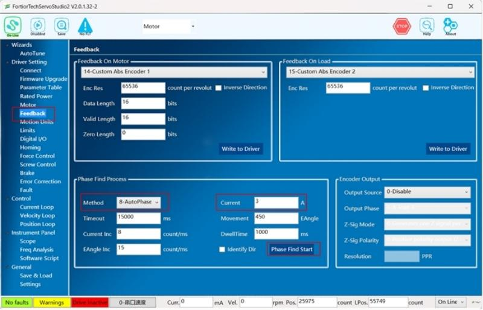

== 跑电机

由于刚才导入的参数文件已经把三环增益调好了，所以这时可以跳过调增益环节直接跑位置环，
跑位置环步骤：

. 示波器“采样点数”设为10000，“时间间隔”设为21；
. 示波器记录变量勾选命令位置CMDPOS、实际位置ACTPOS、命令电流CMDCUR、实际电流ACTCUR；
. 点击示波器“连续采样”按钮，开始采集波形；
. “运行模式”选择 “5-串口位置”；
. “曲线模式”和“运动指令”中选择“T形曲线”/“S形曲线”，选择“绝对”，“往返”，“重复”；
. “目标位置”、 “目标位置2”取一个合适的移动距离，“速度”设为额定速度的40%，“加速度”取一个偏小的值，“时间”设为1000ms；
. 点击上方工具栏“Enable”，使能位置环；
. 点击“开始”，电机开始运行。

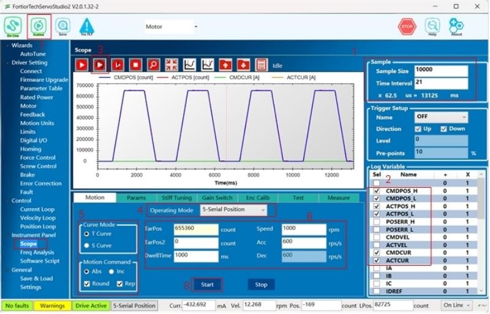

== MIT控制

模式选择，在示波图界面-运动模块的运行模式选择“12- MIT控制”，确定当前控制模式正确。

=== MIT位置控制

. “运行模式”选择 “12-MIT控制”；
. 选择示波器“采样点数”设为10000，“时间间隔”设为21；
. 示波器记录变量勾选命令位置CMDPOS、实际位置ACTPOS；
. 点击示波器“连续采样”按钮，开始采集波形；
. 需要设置MIT参数如下：KP设成50、KD设成200，目标电流设为 0、目标速度设为 0、设置目标位置，设置目标位置2。（注：该模式下KD不能为0，也不能太小，否则可能导致电机强烈震荡）
. “曲线模式”和“运动指令”中选择“T形曲线”/“S形曲线”，选择“绝对”，“往返”，“重复”， 轨迹到达的“停顿时间”。
. 点击上方工具栏“Enable”，使能；
. 点击“开始”，电机开始运行。

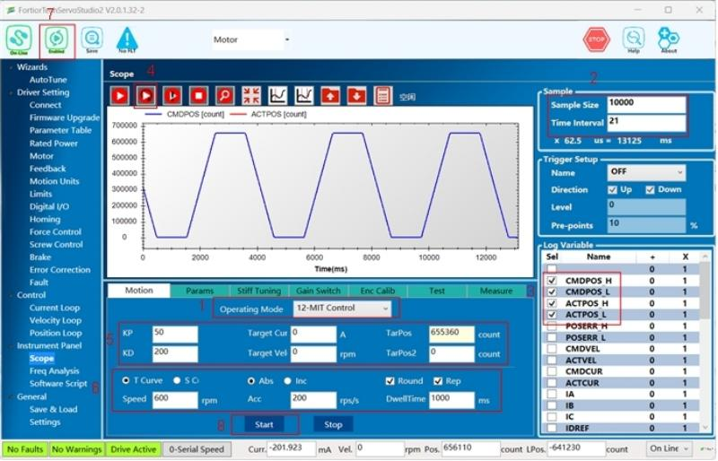

=== MIT速度控制

. “运行模式”选择 “12-MIT控制”；
. 选择示波器“采样点数”设为10000，“时间间隔”设为21；
. 示波器记录变量勾选命令位置CMDVEL、实际位置ACTVEL；
. 点击示波器“连续采样”按钮，开始采集波形；
. 需要设置MIT参数如下：KP设成0、KD设成250，目标电流设为 0、目标速度设为 600、目标位置设为0，目标位置2设为0。（注：该模式下KD不能太大，否则可能导致电机强烈震荡）
. 点击上方工具栏“Enable”，使能；
. 点击“开始”，电机开始运行。

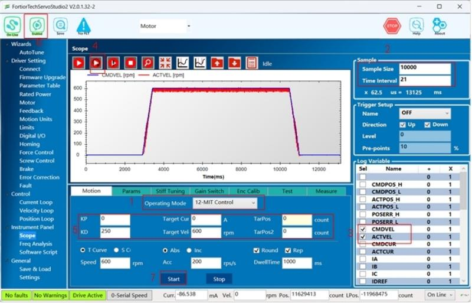

=== MIT电流控制

. “运行模式”选择 “12-MIT控制”；
. 选择示波器“采样点数”设为10000，“时间间隔”设为21；
. 示波器记录变量勾选命令位置CMDCUR、实际位置ACTCUR；
. 点击示波器“连续采样”按钮，开始采集波形；
. 需要设置MIT参数如下：KP设成0、KD设成0，目标电流设为0.35、目标速度设为 0、目标位置设为0，目标位置2设为0。（注：空载时，该模式下目标电流不宜设的太大，否则电机转速会过高。）
. 点击上方工具栏“Enable”，使能；
. 点击“开始”，电机开始运行。

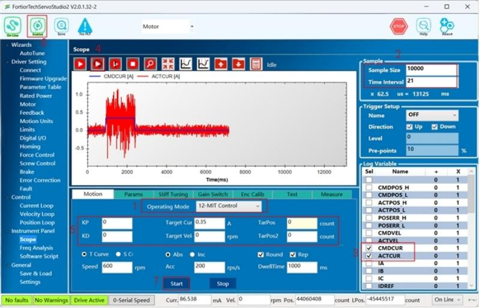

= 更新程序

. 如果需要更新下位机程序，需要用峰岹的编程环境FTM32ForgeIDE通过峰岹仿真器来下载新的程序。
+
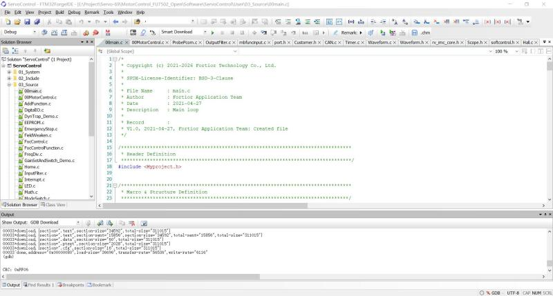

. 请先到 https://www.fortiortech.com/en/download/FTM32ForgeIDE 下载峰岹FTM32ForgeIDE，安装选项都选择默认。
+
用峰岹的仿真器连接板子的下载口，接线定义如下：
+
[cols="2*", options="header"]
|================
| Emulator | Board Download Port 
| VDD   | V    
| FICEK   | K  
| FICED   | D    
| GND   | G           
|================
+
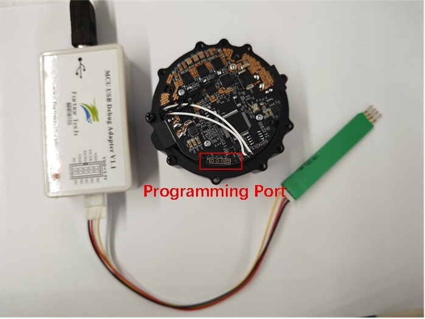

. 双击.ftproj打开工程
+
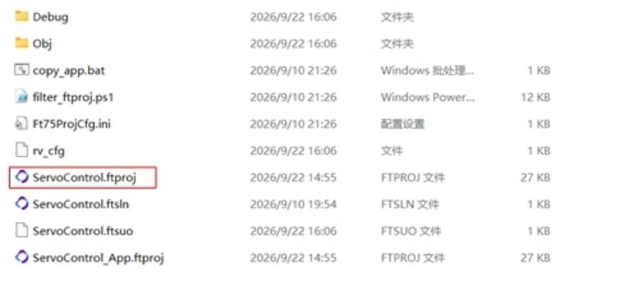

. 点击按钮对代码进行编译
+
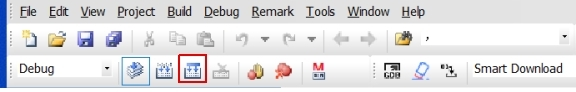

. 编译成功后输出窗口 Output 显示 “Build Project successfully”
+
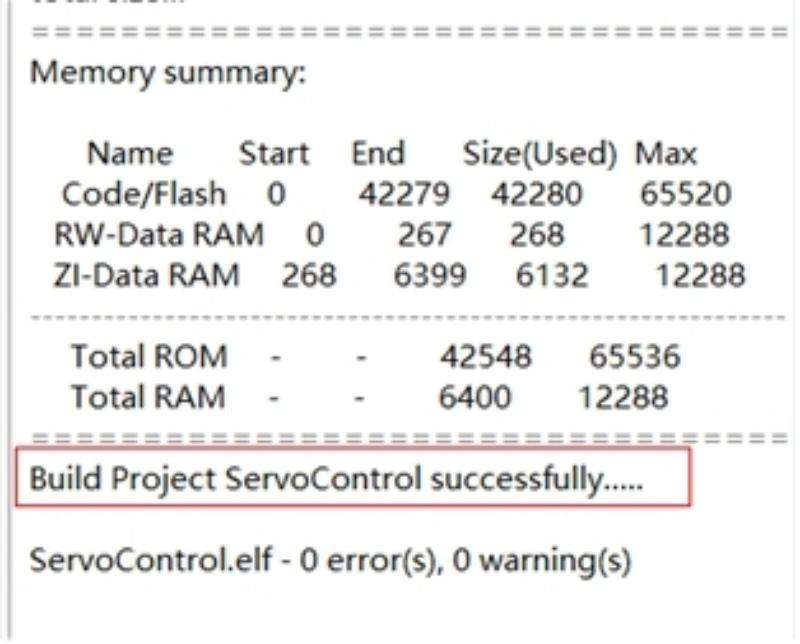

. 点击按钮，将程序下载到板子
+
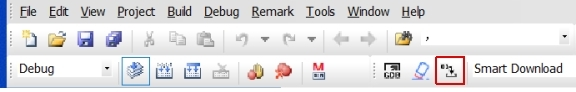

. 等下载进度条达到 100%时，表明程序代码已成功下载到芯片中，
+
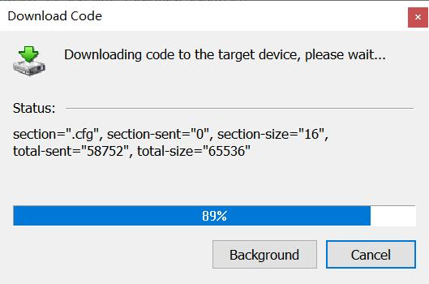

. 下载成功后输出窗口 Output ，CRC显示非零表示校验成功。
+
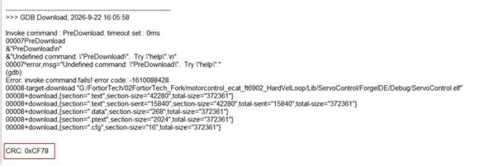

