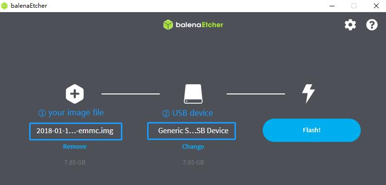

== 简介

Banana Pi BPI-M2C 是香蕉派新一代的单板计算机，搭载紫光展锐（Unisoc）uis7885 处理器。板载 4GB LPDDR4 内存和 128GB eMMC 存储，支持 4 个 USB 2.0 接口、1 个千兆网口、耳机接口、扬声器接口，并集成了 5G 和 WCN（无线连接）功能。

TIP: 更多信息请访问： link:/en/BPI-M2C/BananaPi_BPI-M2C[Banana Pi BPI-M2C]

= 开发指南
== 准备工作

- 准备一张 8G 或以上容量的 TF 卡、USB 转串口线、Ubuntu 系统电脑。

- 5V3A Type-C 电源适配器。

- 下载工具：

* Windows 系统：ResearchDownload

* Linux 系统：Yunji

* 或者开源烧录工具：link:https://etcher.balena.io/[balenaEtcher]

- link:/en/BPI-M2C/BananaPi_BPI-M2C#_system_image[下载需要烧录的系统镜像]

- 使用 USB 转串口线（3.3V TTL，波特率=921600）连接到 BPI-M2C 的调试控制台。接线：G=GND；RX=接 BPI-M2C 的输入（TX）；TX=接 BPI-M2C 的输出（RX）。

== 使用 SD 卡安装镜像（方法一）

使用 balenaEtcher 工具烧录 SD 卡镜像。

. 下载 SD 卡镜像。（可以选择 .zip、.xz、.gz 和 .bz2 等格式；但像 .tar.gz 或 .tar.xz 这种复合压缩包必须先解压。）
. 使用 SDFormatter 工具格式化 TF 卡。
. 打开 balenaEtcher，选择你要烧录的镜像文件，选择你的 TF 卡，然后点击开始烧录。（请务必确保选择了正确的 TF 卡。）



== 使用 SD 卡安装镜像（方法二）

使用 ResearchDownload 工具烧录 PAC 包。

. 下载 SD 卡镜像。（如果是压缩包，请提前解压。）
. 将开发板背面的 SD 拨码开关拨到 ON 的位置。
. 打开工具，点击 "Load packet"（加载包），选择你要烧录的 PAC 包。
+

. 点击 "Settings"，然后点击 "Options"，勾选 "Repartition"（重新分区）、"Keep Charge"（保持充电）和 "Power Off"（关机）。

== 安装镜像到 eMMC


== 备份 NV 数据等文件

== 查询系统信息

```sh
uname -a
cat /etc/os-release
cat /proc/cpuinfo | head
cat /proc/meminfo | head
df -h
```

== 调试

当前内核控制台参数如下：

[cols="1,1",options="header"]
|===
|参数 |设置

|设备
|ttyS1

|波特率
|921600

|数据格式
|8N1（8 个数据位，无校验，1 个停止位）

|流控
|关闭
|===

在 Linux 主机上，你可以使用 `picocom`：


```
sudo picocom -b 921600 /dev/ttyUSB0
```

或者，你可以使用 `minicom`、`PuTTY` 或 `MobaXterm`；在每种情况下，将设置配置为 `921600 8N1` 并确保关闭硬件流控。

== 千兆以太网

将网线连接到 BPI-M2C。当前系统将初始化 eth0 并尝试通过 DHCP 获取 IP 地址。

检查接口状态和 IP 地址：

[source,shell]
```
ip link show eth0
ip addr show eth0
ip route
```

要手动请求新的 DHCP 地址，请运行以下命令：

```
ip link set eth0 up
udhcpc -i eth0
```

```
cat /sys/class/net/eth0/operstate
cat /sys/class/net/eth0/speed
cat /sys/class/net/eth0/duplex
```

== Wi-Fi

首先，检查无线接口：

```
ip link show wlan0
ps | grep -E '[h]ostapd|[w]pa_supplicant'
```

检查当前工作模式：

```
iw dev wlan0 info
wpa_cli -i wlan0 status 2>/dev/null
```

要将 wlan0 配置为无线热点——或者在切换到标准 Wi-Fi 客户端模式之前——你应该首先停止任何当前正在使用该接口的 hostapd 实例:

```
/etc/init.d/hostapd stop 2>/dev/null || true
killall wpa_supplicant 2>/dev/null || true
```

生成 WPA Supplicant 配置文件。运行命令后，根据提示输入你的 Wi-Fi 密码；密码不会在终端中显示：

```
wpa_passphrase "Your Wi-Fi Name" > /tmp/wpa_supplicant.conf
chmod 600 /tmp/wpa_supplicant.conf
```

连接到无线网络并通过 DHCP 获取 IP 地址：

```
ip link set wlan0 up
wpa_supplicant -B -i wlan0 -c /tmp/wpa_supplicant.conf
udhcpc -i wlan0
```

连接后，检查 IP 地址和路由：

```
ip addr show wlan0
ip route
ping -c 4 8.8.8.8
```

检查连接状态和当前接入点（AP）：

```
wpa_cli -i wlan0 status
iw dev wlan0 link
```

断开或重新连接：

```
wpa_cli -i wlan0 disconnect
wpa_cli -i wlan0 reconnect
```

重新扫描网络：

```
wpa_cli -i wlan0 scan
sleep 3
wpa_cli -i wlan0 scan_results
```

== 蓝牙

bluetoothd 守护进程在系统启动时运行；控制器通常被标识为 hci0。

检查蓝牙服务和控制器：

```
ps | grep '[b]luetoothd'
bluetoothctl list
bluetoothctl show
```

如果控制器未上电：

```
bluetoothctl power on
```

=== 搜索、配对和连接设备

进入交互模式：

```
bluetoothctl
```

依次输入以下命令：

```
power on
agent on
default-agent
scan on
```

等待目标设备出现，记下它的 MAC 地址（例如 11:22:33:44:55:66），然后执行：

```
pair 11:22:33:44:55:66
trust 11:22:33:44:55:66
connect 11:22:33:44:55:66
info 11:22:33:44:55:66
scan off
quit
```

在配对过程中，按照终端中的提示确认 PIN 码，或验证两台设备上显示的数字是否匹配。HID 设备（如键盘和鼠标）通常在成功连接后即可使用。断开或移除设备：

```
bluetoothctl disconnect 11:22:33:44:55:66
bluetoothctl remove 11:22:33:44:55:66
```

=== 使用蓝牙音箱或耳机

连接 A2DP 音频设备后，PulseAudio 会创建一个名称以 `bluez_sink` 开头的输出设备：

```
pactl list short sinks
```

将完整的 `bluez_sink...` 名称（如输出所示）设置为默认输出：

```
pactl set-default-sink bluez_sink.11_22_33_44_55_66.a2dp_sink
paplay /mnt/data/test.wav
```

上面使用的 sink 名称只是一个示例；你必须从 pactl list short sinks 的输出中复制实际的名称。如果没有出现蓝牙 sink，请确认设备支持 A2DP、已正确连接，并且已加载 PulseAudio 的蓝牙模块：

```
pactl list short modules | grep bluetooth
```

== SSH

确认你的开发电脑和 BPI-M2C 可以互相通信后，在你的开发电脑上执行以下命令：

```
ssh root@xxx.xxx.xxx.xxx
```

首次连接时，将显示主机指纹。验证地址正确后，输入 `yes`。

[IMPORTANT]
====
串口控制台允许空密码登录，并不意味着 SSH 也允许。
如果 SSH 返回 Permission denied（权限被拒绝）错误，请通过串口控制台为用户账号设置密码并重试：**passwd**

请勿在可被不可信设备访问的网络上使用空密码或弱密码。
====

如果无法连接，请依次检查以下内容：

```
ip addr show eth0
ps | grep '[s]shd'
netstat -lnt 2>/dev/null | grep ':22'
```

如果 SSH 服务未运行，你可以尝试从串口控制台终端启动它：

```
/etc/init.d/sshd start
```

== 使用 SCP 传输文件

从开发电脑复制文件到开发板

```
scp example.bin root@xxx.xxx.xxx.xxx:/tmp/
```

从开发板复制文件到开发电脑

```
scp root@xxx.xxx.xxx.xxx:/var/log/messages ./
```

复制目录时请使用 -r 参数。

== 检查 CPU、内存和存储

```
cat /proc/cpuinfo
cat /proc/meminfo | head
lsblk
df -h
mount
```

== 检查温度

列出温度传感器：

```
for zone in /sys/class/thermal/thermal_zone*; do
printf '%s: ' "$(cat "$zone/type" 2>/dev/null)"
cat "$zone/temp" 2>/dev/null
done
```

对于大多数节点，数值以千分之一摄氏度为单位（例如 45000 表示约 45 °C）；具体含义请参考每个节点关联的 type。

== USB

插入 USB 设备后，运行以下命令：

```
dmesg | tail -n 30
lsusb
lsblk
```

挂载 U 盘的示例：

```
mkdir -p /mnt/usb
mount /dev/sda1 /mnt/usb
ls -la /mnt/usb
sync
umount /mnt/usb
```

[CAUTION]
====
`/dev/sda1` 只是一个示例。在挂载之前，你必须使用 `lsblk` 或 `dmesg` 验证实际的设备名称。拔出设备前请确保已卸载。
====

== 音频

M2C 板载扬声器接口和 3.5 mm 耳机插孔；默认声卡是 `sprdphone-sc2730`。媒体播放使用 `PCM hw:0,5`，标准录音使用 `PCM hw:0,4`。

=== 默认输出和自动切换

当前配置的行为如下：

* 未插入 3.5 mm 耳机时，音频路由到连接到扬声器接口的扬声器。

* 插入 3.5 mm 耳机时，内核报告 "Headset Jack" 事件，PulseAudio 自动将输出切换到耳机。

* 拔出耳机时，PulseAudio 自动将输出恢复为扬声器接口。

* 四段式（TRRS）耳机插头支持播放和麦克风；三段式（TRS）插头仅支持播放。

要检查声卡、PulseAudio 输出和耳机连接状态，请使用以下命令：

```
cat /proc/asound/cards
aplay -l
pactl list short sinks
cat /sys/class/extcon/extcon1/state
```

未连接耳机时，显示 `HEADPHONE=0`；插入耳机后，应变为 `HEADPHONE=1`。

在 `PulseAudio 15.0` 和 `module-unisoc-card` 环境下，`speaker_output` 和 `headphone_output` 端口不会显式列在 `pactl list sinks` 的输出中。在实际硬件上执行以下命令会报错 `Failure: No such entity`；因此，不要使用这些命令来切换输出：

```
# Not available on M2C
pactl set-sink-port @DEFAULT_SINK@ speaker_output
pactl set-sink-port @DEFAULT_SINK@ headphone_output
```

=== 强制输出到扬声器接口或 3.5 mm 耳机

以下方法涉及直接配置 ALSA 混音器，这对于调试或强制使用特定音频路由很有用。必须在执行这些路由命令之前开始播放。如果你在开始播放之前配置耳机，PulseAudio 在从挂起状态唤醒时会重新启用默认的扬声器路径，导致耳机和扬声器同时发声。例如，首先在后台播放一个长音频文件：

```
gst-launch-1.0 -q playbin uri=file:///mnt/data/music.mp3 &
audio_pid=$!
sleep 1
```

强制切换到 3.5 mm 耳机：

```
tinymix 'Speaker Function' 0
tinymix 'AOL EAR Sel' EAR
tinymix 'DA AOR Switch' 0
tinymix 'AO Mixer AOL Switch' 0
tinymix 'AO Mixer AOR Switch' 0

tinymix 'HP mix mode' 0
tinymix 'DAC LRCLK Select' invert
tinymix 'HPL Mixer DACLHPL Switch' 1
tinymix 'HPR Mixer DACRHPR Switch' 1
tinymix 'HPL EAR Sel' HPL
tinymix 'HP Virt Switch' 1
tinymix 'HeadPhone Function' 1
tinymix 'HP_CROSSTALK_EN' 1
tinymix 'HP_CROSSTALK_GAIN' 16400 16400
```

强制切换到扬声器接口：

```
tinymix 'DAC LRCLK Select' normal
tinymix 'HeadPhone Function' 0
tinymix 'HP Virt Switch' 0
tinymix 'HPL Mixer DACLHPL Switch' 0
tinymix 'HPR Mixer DACRHPR Switch' 0
tinymix 'HPL EAR Sel' EAR
tinymix 'HP mix mode' 1
tinymix 'HP_CROSSTALK_EN' 0
tinymix 'HP_CROSSTALK_GAIN' 0 0

tinymix 'DAC LRCLK Select' invert
tinymix 'AO Mixer AOL Switch' 1
tinymix 'AO Mixer AOR Switch' 1
tinymix 'DA AOR Switch' 1
tinymix 'AOL EAR Sel' AOL
tinymix 'AO Gain AO Playback Volume' 2
tinymix 'Speaker Function' 1
```

要停止在后台开始的播放：

```
kill "$audio_pid"
wait "$audio_pid" 2>/dev/null
```

一旦所有播放流停止，且 PulseAudio sink 进入 SUSPENDED 状态，当前固件将禁用扬声器和耳机的硬件路径。在后续播放期间，系统将根据是否插入耳机自动确定路由。

要调整音量或取消静音：

```
pactl set-sink-volume @DEFAULT_SINK@ 60%
pactl set-sink-mute @DEFAULT_SINK@ 0
```

=== 播放音乐

播放 WAV 文件：

```
paplay /mnt/data/test.wav
```

或者，你可以使用 ALSA 播放 WAV 文件：

```
aplay -D default /mnt/data/test.wav
```

要播放 MP3、AAC、FLAC 或 GStreamer 支持的其他媒体文件：

```
gst-launch-1.0 -q playbin uri=file:///mnt/data/music.mp3
```

按 kbd:[Ctrl+C] 停止播放。正常使用时，系统会根据耳机连接状态自动处理路由；上述 `tinymix` 路由命令仅在调试时用于手动切换。

=== 音频输入与切换

查看可用的音频输入源：

```
arecord -l
pactl list short sources
```

PulseAudio 源不暴露端口；在板子上执行以下命令会报错 Failure: No such entity。不要使用这些命令强制指定特定的音频输入路径：

```
# Not supported on M2C
pactl set-source-port @DEFAULT_SOURCE@ sprd-input-internal-mic
pactl set-source-port @DEFAULT_SOURCE@ sprd-input-headphone-mic
```

对于标准录音，`module-unisoc-card` 会根据耳机检测状态，自动选择板载麦克风或 4 极（TRRS）耳机的麦克风。如果连接了 3 极（TRS）耳机——没有麦克风触点——系统将继续使用板载麦克风录音。

录制 48 kHz、16 位、单声道 WAV 文件（按 kbd:[Ctrl+C] 停止）：

```
mkdir -p /mnt/data/audio
parec --file-format=wav --format=s16le --rate=48000 --channels=1 \
/mnt/data/audio/record.wav
```

回放录音：

```
paplay /mnt/data/audio/record.wav
```

通过直接访问 PCM 设备进行诊断录音（绕过 PulseAudio）：

```
arecord -D hw:0,4 -f S16_LE -r 48000 -c 1 -d 10 \
/mnt/data/audio/record-10s.wav
```

[IMPORTANT]
====
直接访问 hw:0,4 不会自动配置所有必要的输入路由路径。对于常规录音，请优先使用 parec；仅在诊断目的下使用原始 ALSA PCM，且仅在已通过 PulseAudio、UCM 或 tinymix 配置麦克风路由时使用。
====

== 显示与图形界面

使用 Wayland/Weston。检查相关进程：

```
ps | grep -E '[w]eston|[w]ayland'
ls -l /dev/dri/ 2>/dev/null
```

当前软件配置包括一个 800 × 1280 的 MIPI-DSI 显示屏和一个 1920 × 1080 的 HDMI 输出。

== 摄像头

当前 M2C 软件支持 IMX258 传感器，并包含 UniSoc V4L2 适配层、unisv4l2src GStreamer 插件以及名为 UnisocCameraApp 的图形界面应用。对于其他摄像头模块——即使是具有相同连接器类型的模块——你也必须验证引脚定义、电压、时钟设置、设备树配置和驱动程序。

=== 检查摄像头

```
ls -l /dev/video* 2>/dev/null
v4l2-ctl --list-devices
gst-inspect-1.0 unisv4l2src
```


