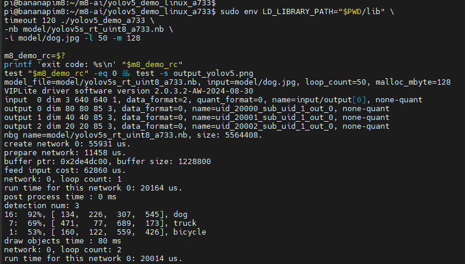
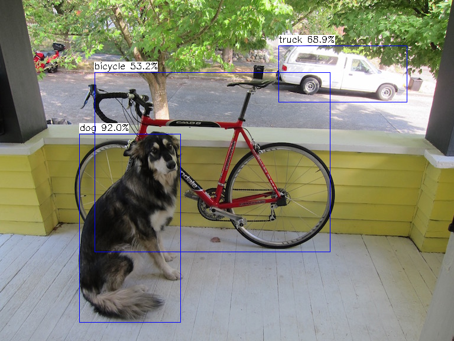

= BPI-M8 入门指南

== 简介

BPI-M8 搭载全志 A733 八核处理器，集成双核 Arm Cortex-A76、六核 Arm Cortex-A55、PowerVR GPU 和 3 TOPS NPU，配备 4 GB LPDDR5 内存。

开发板提供 HDMI、MIPI DSI、双路 MIPI CSI、USB、千兆以太网和 40 针 GPIO 等接口，支持 SD 卡启动，可通过扩展板连接 M.2 固态硬盘和 eDP 显示屏。

TIP: 更多信息：link:/zh/BPI-M8/BananaPi_BPI-M8[Banana Pi BPI-M8]。

== 主要特性

* 双核 Arm Cortex-A76 + 六核 Arm Cortex-A55，主频最高 2.0 GHz。
* 4 GB LPDDR5 内存。
* 64 GB eMMC（BPI-M8A）或 16 MB SPI NOR（BPI-M8B）。
* 3 TOPS NPU。
* 1 个 HDMI 2.0b 输出接口。
* 1 个 MIPI DSI 显示接口。
* 2 个 MIPI CSI 摄像头接口。
* 1 个 PCIe/DP 扩展接口。
* 4 个 USB Type-A 接口。
* 1 个千兆以太网接口，支持通过 PoE 扩展板供电。
* Wi-Fi 6 和蓝牙 5。
* 1 组 40 针 GPIO。
* 1 个 UFS 接口。

== Android

=== 准备

* 下载 link:/zh/BPI-M8/BananaPi_BPI-M8#_android_2[Android 镜像]。
* 在 Windows 电脑上安装 link:https://download.banana-pi.dev/d/ca025d76afd448aabc63/files/?p=%2FTools%2Fimage_download_tools%2Fphoenixsuit_V1.1.0_20150325.rar[PhoenixSuit]。
* 准备支持数据传输的 Type-C 数据线和符合主板要求的 5 V 电源。

=== 烧录镜像

WARNING: 烧录会清除 eMMC 中的数据，请先备份。

. 打开 PhoenixSuit，进入“一键刷机”页面，单击“浏览”选择 Android 镜像。
. 按住开发板上的 FEL 按钮，通过 USB OTG Type-C 接口连接电脑，设备识别后松开按钮。
. 按提示确认烧录，等待下载完成。烧录期间不要断电或拔出数据线。
. 烧录完成后重新上电，等待 Android 启动。

NOTE: 本指南的 Android 镜像烧录到 eMMC。

== Linux 开发

=== 准备

* 下载 link:/zh/BPI-M8/BananaPi_BPI-M8#_linux_2[Linux 镜像]。桌面版提供图形界面，Minimal 版使用终端。
* 准备 SD 卡和读卡器。SD 卡容量需大于解压后的镜像大小，推荐使用 A1 等级存储卡。
* 下载 link:https://etcher.balena.io/[balenaEtcher] 烧录工具，支持 Windows、Linux 和 macOS。
* 默认登录信息以镜像说明为准，常见账号为 `pi/bananapi` 或 `root/1234`。首次启动时，按向导设置密码和用户。

本节适用于 BPI-M8 的 Ubuntu / Debian 镜像。从 SD 卡启动无需预先擦除 eMMC。

=== 将镜像写入 SD 卡

WARNING: 烧录会清除目标设备中的数据，请确认选择的是 SD 卡。

. 将 SD 卡插入读卡器并连接电脑，打开 balenaEtcher，单击“从文件烧录”选择镜像。
+
image::/bpi-m8/bananapi_bpim8_img_write_sd1.jpg[选择镜像]
+
image::/bpi-m8/bananapi_bpim8_img_write_sd2.jpg[打开镜像文件]

. 单击“选择目标”，选择 SD 卡并核对容量。
+
image::/bpi-m8/bananapi_bpim8_img_write_sd3.jpg[选择目标设备]
+
image::/bpi-m8/bananapi_bpim8_img_write_sd4.jpg[确认 SD 卡]

. 单击“烧录”，等待写入和校验完成。
+
image::/bpi-m8/bananapi_bpim8_img_write_sd5.jpg[开始烧录]
+
image::/bpi-m8/bananapi_bpim8_img_write_sd6.jpg[写入镜像]
+
image::/bpi-m8/bananapi_bpim8_img_write_sd7.jpg[烧录完成]

. 安全移除 SD 卡，插入 BPI-M8，连接显示器、键盘和电源，等待系统启动。

=== 将镜像写入 eMMC

WARNING: 写入会清除 eMMC 中的数据。以下以 `/dev/mmcblk1` 为例，设备名以实际输出为准，不要写入当前运行系统所在的磁盘。

. 从 SD 卡启动 M8，将已解压的 `.img` 镜像复制到 U 盘，再将 U 盘接入 M8。

. 查看磁盘和当前系统分区，确认 SD 卡、eMMC 和 U 盘。
+
[source,bash]
----
lsblk -o NAME,SIZE,TYPE,FSTYPE,MOUNTPOINT
findmnt /
----
+
image::/bpi-m8/bananapi_bpim8_img_write_emmc1.jpg[查看存储设备]

. 挂载 U 盘。以下以 `/dev/sda1` 为例，已挂载的 U 盘可直接使用原挂载路径。
+
[source,bash]
----
sudo mkdir -p /mnt/usb
sudo mount /dev/sda1 /mnt/usb
ls /mnt/usb
----
+
image::/bpi-m8/bananapi_bpim8_img_write_emmc2.jpg[挂载 U 盘]

. 确认 eMMC 分区均未挂载，将下方 `bpi-m8.img` 替换为实际镜像文件名，执行写入。
+
[source,bash]
----
sudo dd if=/mnt/usb/bpi-m8.img of=/dev/mmcblk1 bs=4M status=progress conv=fsync
sync
----
+
image::/bpi-m8/bananapi_bpim8_img_write_emmc3.jpg[写入 eMMC]

. 写入完成后关闭系统，断电取出 SD 卡，再重新上电。
+
[source,bash]
----
sudo poweroff
----

. 启动后确认系统分区位于 eMMC。
+
[source,bash]
----
findmnt /
lsblk
----
+
image::/bpi-m8/bananapi_bpim8_img_write_emmc4.jpg[确认 eMMC 启动]

=== 擦除 eMMC（可选）

WARNING: 此操作会清除 eMMC 用户区的全部数据，无法恢复。仅在从 SD 卡启动、确认目标不是当前系统磁盘且目标分区均未挂载时执行。

. 查看设备和系统分区，确认 eMMC 的设备名。
+
[source,bash]
----
lsblk -o NAME,SIZE,TYPE,FSTYPE,MOUNTPOINT
findmnt /
----

. 以下以 `/dev/mmcblk1` 为例，向 eMMC 用户区写入零。
+
[source,bash]
----
sudo dd if=/dev/zero of=/dev/mmcblk1 bs=4M status=progress conv=fsync
sync
----

写满设备后会提示“设备上没有空间”。此操作不擦除独立的 eMMC boot0 / boot1 启动区。

=== USB

. 将 U 盘或其他 USB 设备插入开发板的 USB Type-A 接口，查看设备是否识别。
+
[source,bash]
----
lsusb
lsblk
----
+
image::/bpi-m8/bananapi_bpim8_img_write_usb1.jpg[查看 USB 设备]

. 挂载 U 盘。以下以 `/dev/sda1` 为例。
+
[source,bash]
----
sudo mkdir -p /mnt/usb
sudo mount /dev/sda1 /mnt/usb
ls /mnt/usb
----

. 使用完成后卸载 U 盘，再拔出设备。
+
[source,bash]
----
sudo umount /mnt/usb
----
+
image::/bpi-m8/bananapi_bpim8_img_write_usb2.jpg[卸载 U 盘]

=== 以太网

. 使用网线将 M8 连接到路由器的 LAN 口，查看 M8 的 IP 地址。
+
[source,bash]
----
ip -4 addr
----
+
image::/bpi-m8/bananapi_bpim8_img_write_iperf_1.jpg[查看 M8 的 IP 地址]

. 在同一局域网内的另一台电脑上启动 iperf3 服务端。
+
[source,bash]
----
iperf3 -s
----
+
image::/bpi-m8/bananapi_bpim8_img_write_iperf_2.jpg[启动 iperf3 服务端]

. 在 M8 上启动客户端，将示例地址改为服务端电脑的 IP。
+
[source,bash]
----
iperf3 -c 192.168.1.200
----
+
image::/bpi-m8/bananapi_bpim8_img_write_iperf_3.jpg[测试以太网速度]

=== Wi-Fi

. 查看网络设备和可用热点。
+
[source,bash]
----
nmcli device
nmcli device wifi list
----

. 连接 Wi-Fi，将“WiFi名称”改为实际热点名称，按提示输入密码。
+
[source,bash]
----
sudo nmcli --ask device wifi connect "WiFi名称"
nmcli connection show --active
----
+
image::/bpi-m8/bananapi_bpim8_img_write_wifi1.jpg[连接 Wi-Fi]

. 需要断开连接时，执行以下命令。无线接口名以 `nmcli device` 的输出为准。
+
[source,bash]
----
sudo nmcli device disconnect wlan0
----

=== 蓝牙

. 打开目标蓝牙设备并进入配对模式，在 M8 上启动蓝牙管理工具。
+
[source,bash]
----
bluetoothctl
----

. 在 `bluetoothctl` 中打开蓝牙并开始扫描。
+
[source,text]
----
power on
agent on
default-agent
scan on
----

. 找到目标设备后停止扫描，配对并连接。将示例 MAC 地址改为实际地址，并按提示确认配对。
+
[source,text]
----
scan off
devices
pair AA:BB:CC:DD:EE:FF
trust AA:BB:CC:DD:EE:FF
connect AA:BB:CC:DD:EE:FF
----

. 需要断开连接或退出时，在 `bluetoothctl` 中执行：
+
[source,text]
----
disconnect AA:BB:CC:DD:EE:FF
exit
----

=== HDMI 显示

通过 HDMI 线连接显示器，选择对应的输入源，再为 M8 上电。桌面版进入图形界面，Minimal 版进入终端。

image::/bpi-m8/bananapi-pi_m8_hdmi_1.jpg[HDMI 显示]

=== 按钮

=== PWR

关机状态下，长按 PWR 开机。开机状态下，短按触发系统电源操作，具体响应由当前镜像设置决定。

image::/bpi-m8/bnanapi_bpim8_img_write_pwr.jpg[PWR 按钮响应]

=== RST

短按 RST 立即重启开发板，请先保存数据。

=== SSH

. 将 M8 和电脑连接到同一局域网，在 M8 上查看 IP 地址。
+
[source,bash]
----
ip -4 addr
----
+
image::/bpi-m8/bananapi_bpim8_img_write_shh1.jpg[查看 SSH 连接地址]

. 在电脑上打开 MobaXterm，新建 SSH 会话，填写 M8 的 IP 地址、用户名和端口 `22`。
+
image::/bpi-m8/bananapi_bpim8_img_write_ssh2.jpg[新建 SSH 会话]
+
image::/bpi-m8/bananapi_bpim8_img_write_ssh3.jpg[填写连接信息]

. 连接后输入账号密码。也可以使用终端命令连接，将示例 IP 改为实际地址。
+
[source,bash]
----
ssh pi@192.168.1.100
----
+
image::/bpi-m8/bananapi_bpim8_img_write_ssh4.jpg[登录 M8]
+
image::/bpi-m8/bananapi_bpim8_img_write_ssh5.jpg[SSH 终端]

=== 音频

. 插入耳机，或连接支持 HDMI 音频的显示器，查看系统声卡。
+
[source,bash]
----
aplay -l
----
+
image::/bpi-m8/bnanapi_bpim8_img_write_hp1.jpg[查看声卡]

. 将音频文件复制到 U 盘，按“USB”章节挂载后查看文件。
+
[source,bash]
----
ls /mnt/usb
----
+
image::/bpi-m8/bananapi_bpim8_img_write_hp2.jpg[查看音频文件]

. 使用 VLC 播放音频。以下以声卡 `0`、设备 `0` 为例，按 `aplay -l` 的输出修改编号和文件名。
+
[source,bash]
----
cvlc --aout alsa --alsa-audio-device plughw:0,0 "/mnt/usb/音频文件名"
----
+
image::/bpi-m8/bananapi_bpim8_img_write_hp3.jpg[播放音频]

NOTE: 播放 HDMI 音频时，选择 HDMI 对应的声卡，并确认显示器未静音。未安装 VLC 时，可使用 `aplay -D plughw:0,0 /mnt/usb/test.wav` 播放 WAV 文件。

=== RTC

. 断电后连接 RTC 备用电源，核对接口极性。
+
WARNING: RTC 备用电源电压不能超过 2 V。
+
image::/bpi-m8/bananapi_bpim8_img_write_rtc0.jpg[RTC 备用电源接口]

. 上电后检查 RTC 驱动并读取硬件时间。
+
[source,bash]
----
sudo dmesg | grep -Ei 'rtc|sunxi-rtc'
sudo hwclock -r -f /dev/rtc0
----

. 确认系统时间正确后，将系统时间写入 RTC。
+
[source,bash]
----
date
sudo hwclock -w -f /dev/rtc0
sudo hwclock -r -f /dev/rtc0
----

. 关闭系统并断开主电源，保留 RTC 备用电源。数分钟后重新上电，检查 RTC 时间是否持续运行。
+
[source,bash]
----
sudo hwclock -r -f /dev/rtc0
date
----

=== 风扇

风扇由系统温控策略调速。查看风扇设备和当前 PWM 输出：

[source,bash]
----
for m8_hwmon in /sys/class/hwmon/hwmon*; do
    echo "$m8_hwmon"
    cat "$m8_hwmon/name"
    if [ -f "$m8_hwmon/pwm1" ]; then
        cat "$m8_hwmon/pwm1"
    fi
done
----

NOTE: `hwmon` 编号可能变化，请根据 `name` 确认风扇设备。压力测试时不要关闭自动温控。

=== PoE 供电

. 准备兼容的 PoE 交换机、BPI-M8 PoE 扩展板和网线。
. 断电连接 PoE 扩展板，再通过网线连接 PoE 交换机。
. 接通交换机电源，确认开发板正常启动。

image::/bpi-m8/bananapi_bpim8_img_write_poe1.jpg[PoE 供电]

=== BPI-M8 扩展板

. 准备扩展板、1 根 31 针 FPC 排线和 2 根 35 针 FPC 排线。
. 断电后，将主板的 PCIe/DP、MIPI 接口连接到扩展板对应接口。
. 对齐 40 针 GPIO 的方向，将主板与扩展板连接。

image::/bpi-m8/bananapi_bpim8_img_write_kzb1.jpg[连接扩展板排线]

image::/bpi-m8/bananapi_bpim8_img_write_kzb2.jpg[安装扩展板]

=== M.2 固态硬盘

. 断电后，将 NVMe 固态硬盘插入扩展板的 M.2 接口并固定。
+
image::/bpi-m8/bananapi_bpim8_img_write_m.2_.jpg[安装 NVMe 固态硬盘]

. 启动系统，确认 M.2 对应的设备树 overlay 已安装。
+
[source,bash]
----
ls /boot/dtb/sunxi/overlay/bpi-m8/ | grep -i pcie
----
+
image::/bpi-m8/bananapi_bpim8_img_write_m.2_3.jpg[查看 PCIe overlay]

. 备份并编辑启动配置。
+
[source,bash]
----
sudo cp -an /boot/armbianEnv.txt /boot/armbianEnv.txt.before-pcie
sudo nano /boot/armbianEnv.txt
----

. 在已有的 `overlays=` 行中追加 `bpi-m8-expansion-pcie-m2`，多个 overlay 用空格分隔。没有该行时，添加：
+
[source,text]
----
overlays=bpi-m8-expansion-pcie-m2
----
+
image::/bpi-m8/bananapi_bpim8_img_write_m.2_2.jpg[启用 PCIe overlay]

. 按 `Ctrl+O` 保存、`Enter` 确认、`Ctrl+X` 退出，再重启系统。
+
[source,bash]
----
sudo reboot
----

. 重启后检查 PCIe 设备和硬盘。
+
[source,bash]
----
lspci
lsblk
----
+
image::/bpi-m8/bananapi_bpim8_img_write_m.2_4.jpg[查看 NVMe 固态硬盘]

NOTE: 不要重复添加 `overlays=` 行，也不要覆盖已有的其他 overlay 配置。

=== NPU

BPI-M8 支持使用 AWNPU Model Zoo 运行 AI 示例。以下以 YOLOv5 图片目标检测为例，介绍模型转换、编译和运行方法。

=== 准备

* 一台 x86_64 Ubuntu 开发电脑。
* BPI-M8，运行 64 位 Armbian 系统，并连接网络。
* `AWNPU_Docker_cp38.zip`：A733 版本 `v2.0.10.2`。
* `AWNPU_ModelZoo.gz`：版本 `v1.0.0`。
* AArch64 GCC 交叉编译工具链，下载说明位于 ModelZoo 的 `0-toolchains` 目录。

NOTE: 模型转换和编译在开发电脑上进行，推理程序在 M8 上运行。

. 在 M8 上检查 NPU 设备。
+
[source,bash]
----
uname -m
ls -l /dev/vipcore
----

系统架构应为 `aarch64`，并存在 `/dev/vipcore`。

=== 配置开发环境

. 在开发电脑上安装 Docker 和基础工具。已安装可跳过。
+
[source,bash]
----
sudo apt-get update
sudo apt-get install -y docker.io unzip tar cmake build-essential file openssh-client
sudo systemctl start docker
sudo docker version
----

. 设置软件包路径和工作目录。将 `M8_PACKAGE_DIR` 改为实际存放路径。
+
[source,bash]
----
export M8_PACKAGE_DIR="$HOME/Downloads"
export M8_AI_ROOT="$HOME/m8-ai"
export M8_MODEL_ZOO="$M8_AI_ROOT/awnpu_model_zoo-v1.0.0-20260423-f562dd16"

mkdir -p "$M8_AI_ROOT/docker"
unzip -t "$M8_PACKAGE_DIR/AWNPU_Docker_cp38.zip"
gzip -t "$M8_PACKAGE_DIR/AWNPU_ModelZoo.gz"
----

. 校验通过后，解压软件包。
+
[source,bash]
----
unzip -n "$M8_PACKAGE_DIR/AWNPU_Docker_cp38.zip" -d "$M8_AI_ROOT/docker"
tar -xzf "$M8_PACKAGE_DIR/AWNPU_ModelZoo.gz" -C "$M8_AI_ROOT"
cat "$M8_MODEL_ZOO/version"
----

. 解压并导入 Docker 镜像。
+
[source,bash]
----
unzip -n \
"$M8_AI_ROOT/docker/docker_images_v2.0.x/ubuntu-npu_v2.0.10.2.tar.zip" \
-d "$M8_AI_ROOT/docker"

sudo docker load -i "$M8_AI_ROOT/docker/ubuntu-npu_v2.0.10.2.tar"
sudo docker images
----

. 创建并进入容器。
+
[source,bash]
----
sudo docker run -it --name m8-npu-a733 \
--shm-size=1g \
--mount "type=bind,source=$M8_AI_ROOT,target=/workspace" \
ubuntu-npu:v2.0.10.2 /bin/bash
----

开发电脑的 `$M8_AI_ROOT` 映射到容器内 `/workspace`。退出后，使用以下命令重新进入：

[source,bash]
----
sudo docker start -ai m8-npu-a733
----

. 在容器内设置 ModelZoo 路径，检查转换工具。
+
[source,bash]
----
export M8_MODEL_ZOO=/workspace/awnpu_model_zoo-v1.0.0-20260423-f562dd16

printf 'ACUITY_PATH=%s\nVIV_SDK=%s\n' "$ACUITY_PATH" "$VIV_SDK"
pegasus --help
----

`ACUITY_PATH`、`VIV_SDK` 应已配置，`pegasus --help` 应显示帮助信息。

=== 转换 YOLOv5 模型

在容器内执行，将包内 ONNX 模型转换为 A733 模型。

NOTE: 包内预置的 `yolov5s_rt_uint8_t527.nb` 用于 T527，M8 需要重新导出为 A733，不能直接改名使用。

. 进入模型转换目录，检查 ONNX 模型、量化数据集和工具链环境。
+
[source,bash]
----
cd "$M8_MODEL_ZOO/examples/yolov5/convert_model"
test -s yolov5s_rt.onnx
test -s ../../dataset/coco_12/dataset.txt
test -n "$ACUITY_PATH"
test -d "$VIV_SDK"
pwd
ls -lh yolov5s_rt.onnx ../../dataset/coco_12/dataset.txt
----

. 导入 ONNX 模型。
+
[source,bash]
----
pegasus import onnx \
    --model yolov5s_rt.onnx \
    --output-model yolov5s_rt.json \
    --output-data yolov5s_rt.data
----

. 生成并配置输入、输出和预处理文件。
+
[source,bash]
----
pegasus generate inputmeta \
    --model yolov5s_rt.json \
    --separated-database \
    --input-meta-output yolov5s_rt_inputmeta.yml

pegasus generate postprocess-file \
    --model yolov5s_rt.json \
    --postprocess-file-output yolov5s_rt_postprocess_file.yml

python3 ./config_yml.py yolov5s_rt
----

. 使用 COCO 示例数据量化模型。
+
[source,bash]
----
pegasus quantize \
    --model yolov5s_rt.json \
    --model-data yolov5s_rt.data \
    --device CPU \
    --with-input-meta yolov5s_rt_inputmeta.yml \
    --iterations 12 --rebuild \
    --model-quantize yolov5s_rt_uint8.quantize \
    --quantizer asymmetric_affine --qtype uint8
----

. 导出 A733 模型，并复制到示例程序的模型目录。
+
[source,bash]
----
pegasus export ovxlib \
    --pack-nbg-unify \
    --optimize VIP9000NANODI_PLUS_PID0X1000003B \
    --viv-sdk "$VIV_SDK" \
    --model yolov5s_rt.json \
    --model-data yolov5s_rt.data \
    --dtype quantized \
    --model-quantize yolov5s_rt_uint8.quantize \
    --target-ide-project linux64 \
    --with-input-meta yolov5s_rt_inputmeta.yml \
    --postprocess-file yolov5s_rt_postprocess_file.yml \
    --output-path ./wksp/yolov5s_rt_uint8/yolov5s_rt_uint8

test -s ./wksp/yolov5s_rt_uint8_nbg_unify/network_binary.nb
cp ./wksp/yolov5s_rt_uint8_nbg_unify/network_binary.nb \
    ../model/yolov5s_rt_uint8_a733.nb
ls -lh ../model/yolov5s_rt_uint8_a733.nb
----

生成的模型位于 `examples/yolov5/model/yolov5s_rt_uint8_a733.nb`。

=== 编译示例

. 根据 `0-toolchains/gcc-arm-10.3-aarch64-none-linux-gnu.tar.txt` 下载 GCC 10.3，放入 `0-toolchains` 目录。

. 在容器内解压工具链和 OpenCV。
+
[source,bash]
----
cd "$M8_MODEL_ZOO/0-toolchains"
tar -xf gcc-arm-10.3-2021.07-x86_64-aarch64-none-linux-gnu.tar.xz
./gcc-arm-10.3-2021.07-x86_64-aarch64-none-linux-gnu/bin/aarch64-none-linux-gnu-gcc --version

cd "$M8_MODEL_ZOO/3rdparty/opencv"
python3 -m zipfile -e opencv-4.9.0-aarch64-linux-sunxi-glibc.zip .
test -d opencv-4.9.0-aarch64-linux-sunxi-glibc
----

NOTE: NPU 容器未预装 `unzip`。以上命令使用 Python 标准库解压，不需要通过容器内的 Allwinner APT 源安装额外软件。

. 编译 YOLOv5，并复制 A733 运行库。
+
[source,bash]
----
cd "$M8_MODEL_ZOO/examples"
test -s yolov5/model/yolov5s_rt_uint8_a733.nb

bash ./build_linux.sh -t a733 -p yolov5 -s linux

M8_DEMO_DIR="$M8_MODEL_ZOO/examples/yolov5/install/yolov5_demo_linux_a733"
test -x "$M8_DEMO_DIR/yolov5_demo_a733"
test -s "$M8_DEMO_DIR/model/yolov5s_rt_uint8_a733.nb"

mkdir -p "$M8_DEMO_DIR/lib"
cp -a "$M8_MODEL_ZOO/common/npuruntime/lib_linux_aarch64/A733/"*.so \
    "$M8_DEMO_DIR/lib/"

ls -lh "$M8_DEMO_DIR/lib/"
----

NOTE: Bullseye 使用 GCC 10.2，下载说明见 `0-toolchains/gcc-arm-10.2-aarch64-none-linux-gnu.tar.xz.txt`。解压后，将编译参数 `-s linux` 改为 `-s debian11`。

=== 运行示例

. 在开发电脑上，将程序传到 M8。将 IP 地址改为 M8 的实际地址。
+
[source,bash]
----
export M8_MODEL_ZOO="$HOME/m8-ai/awnpu_model_zoo-v1.0.0-20260423-f562dd16"
export M8_TARGET=pi@192.168.1.100

ssh "$M8_TARGET" 'mkdir -p ~/m8-ai'
scp -r "$M8_MODEL_ZOO/examples/yolov5/install/yolov5_demo_linux_a733" \
"$M8_TARGET:~/m8-ai/"
----

. 在 M8 上检查运行库。输出中不应出现 `not found`。
+
[source,bash]
----
cd "$HOME/m8-ai/yolov5_demo_linux_a733"
LD_LIBRARY_PATH="$PWD/lib" \
ldd ./yolov5_demo_a733
----

. 执行目标检测。
+
[source,bash]
----
sudo env LD_LIBRARY_PATH="$PWD/lib" \
timeout 120 ./yolov5_demo_a733 \
-nb model/yolov5s_rt_uint8_a733.nb \
-i model/dog.jpg -l 50 -m 128

m8_demo_rc=$?
printf 'exit code: %s\n' "$m8_demo_rc"
test "$m8_demo_rc" -eq 0 && test -s output_yolov5.png
----

`-l` 设置运行次数，`-m` 设置 NPU 初始化内存大小（MiB）。运行成功后，当前目录生成检测结果图片 `output_yolov5.png`。

. 在开发电脑上获取结果图片。
+
[source,bash]
----
scp "$M8_TARGET:~/m8-ai/yolov5_demo_linux_a733/output_yolov5.png" ./
----

使用自己的图片时，将 `-i model/dog.jpg` 改为对应的 JPG 路径。

=== 其他示例

其他示例的使用方法见对应目录的 `README.md`：

* 图像分类：`examples/mobilenetv2`、`examples/resnet50v2`。
* 目标检测：`examples/yolov8`、`examples/yolo11`。
* 图像分割：`examples/yolov8_seg`、`examples/ppseg`。
* 人体关键点：`examples/yolov8_pose`。
* 文字检测与识别：`examples/ppocr`；车牌识别：`examples/LPRNet`。

M8 编译平台选择 `a733`。更多说明见包内 `docs/NPU_快速入门_开发指南.pdf`。

== 引脚定义

NOTE: 连接排线或扩展板前请断电，并核对接口的 1 脚位置。

.40 针 GPIO
[%collapsible]
====
[options="header",cols="1,2",width="70%"]
|===
| 引脚号 | 引脚名称
| 1  | DCDC1
| 2  | VBUS-AXP318
| 3  | PJ23/TWI7-SDA
| 4  | VBUS-AXP318
| 5  | PJ22/TWI7-SCK
| 6  | GND
| 7  | PL05/PWM0-3
| 8  | PB00/UART2-TX
| 9  | GND
| 10 | PB01/UART2-RX
| 11 | PL12/S-UART1-TX
| 12 | HD-PIN12
| 13 | PL13/S-UART1-RX
| 14 | GND
| 15 | PL06/S-UART0-TX
| 16 | PB02/UART2-RTS
| 17 | DCDC1
| 18 | PB03/UART2-CTS
| 19 | PJ25/SPI3-MOSI
| 20 | GND
| 21 | PJ26/SPI3-MISO
| 22 | HD-PIN22
| 23 | PJ24/SPI3-CLK
| 24 | HD-PIN24
| 25 | GND
| 26 | PJ27/SPI3-CS0
| 27 | HD-PIN27
| 28 | HD-PIN28
| 29 | PL07/S-UART0-RX
| 30 | GND
| 31 | HD-PIN31
| 32 | HD-PIN32
| 33 | HD-PIN33
| 34 | GND
| 35 | HD-PIN35
| 36 | HD-PIN36
| 37 | HD-PIN37
| 38 | HD-PIN38
| 39 | GND
| 40 | HD-PIN40
|===
====

.MIPI CSI-A
[%collapsible]
====
[options="header",cols="1,2",width="70%"]
|===
| 引脚号 | 引脚名称
| 1  | MCSIA-D3N
| 2  | MCSIA-D3P
| 3  | GND
| 4  | MCSIA-D2N
| 5  | MCSIA-D2P
| 6  | GND
| 7  | NC
| 8  | NC
| 9  | GND
| 10 | MCSIA-D1N
| 11 | MCSIA-D1P
| 12 | GND
| 13 | MCSIA-D0N
| 14 | MCSIA-D0P
| 15 | GND
| 16 | MCSIA-CKN
| 17 | MCSIA-CKP
| 18 | GND
| 19 | PE00/MCSI-A-MCLK
| 20 | PE06/MCSI-A-STBY
| 21 | PE07/MCSI-A-RST
| 22 | PE10/TWI4-SCK
| 23 | PE11/TWI4-SDA
| 24 | GND
| 25 | NC
| 26 | NC
| 27 | NC
| 28 | NC
| 29 | NC
| 30 | VCC1V8_CSI0
| 31 | GND
| 32 | GND
| 33 | VCC3V3_CSI0
| 34 | VCC3V3_CSI0
| 35 | VCC3V3_CSI0
| 36 | GND
| 37 | GND
|===
====

.MIPI CSI-B
[%collapsible]
====
[options="header",cols="1,2",width="70%"]
|===
| 引脚号 | 引脚名称
| 1  | MCSIB-D3N
| 2  | MCSIB-D3P
| 3  | GND
| 4  | MCSIB-D2N
| 5  | MCSIB-D2P
| 6  | GND
| 7  | NC
| 8  | NC
| 9  | GND
| 10 | MCSIB-D1N
| 11 | MCSIB-D1P
| 12 | GND
| 13 | MCSIB-D0N
| 14 | MCSIB-D0P
| 15 | GND
| 16 | MCSIB-CKN
| 17 | MCSIB-CKP
| 18 | GND
| 19 | PE05/MCSI-B-MCLK
| 20 | PE08/MCSI-B-STBY
| 21 | PE09/MCSI-B-RST
| 22 | PE03/TWI3-SCK
| 23 | PE04/TWI3-SDA
| 24 | GND
| 25 | AP-NMI
| 26 | PMU-PWRON
| 27 | AP-RESET
| 28 | PMU-SCK
| 29 | PMU-SDA
| 30 | VCC1V8_CSI1
| 31 | GND
| 32 | GND
| 33 | VCC3V3_CSI1
| 34 | VCC3V3_CSI1
| 35 | VCC3V3_CSI1
| 36 | GND
| 37 | GND
|===
====

.PCIe/DP
[%collapsible]
====
[options="header",cols="1,2",width="70%"]
|===
| 引脚号 | 引脚名称
| 1  | COMB1-TX0P
| 2  | COMB1-TX0N
| 3  | GND
| 4  | COMB1-RX0P
| 5  | COMB1-RX0N
| 6  | GND
| 7  | COMB1-REFP
| 8  | COMB1-REFN
| 9  | GND
| 10 | DP_TX0P
| 11 | DP_TX0N
| 12 | GND
| 13 | DP_TX1P
| 14 | DP_TX1N
| 15 | GND
| 16 | DP_AUXP
| 17 | DP_AUXN
| 18 | DP_HPD
| 19 | HOST-D4M
| 20 | HOST-D4P
| 21 | GND
| 22 | PCIE-PERSTn-3p3V
| 23 | PCIE-WAKEn-3p3v
| 24 | PCIE-CLKREQn-3p3v
| 25 | PCIE-PWREN-3p3v
| 26 | VDD1P8V-PCIe
| 27 | GND
| 28 | GND
| 29 | VDD5P0V-PCIe
| 30 | VDD5P0V-PCIe
| 31 | VDD5P0V-PCIe
| 32 | GND
| 33 | GND
|===
====

.MIPI DSI0
[%collapsible]
====
[options="header",cols="1,2",width="70%"]
|===
| 引脚号 | 引脚名称
| 1  | MIPI-DSI0-D0N
| 2  | MIPI-DSI0-D0P
| 3  | GND
| 4  | MIPI-DSI0-D1N
| 5  | MIPI-DSI0-D1P
| 6  | GND
| 7  | MIPI-DSI0-CKN
| 8  | MIPI-DSI0-CKP
| 9  | GND
| 10 | MIPI-DSI0-D2N
| 11 | MIPI-DSI0-D2P
| 12 | GND
| 13 | MIPI-DSI0-D3N
| 14 | MIPI-DSI0-D3P
| 15 | GND
| 16 | GPADC6
| 17 | PD18/LCD-PWREN
| 18 | PD21/LCD-RST
| 19 | PD19/LCD-BLEN
| 20 | PD22/LCD-PWM
| 21 | GND
| 22 | PD23/TP-INT
| 23 | PD20/TP-RST
| 24 | PD16/TWI2-SCK
| 25 | PD17/TWI2-SDA
| 26 | VDD1P8V-DSI0
| 27 | GND
| 28 | GND
| 29 | VDD5P0V-DSI0
| 30 | VDD5P0V-DSI0
| 31 | VDD5P0V-DSI0
| 32 | GND
| 33 | GND
|===
====
