= 简介

BPI-M8 搭载高性能八核 AI 平台芯片 A733，集成 2 个 Arm® Cortex®-A76 核心和 6 个 Arm Cortex-A55 核心。该平台支持 Imagination PowerVR BXM-4-64 MC1 GPU、3 TOPS NPU、LPDDR4/LPDDR4x/LPDDR5 DRAM，以及 UFS/eMMC 存储。

BPI-M8 提供丰富的外设接口，包括 USB、DP、UFS、HDMI、MIPI CSI、MIPI DSI、风扇、RTC，以及 1 个支持 PoE 的千兆以太网口。开发板支持从 SD 卡启动，板载 KEIIOT K038 WiFi/蓝牙芯片，并配备 4 GB LPDDR5 RAM、32 GB eMMC 存储和两个 12 mm × 12 mm 单天线模块。
目录

TIP: 更多信息：link:/zh/BPI-M8/BananaPi_BPI-M8[Banana Pi BPI-M8]

== 主要特性
* 双核 Arm Cortex-A76 + 六核 Arm Cortex-A55，主频最高 2.0GHz
* 4GB LPDDR5 内存
* 64GB eMMC 闪存(BPI-M8A)
* 16MB SPI NOR 存储（BPI-M8B）
* 1 个 MIPI DSI 显示接口
* 2 个 MIPI CSI 摄像头接口
* 1 个 PCIe/DP 接口
* 1 个 HDMI 2.0b 输出接口
* 4 个 USB-A 接口
* 1 个千兆以太网 (GbE) RJ45 接口（通过 PoE 扩展板支持 PoE 供电）
* 1 个 Wi-Fi 6/蓝牙 5 模块
* 1 组 40-pin GPIO 引脚
* 1 个 UFS 接口

= Android
== 准备
. 下载最新的 link:/zh/BPI-M8/BananaPi_BPI-M8#_android_2[Android 镜像]。
. 获取全志刷机工具 PhoenixSuit： link:https://download.banana-pi.dev/d/ca025d76afd448aabc63/files/?p=%2FTools%2Fimage_download_tools%2Fphoenixsuit_V1.1.0_20150325.rar[phoenixsuit] （Windows 平台）。
. Type‑C 数据线（支持数据传输）、5V电源。

== USB刷机步骤
. 打开**PhoenixSuit**，单击 **一键刷机** 图标切换到固件下载面板。

. 单击 **浏览** 选择 **Android 镜像文件**。

. 长按 **FEL 按钮**，同时使用 **Type-C **接口将 M8 连接到电脑，后几秒松开**FEL 按钮**，弹出警告对话框后，单击 **是**。

. 自动开始固件下载，等待刷机完成。

. 下载完成(**Android 版本只能下载到 eMMC**)。


= Linux开发

== 将镜像安装到 SD 卡
. Linux 镜像支持 SD 卡或 eMMC 两种启动方式；插入 SD 卡时，板子优先从 SD 卡启动。
. SD 卡推荐：容量≥8GB，A1 等级存储卡。
. 若从 SD 卡启动：建议提前格式化 eMMC，清除原有系统。
. 若从 eMMC 启动，SD 卡仅作存储使用：SD 卡需提前格式化，不要写入系统镜像。
. 下载最新的 link:/zh/BPI-M8/BananaPi_BPI-M8#_linux_2[Linux镜像] 。
. 镜像烧录工具： link:https://etcher.balena.io/[balenaEtcher] 。
. 默认账号密码： pi/bananapi 或 root/1234。
. 本 Wiki 指南仅适用于 Ubuntu/Debian 类镜像。

== 将镜像写入SD卡


> 方法： **Balena Etcher** 图形工具烧录

Balena Etcher 是 Balena 提供的开源图形化镜像写入工具，可将操作系统镜像写入 SD 卡或 U 盘。

. 运行 Balena Etcher，选择 **从文件烧录**，导入镜像文件。
+
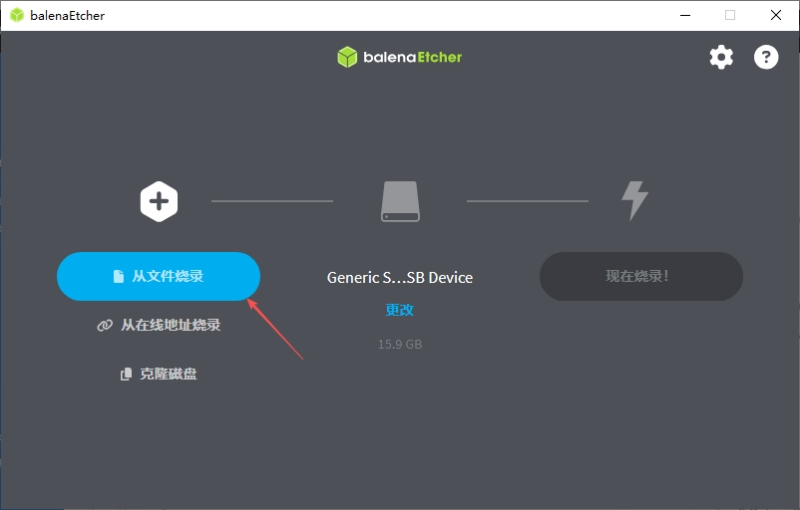
+
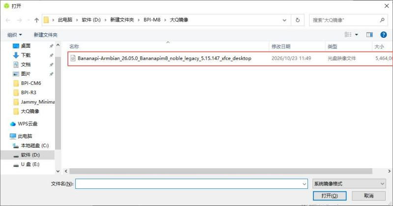
+
WARNING: 选中目标 SD 卡设备，**注意仔细核对设备，防止选错盘**。
+
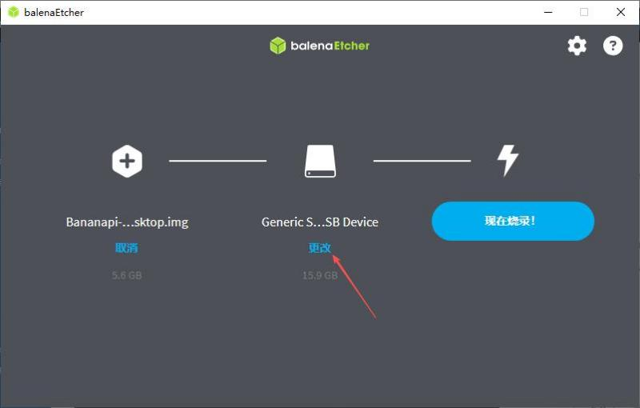
+
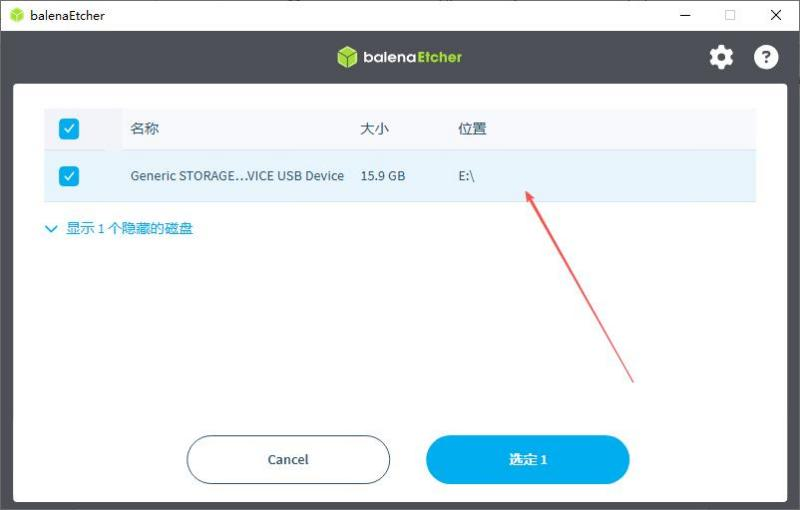
+
开始烧录，等待写入 + 校验完成。
+

+
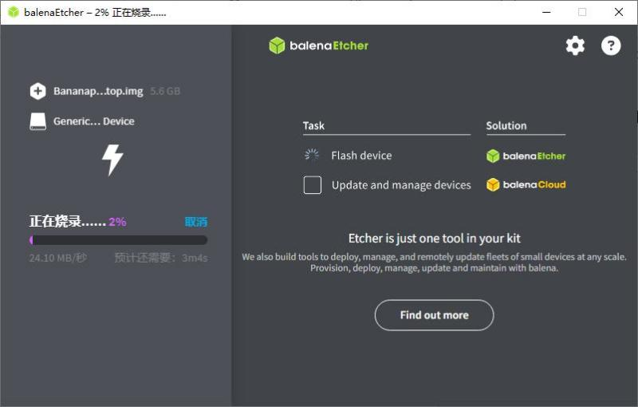
+


== 将镜像安装到 eMMC

. 将 SD 卡插入 M8 并启动。

. 将待烧录镜像保存到 U 盘，然后将 U 盘连接到 M8。

. 使用 lsblk 命令查询 USB 设备。
+
```sh
lsblk
```
+
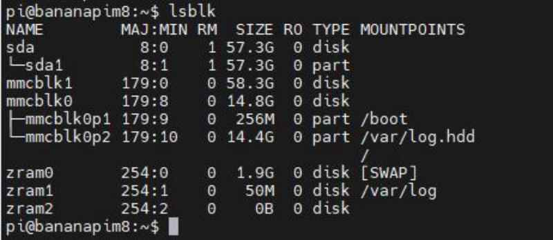
. 使用 mount 命令挂载 U 盘，并进入存放镜像的目录。
+
```sh
sudo mkdir -p /mnt/usb
sudo mount /dev/sda1 /mnt/usb
lsblk
```
+
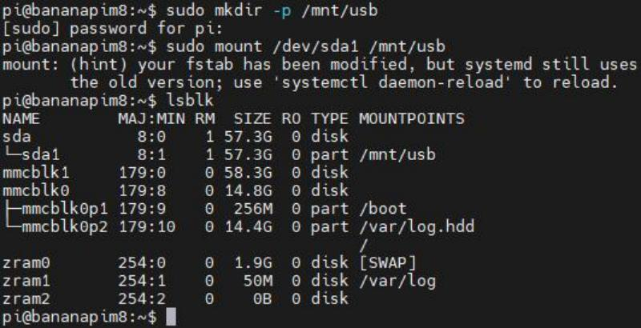
. 使用 dd 命令烧录镜像。
+
```sh
sudo dd if=Bananpi-Armbian_26.05.0_Bananapim8_noble_legacy_5.15.147_xfce_desktop.img of=/dev/mmcblk1 bs=4M status=progress conv=fdatasync
```
+
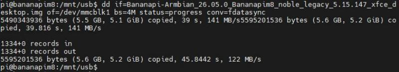
. 取出 SD 卡，再次为 M8 上电，即可从 eMMC 启动。
+
```
lsblk
```
+
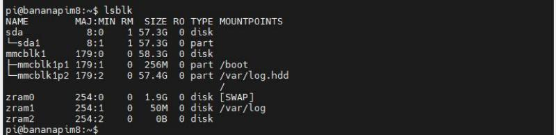

== 擦除eMMC
. 确保 Linux 镜像已烧录到 SD 卡中并插入 SD 卡。插入 SD 卡默认优先 SD 卡启动。
. 终端执行下列命令，列出系统中的硬盘、分区等块设备信息。
+
```
lsblk
```

. mmcblk1 是 eMMC，mmcblk0 是 SD 卡。在终端中输入以下命令擦除 eMMC。此过程需要二十多分钟且不可逆，请事先备份重要数据。
+
```
sudo dd if=/dev/zero of=/dev/mmcblk1  #向 eMMC 全盘持续写入 0，覆盖所有分区与数据
```


== USB

. 将需要使用的 USB 设备连接到 M8的USBA口。
+
可以使用下面命令查询。查询板上所有磁盘结构、挂载状态、文件系统和查询板上所有的USB设备。
+
```sh
lsblk
lsusb
```
+
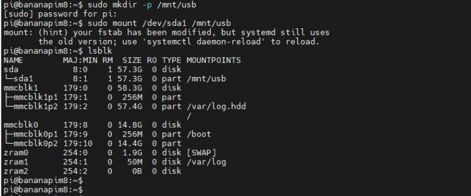

. 挂载U盘设备
+
创建挂载点
+
```sh 
sudo mkdir -p /mnt/usb
```
+
把U盘挂载上去后查看
+
```sh
sudo mount /dev/sda1 /mnt/usb
lsblk
```
+


. 取消挂载后查看
+
```sh
sudo umount /mnt/usb
lsblk
```
+
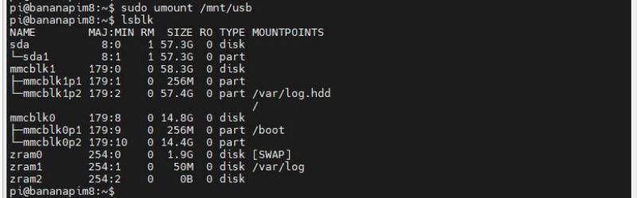


== 网口

. 准备网线,路由器。

. 使用网线连接路由器和BPI-M8。


. 查看路由器ip地址
+
```sh
ip a
```
+
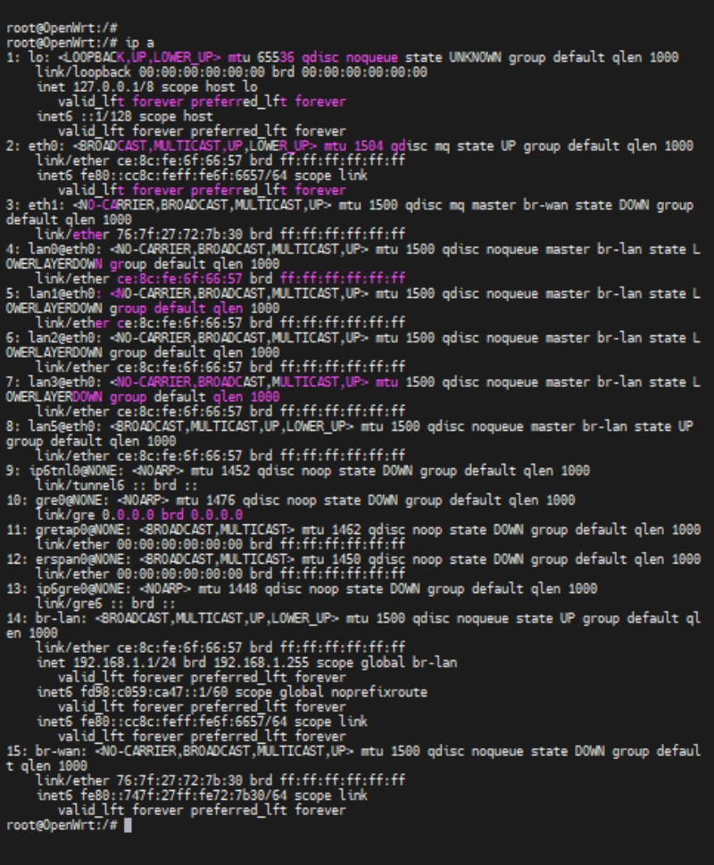

. 在路由器上启动 iperf3 服务端  
+
```sh
iperf3 -s
```
+
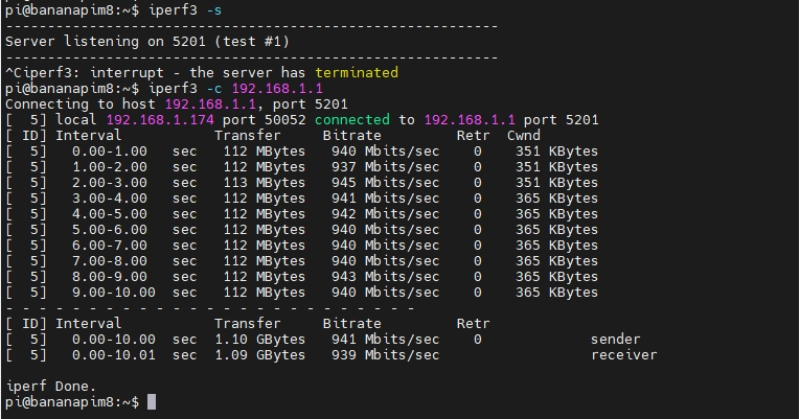

. 在BPI-M8上启动客户端
+
```sh
iperf3 -c (iperf3 -s 的地址)
```
+
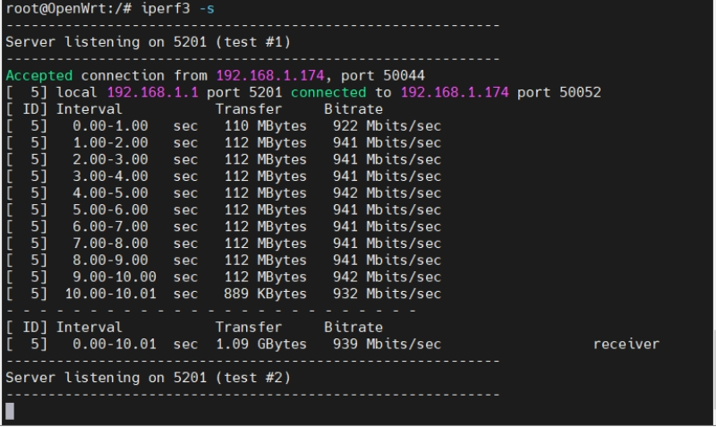

使用 iperf3 测试时，网口速率通常约为 1 Gbps。

== WiFi

使用 nmcli 命令连接 WiFi，完成后即可使用 WiFi。

```sh
nmcli device                                                      # 查看网口硬件状态
nmcli device wifi list                                            # 列出可用的无线网络接入点
sudo nmcli device wifi connection “WiFi名称” password “WiFi密码”   # 链接WiFi
sudo nmcli device disconnect wlan0                                #断开WiFi
```

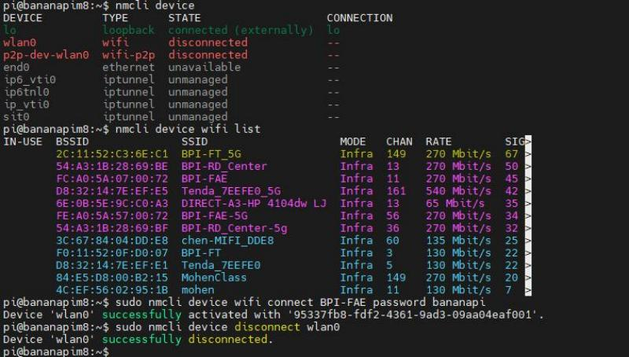

== 使用蓝牙

. 板子和手机蓝牙配对（shell 命令配置）
```sh
hciconfig                  # 查看本机的蓝牙适配器
bluetoothctl               # 启动蓝牙控制工具
power on                   # 打开蓝牙控制器电源
agent on                   # 启用配对代理
pairable on                # 开启【可被配对】
discoverable on            # 开启【可被发现】
scan on                    # 开启扫描周围蓝牙设备
scan off                   # 关闭扫描周围蓝牙设备
devices                    # 查看设备列表
pair MAC地址                # 向指定 MAC 地址的耳机发起配对请求，弹出确认提示时输入 
connect MAC地址             # 和耳机建立正式蓝牙音频连接（连接成功终端会出现设备名字）
disconnect MAC地址          # 断开指定 MAC 地址的蓝牙设备
exit                       # 退出
```


== HDMI 输出

通过 HDMI 线连接到显示器。

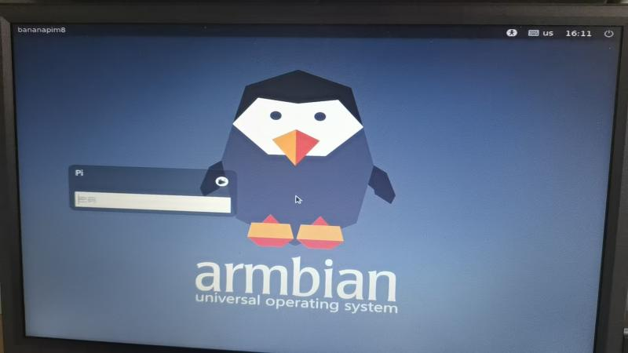

== 按钮

=== PWR

短按 PWR 按钮即可关闭电源。 

关闭时会出现如下日志：

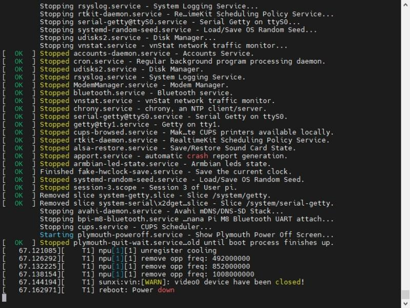

长按 PWR 按钮开机。

=== RST
短按RST按键BPI-M8重启


== SSH

. BPI-M8连接wifi.
. 查看M8链接WiFi后的ip地址。
+
```sh
ip a
```
+
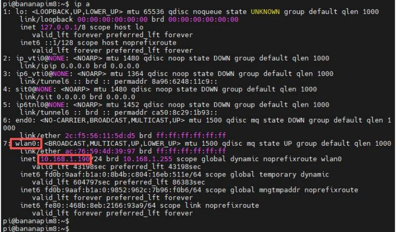

. 用 MobaXterm 连接。
+
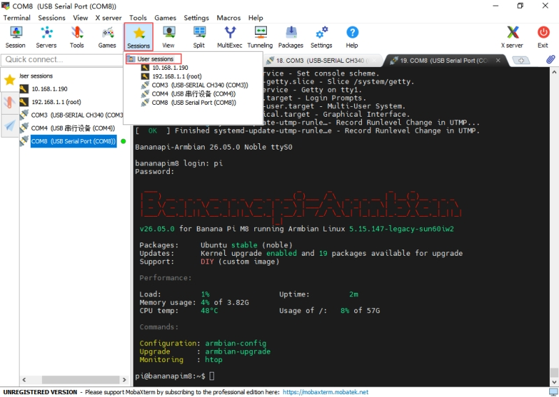
+
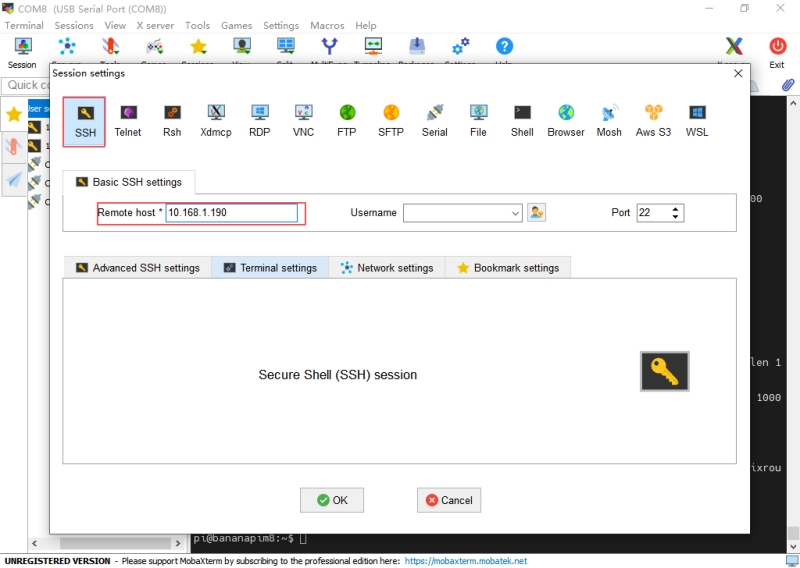
+
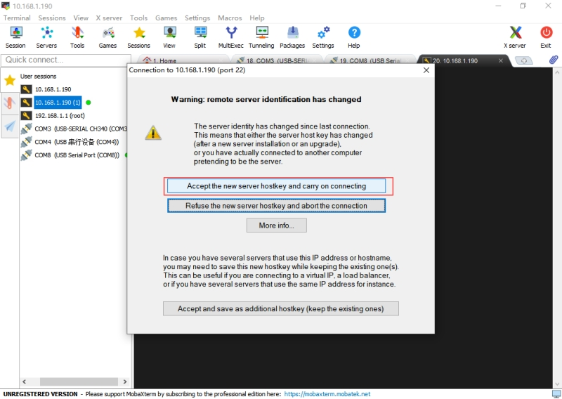
+
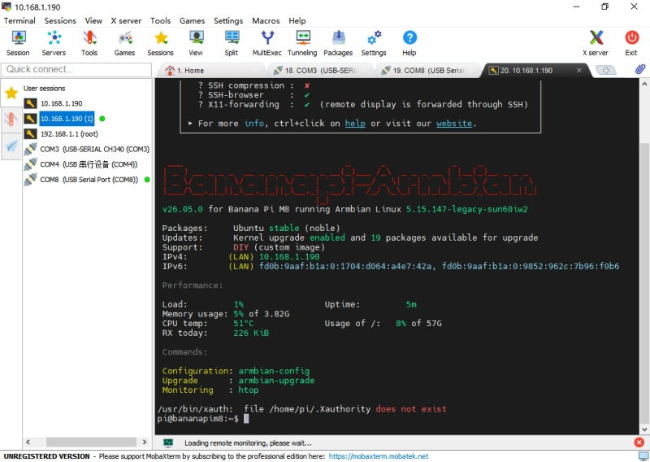

== 音频

使用 aplay 命令可看到 M8 声卡提供两个输出：

. HP 耳机输出
. HDMI 输出
+
```sh
aplay -l
```
+
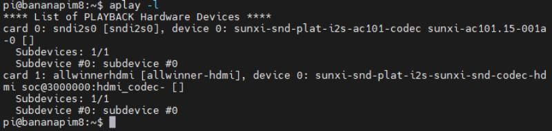


=== HP 耳机音频输出
. 准备一个带音频文件的U盘，一个有线耳机。
. 将U盘接入usb接口,查看U盘挂载情况，使用cd命令进入U盘。
+
```sh
lsblk
cd /mnt/usb
```
+
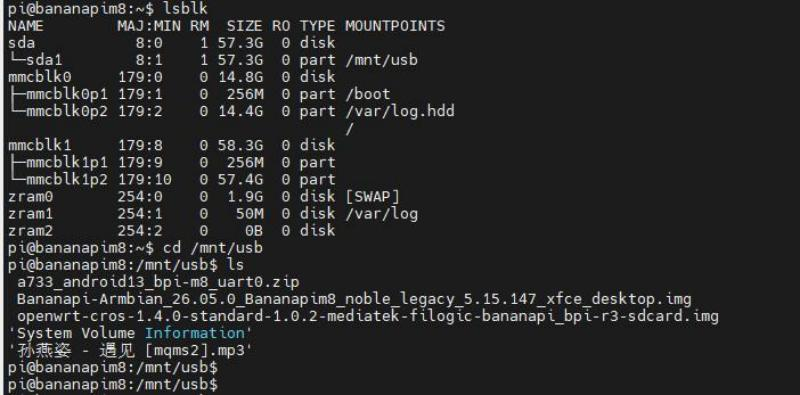

. 播放音频
+
```sh
cvlc --aout alsa --alsa-audio-device plughw:0,0 "音频文件名"
```
+
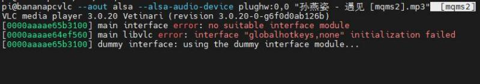


== RTC

连接间距为 2 mm 的电池，为 RTC 供电。

WARNING: 注意：RTC供电电压不能超过2V

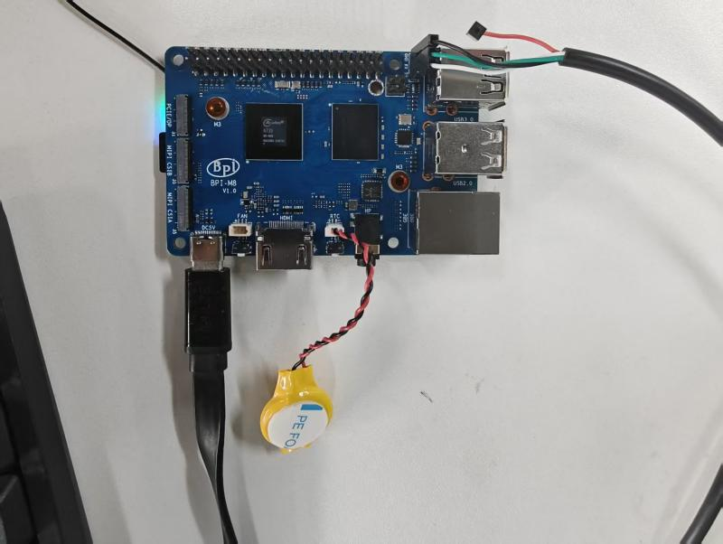

查看系统 RTC 配置

```sh
sudo dmesg | grep -Ei "rtc|sunxi-rtc"
```


设置 RTC 时间

```sh
sudo date -s "2026-11-03 11:52:00" 
sudo hwclock -w -f /dev/rtc0 
sudo hwclock -r -f /dev/rtc0 
```


断电数分钟后，RTC 时钟仍在运行，而系统时钟已经停止了数分钟。

```sh
sudo hwclock -r -f /dev/rtc0
date
```


== 风扇

查询系统中的风扇控制 PWM 设备

```sh
root@bananapim8:~# cat /sys/class/hwmon/hwmon0/name
pwmfan
root@bananapim8:~# ls /sys/class/hwmon/
hwmon0
```     
使用命令控制风扇开关

```sh
root@bananapim8:~# echo 1 > /sys/class/hwmon/hwmon0/pwm1
root@bananapim8:~# echo 0 > /sys/class/hwmon/hwmon0/pwm1
```     

== POE

. 准备一个POE交换机，一个POE扩展板，一根网线。
. 将网线连接POE交换机和BPI-M8，POE交换机即可给BPI-M8进行正常供电使用。

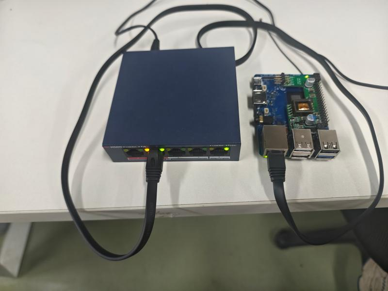

== BPI-M8扩展板
. 准备一个BPI-M8扩展板，一根 31-pin 的 FPC 软排线，两跟 35-pin 的FPC 软排线。
. 将 BPI-M8 主板的 PCIe/DP 和 MIPI 接口与扩展板的对应接口相连.
. 将 BPI-M8 主板的 40ping公头与 BPI-M8 扩展板的母头连接。

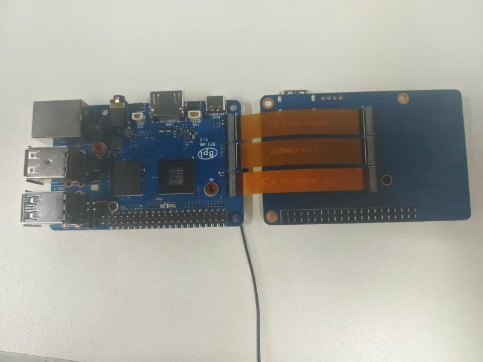

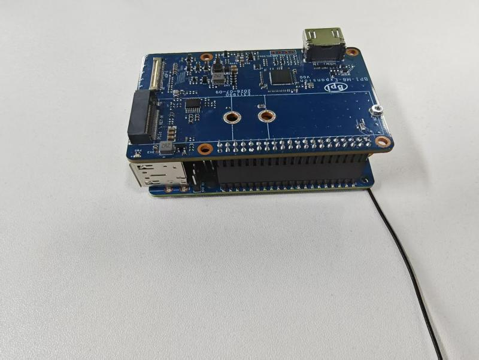

=== M.2固态硬盘

. 准备一个M.2固态硬盘，将M.2固态硬盘连接到BPI-M8扩展板上。
+
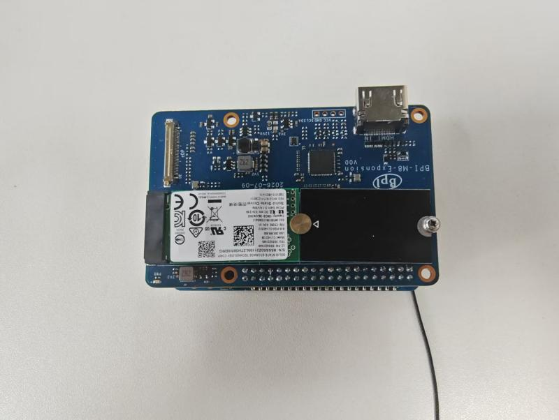

. 确认系统内包含BPI-M8扩展板M.2接口的设备树文件
+
```sh
ls /boot/dtb/sunxi/overlay/bpi-m8/ | grep -i pcie
```
+
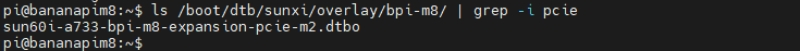

. 使用 nano 编辑器打开启动配置文件,在文件末尾添加配置.
+
```sh
sudo nano /boot/armbianEnv.txt
overlays=bpi-m8-expansion-pcie-m2
```
+
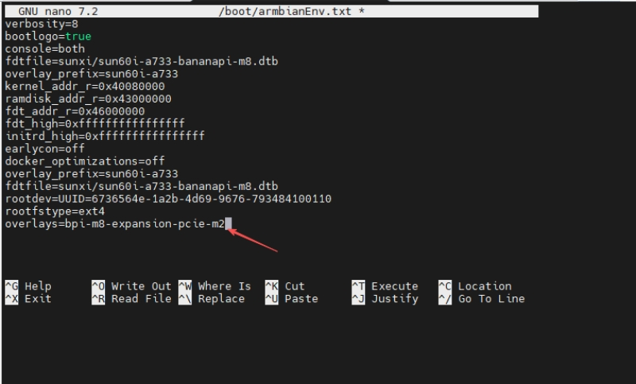
+
保存并退出：按 Ctrl+O 写入，按 Enter 确认，按 Ctrl+X 退出，重启系统使配置生效.

. 检查 PCIe 设备枚举状态，检查系统块设备.
+
```sh
lspci
lsblk
```
+
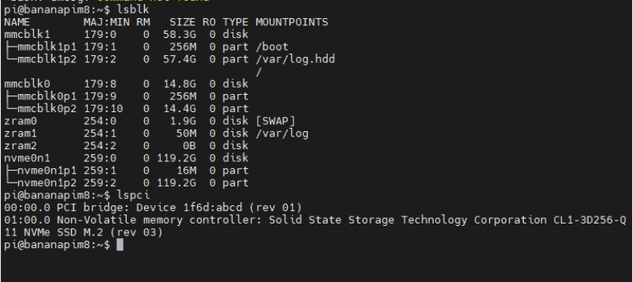


== 引脚定义

.BPI-M8 40 针 GPIO
[%collapsible]
====
[options="header",cols="1,2",width="70%"]
|=====
2+| **Banana Pi BPI-M8 的 40 针 GPIO**
| 引脚号 | 引脚名称 
| 1  | DCDC1 
| 2  | VBUS-AXP318 
| 3  | PJ23/TWI7-SDA
| 4  | VBUS-AXP318
| 5  | PJ22/TWI7-SCK
| 6  | GND 
| 7  | PL05/PWM0-3
| 8  | PB00/UART2-TX 
| 9  | GND 
| 10 | PB01/UART2-RX
| 11 | PL12/S-UART1-TX
| 12 | HD-PIN12 
| 13 | PL13/S-UART1-RX 
| 14 | GND 
| 15 | PL06/S-UART0-TX 
| 16 | PB02/UART2-RTS 
| 17 | DCDC1
| 18 | PB03/UART2-CTS
| 19 | PJ25/SPI3-MOSI
| 20 | GND  
| 21 | PJ26/SPI3-MISO 
| 22 | HD-PIN22 
| 23 | PJ24/SPI3-CLK 
| 24 | HD-PIN24
| 25 | GND 
| 26 | PJ27/SPI3-CS0 
| 27 | HD-PIN27
| 28 | HD-PIN28 
| 29 | PL07/S-UART0-RX
| 30 | GND 
| 31 | HD-PIN31 
| 32 | HD-PIN32
| 33 | HD-PIN33 
| 34 | GND 
| 35 | HD-PIN35 
| 36 | HD-PIN36
| 37 | HD-PIN37 
| 38 | HD-PIN38
| 39 | GND 
| 40 | HD-PIN40
|=====
====

.BPI-M8 MIPI CSIA
[%collapsible]
====
[options="header",cols="1,2",width="70%"]
|=====
2+| **Banana Pi BPI-M8 的 MIPI CSIA**
| 引脚号 | 引脚名称 
| 1  | MCSIA-D3N 
| 2  | MCSIA-D3P
| 3  | GND
| 4  | MCSIA-D2N
| 5  | MCSIA-D2P
| 6  | GND 
| 7  | NC
| 8  | NC
| 9  | GND 
| 10 | MCSIA-D1N
| 11 | MCSIA-D1P
| 12 | GND 
| 13 | MCSIA-D0N
| 14 | MCSIA-D0P
| 15 | GND
| 16 | MCSIA-CKN
| 17 | MCSIA-CKP
| 18 | GND
| 19 | PE00/MCSI-A-MCLK
| 20 | PE06/MCSI-A-STBY
| 21 | PE07/MCSI-A-RST
| 22 | PE10/TWI4-SCK
| 23 | PE11/TWI4-SDA
| 24 | GND
| 25 | NC
| 26 | NC
| 27 | NC
| 28 | NC
| 29 | NC
| 30 | VCC1V8_CSI0
| 31 | GND
| 32 | GND
| 33 | VCC3V3_CSI0 
| 34 | VCC3V3_CSI0
| 35 | VCC3V3_CSI0
| 36 | GND
| 37 | GND
|=====
====

.BPI-M8 MIPI CSIB
[%collapsible]
====
[options="header",cols="1,2",width="70%"]
|=====
2+| **Banana Pi BPI-M8 的 MIPI CSIB**
| 引脚号 | 引脚名称 
| 1  | MCSIB-D3N
| 2  | MCSIB-D3P
| 3  | GND
| 4  | MCSIB-D2N
| 5  | MCSIB-D2P
| 6  | GND 
| 7  | NC
| 8  | NC
| 9  | GND 
| 10 | MCSIB-D1N
| 11 | MCSIB-D1P
| 12 | GND 
| 13 | MCSIB-D0N
| 14 | MCSIB-D0P
| 15 | GND
| 16 | MCSIB-CKN
| 17 | MCSIB-CKP
| 18 | GND
| 19 | PE05/MCSI-B-MCLK
| 20 | PE08/MCSI-B-STBY
| 21 | PE09/MCSI-B-RST
| 22 | PE03/TWI3-SCK
| 23 | PE04/TWI3-SDA
| 24 | GND
| 25 | AP-NMI
| 26 | PMU-PWRON
| 27 | AP-RESET
| 28 | PMU-SCK
| 29 | PMU-SDA
| 30 | VCC1V8_CSI1
| 31 | GND
| 32 | GND
| 33 | VCC3V3_CSI1 
| 34 | VCC3V3_CSI1
| 35 | VCC3V3_CSI1
| 36 | GND
| 37 | GND
|=====
====

.BPI-M8 PCIe+DP
[%collapsible]
====
[options="header",cols="1,2",width="70%"]
|=====
2+| **Banana Pi BPI-M8 的 PCIe+DP**
| 引脚号 | 引脚名称 
| 1  | COMB1-TX0P
| 2  | COMB1-TX0N
| 3  | GND
| 4  | COMB1-RX0P
| 5  | COMB1-RX0N
| 6  | GND 
| 7  | COMB1-REFP
| 8  | COMB1-REFN
| 9  | GND 
| 10 | DP_TX0P
| 11 | DP_TX0N
| 12 | GND 
| 13 | DP_TX1P
| 14 | DP_TX1N
| 15 | GND
| 16 | DP_AUXP
| 17 | DP_AUXN
| 18 | DP_HPD
| 19 | HOST-D4M
| 20 | HOST-D4P
| 21 | GND
| 22 | PCIE-PERSTn-3p3V
| 23 | PCIE-WAKEn-3p3v
| 24 | PCIE-CLKREQn-3p3v
| 25 | PCIE-PWREN-3p3v
| 26 | VDD1P8V-PCIe
| 27 | GND
| 28 | GND
| 29 | VDD5P0V-PCIe
| 30 | VDD5P0V-PCIe
| 31 | VDD5P0V-PCIe
| 32 | GND
| 33 | GND
|=====
====

.BPI-M8 MIPI DSI0
[%collapsible]
====
[options="header",cols="1,2",width="70%"]
|=====
2+| **Banana Pi BPI-M8 的 MIPI DSI0**
| 引脚号 | 引脚名称 
| 1  | MIPI-DSI0-D0N
| 2  | MIPI-DSI0-D0P
| 3  | GND
| 4  | MIPI-DSI0-D0P
| 5  | MIPI-DSI0-D1P
| 6  | GND 
| 7  | MIPI-DSI0-CKN
| 8  | MIPI-DSI0-CKP
| 9  | GND 
| 10 | MIPI-DSI0-D2N
| 11 | MIPI-DSI0-D2P
| 12 | GND 
| 13 | MIPI-DSI0-D3N
| 14 | MIPI-DSI0-D3P
| 15 | GND
| 16 | GPADC6
| 17 | PD18/LCD-PWREN
| 18 | PD21/LCD-RST
| 19 | PD19/LCD-BLEN
| 20 | PD22/LCD-PWM
| 21 | GND
| 22 | PD23/TP-INT
| 23 | PD20/TP-RST
| 24 | PD16/TWI2-SCK
| 25 | PD17/TWI2-SDA
| 26 | VDD1P8V-DSI0
| 27 | GND
| 28 | GND
| 29 | VDD5P0V-DSI0
| 30 | VDD5P0V-DSI0
| 31 | VDD5P0V-DSI0
| 32 | GND
| 33 | GND
|=====
====
